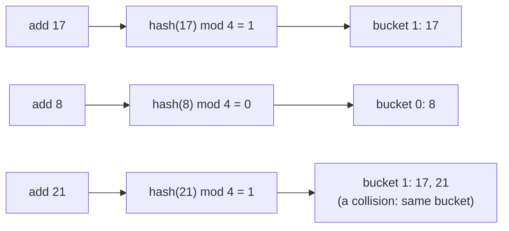

# HashSet Fundamentals

> A set of **unique items** with **`O(1)`** `add`, `contains` and `remove` on average. It answers one question fast: "have I seen this before?"

#### 1. What Is It?

A **`HashSet`** stores items with **no duplicates** and **no guaranteed order**. It uses a **hash function** to turn each item into a bucket number, so it can find an item without scanning.

| Operation | Meaning | Average cost |
|---|---|---|
| `add(x)` | insert `x` (does nothing if already there) | `O(1)` |
| `contains(x)` | is `x` in the set? | `O(1)` |
| `remove(x)` | delete `x` | `O(1)` |
| `size` | number of items | `O(1)` |

**Signals:** "duplicate", "unique", "distinct", "seen before", "visited", "common elements", "in both", "complement", "membership".

#### 2. How It Works

*The hash function sends each value to a bucket. `contains` looks only in that bucket.*



- Two different items may land in the same bucket (a **collision**). The bucket then holds a short list (or tree). Lookups stay fast as long as buckets stay short.
- When the set gets too full, it **resizes** and re-hashes everything (a rare, `O(n)` step that is `O(1)` on average, "amortised").
- An item needs a correct **`equals` and `hashCode`**. Equal items must have the same hash code. (`Int`, `String`, `Pair` and data classes already do.)

**HashSet vs the alternatives**

| | `List` | Sorted array | **HashSet** |
|---|---|---|---|
| `contains` | `O(n)` | `O(log n)` | **`O(1)`** |
| `add` | `O(1)` (allows duplicates) | `O(n)` | `O(1)` |
| Keeps order | insertion | sorted | **none** |
| Duplicates | allowed | allowed | **not allowed** |

**The three Kotlin sets**

| Type | Order | Cost | Use |
|---|---|---|---|
| `HashSet` | none | `O(1)` | default |
| `LinkedHashSet` | insertion order | `O(1)` | unique **and** keep the order |
| `TreeSet` | sorted | `O(log n)` | need the next larger / smaller (`floor`, `ceiling`) |

#### 3. Brute Force vs Optimized

| Question | Brute force | HashSet |
|---|---|---|
| Does the array have a duplicate? | compare every pair: `O(n²)` | one pass: `O(n)` |
| Is `x` in this collection (many times)? | scan a list: `O(n)` each | `O(1)` each |
| Distinct values | sort, then compare neighbours: `O(n log n)` | `O(n)` |

```kotlin
// Brute force: every pair
fun hasDuplicateBrute(nums: IntArray): Boolean {
    for (i in nums.indices) for (j in i + 1 until nums.size) if (nums[i] == nums[j]) return true
    return false
}
```

#### 4. Kotlin Code

```kotlin
fun demo() {
    val set = HashSet<Int>()               // also: mutableSetOf<Int>() (a LinkedHashSet), hashSetOf(1, 2, 3)
    println(set.add(5))                    // true   (new)
    println(set.add(5))                    // false  (already there)
    set.add(7)
    println(set.contains(7))               // true
    println(7 in set)                      // true   (operator form)
    println(set.remove(5))                 // true
    println(set.size)                      // 1
}

// Contains Duplicate (LeetCode 217)
fun containsDuplicate(nums: IntArray): Boolean {
    val seen = HashSet<Int>()
    for (x in nums) {
        if (!seen.add(x)) return true       // add returns false if x was already there
    }
    return false
}
```

Checks: `containsDuplicate(intArrayOf(1, 2, 3, 1))` → `true`. `containsDuplicate(intArrayOf(1, 2, 3, 4))` → `false`. `containsDuplicate(intArrayOf())` → `false`. `hasDuplicateBrute(intArrayOf(1, 2, 3, 1))` → `true`. In `demo()`, the prints are `true, false, true, true, true, 1`.

`add` returning a Boolean is the tidiest way to do "check, then insert" in one call.

#### 5. Complexity

| | Time | Space |
|---|---|---|
| `add`, `contains`, `remove` | `O(1)` average, `O(n)` worst (all items collide) | |
| Build a set of `n` items | `O(n)` | `O(n)` |
| Iterate | `O(n + buckets)` | |

#### 6. Common Mistakes

1. **Assuming order.** A `HashSet` does not keep insertion or sorted order. Use `LinkedHashSet` or `TreeSet`.
2. **Using a `List` for `contains`** inside a loop (`O(n²)`).
3. **Putting arrays in a set.** `IntArray` compares by identity, so `setOf(intArrayOf(1))` will not find another `intArrayOf(1)`. Use `List<Int>` or a string key (note 11).
4. **Changing an object after adding it** when `equals`/`hashCode` depend on its fields.
5. **Forgetting that `Set` has no index.** You cannot ask for the 3rd element.
6. **Modifying the set while iterating it** (`ConcurrentModificationException`).

#### 7. Say This in the Interview

1. "I need to know if I've seen a value before. A `HashSet` gives `O(1)` average membership, so one pass is `O(n)` instead of the `O(n²)` pair check."
2. "The cost is `O(n)` extra space. If space mattered I'd sort instead: `O(n log n)` time, `O(1)` extra space."
3. "`add` returns false for a duplicate, so I can detect and insert in one step."

#### 8. Quick Check

1. What does `set.add(x)` return if `x` is already in the set?
2. When would you choose a `TreeSet` over a `HashSet`?
3. Is the iteration order of a `HashSet` guaranteed?

<details>
<summary>Answers</summary>

1. `false`.
2. When you need sorted order or the closest value (`floor`, `ceiling`, `first`, `last`), at `O(log n)` per operation.
3. No.

</details>

#### 9. Related LeetCode Questions

| # | Question | Idea |
|---|---|---|
| 217 | [Contains Duplicate](https://leetcode.com/problems/contains-duplicate/) (Easy) | `add` returns false |
| 349 | [Intersection of Two Arrays](https://leetcode.com/problems/intersection-of-two-arrays/) (Easy) | two sets |
| 771 | [Jewels and Stones](https://leetcode.com/problems/jewels-and-stones/) (Easy) | fast membership |
| 202 | [Happy Number](https://leetcode.com/problems/happy-number/) (Easy) | seen set for a cycle |
| 128 | [Longest Consecutive Sequence](https://leetcode.com/problems/longest-consecutive-sequence/) (Medium) | set + sequence starts |
| 36 | [Valid Sudoku](https://leetcode.com/problems/valid-sudoku/) (Medium) | sets per row, column, box |
