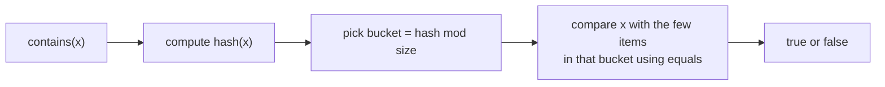

# HashSet Operations & Complexity

> `add`, `contains` and `remove` are `O(1)` on average. Know **why**, and know the three Kotlin set types and what each costs.

#### 1. What Is It?

The core operations and their costs:

| Operation | Kotlin | Average | Worst |
|---|---|---|---|
| Add | `set.add(x)` (returns `Boolean`) | `O(1)` | `O(n)` |
| Contains | `x in set`, `set.contains(x)` | `O(1)` | `O(n)` |
| Remove | `set.remove(x)` (returns `Boolean`) | `O(1)` | `O(n)` |
| Size / empty | `set.size`, `set.isEmpty()` | `O(1)` | `O(1)` |
| Iterate | `for (x in set)` | `O(n)` | `O(n)` |
| Clear | `set.clear()` | `O(n)` | `O(n)` |

#### 2. How It Works

**Why `O(1)` on average?** `hashCode()` gives a number. The set takes `hash mod (number of buckets)` to choose one bucket and checks only the few items in it.



**Why `O(n)` in the worst case?** If every item lands in the same bucket (a bad hash function, or an attack), the bucket is a long list. Java 8+ turns long buckets into balanced trees (`O(log n)`), so this is rare in practice. Interviewers accept "`O(1)` average".

**Load factor and resize.** The default load factor is `0.75`. When `size > 0.75 × buckets`, the set doubles its buckets and re-hashes all items: `O(n)`. This happens rarely, so `add` is **amortised** `O(1)`. If you know the size, you can create the set with a capacity (`HashSet<Int>(n * 2)`) to avoid resizes.

**Three set types in Kotlin/Java**

| | `HashSet` | `LinkedHashSet` (`mutableSetOf()` / `linkedSetOf()`) | `TreeSet` |
|---|---|---|---|
| Order | none | insertion order | sorted |
| `add` / `contains` / `remove` | `O(1)` | `O(1)` | `O(log n)` |
| Extra methods | | | `first()`, `last()`, `floor`, `ceiling`, `higher`, `lower`, `headSet`, `tailSet` |
| Memory | lowest | a bit more (links) | a bit more (tree) |
| Null allowed | one null | one null | no (with natural ordering) |

`mutableSetOf()` and `setOf()` create a `LinkedHashSet`, so they keep insertion order.

**Remove while iterating.** Use `removeAll { cond }` or an iterator's `remove()`. Calling `set.remove(x)` inside a `for` loop over the same set throws `ConcurrentModificationException`.

#### 3. Brute Force vs Optimized

| Task | Slow | Fast |
|---|---|---|
| Membership many times | `list.contains(x)`: `O(n)` | `set.contains(x)`: `O(1)` |
| Keep unique + sorted | sort + dedupe: `O(n log n)` once | `TreeSet`: `O(log n)` per insert |
| Keep unique + order | `list.contains` before adding: `O(n²)` | `LinkedHashSet`: `O(n)` |

```kotlin
// Slow: unique values in order with a list, O(n^2)
fun uniqueSlow(nums: IntArray): List<Int> {
    val out = mutableListOf<Int>()
    for (x in nums) if (x !in out) out.add(x)        // 'in' on a list scans it
    return out
}
```

#### 4. Kotlin Code

```kotlin
import java.util.TreeSet

// Unique values, keeping the first-seen order: LinkedHashSet
fun uniqueInOrder(nums: IntArray): List<Int> = LinkedHashSet(nums.toList()).toList()

// Unique values, sorted: TreeSet
fun uniqueSorted(nums: IntArray): List<Int> = TreeSet(nums.toList()).toList()

// Nearest value (needs a TreeSet): the largest value <= x and the smallest value >= x
fun nearest(values: IntArray, x: Int): Pair<Int?, Int?> {
    val set = TreeSet<Int>()
    for (v in values) set.add(v)
    return set.floor(x) to set.ceiling(x)
}

// Safe removal while looping
fun removeEvens(set: MutableSet<Int>) {
    set.removeAll { it % 2 == 0 }                       // not: for (x in set) set.remove(x)
}
```

Checks: `uniqueInOrder(intArrayOf(3, 1, 3, 2, 1))` → `[3, 1, 2]`. `uniqueSorted(intArrayOf(3, 1, 3, 2, 1))` → `[1, 2, 3]`. `uniqueSlow(intArrayOf(3, 1, 3, 2, 1))` → `[3, 1, 2]`. `nearest(intArrayOf(10, 20, 30), 25)` → `(20, 30)`. `nearest(intArrayOf(10, 20, 30), 5)` → `(null, 10)`. `nearest(intArrayOf(10, 20, 30), 20)` → `(20, 20)`. With `val s = mutableSetOf(1, 2, 3, 4)`: `removeEvens(s)` leaves `[1, 3]`. `HashSet<Int>().add(1)` → `true`, then `add(1)` → `false`.

#### 5. Complexity

| | `HashSet` | `TreeSet` |
|---|---|---|
| `add` / `contains` / `remove` | `O(1)` avg | `O(log n)` |
| Min / max | `O(n)` | `O(log n)` |
| Sorted iteration | needs a sort `O(n log n)` | `O(n)` |
| Space | `O(n)` | `O(n)` |

#### 6. Common Mistakes

1. **Saying `HashSet` operations are always `O(1)`.** Say "average `O(1)`, worst `O(n)`".
2. **Expecting sorted output** from a `HashSet`.
3. **`set.remove(x)` inside a `for` over the same set.**
4. **Using a `HashSet` when you need `floor` or `ceiling`** (that needs a `TreeSet`).
5. **Using `mutableSetOf()` and assuming hash speed with no order** (it is a `LinkedHashSet`, still `O(1)`, just ordered).
6. **A bad `hashCode`** (constant) for custom classes, making every operation `O(n)`.

#### 7. Say This in the Interview

1. "`add`, `contains` and `remove` are `O(1)` on average: the hash picks a bucket, and the bucket has only a few items. In the worst case, with many collisions, it is `O(n)`."
2. "If I need sorted order or the nearest value I'd use a `TreeSet`, which is `O(log n)` per operation."
3. "`LinkedHashSet` keeps insertion order at the same `O(1)` cost."

#### 8. Quick Check

1. What is the amortised cost of `add`, and why?
2. Which Kotlin function creates a set that keeps insertion order?
3. How do you remove all even numbers from a set safely?

<details>
<summary>Answers</summary>

1. `O(1)`. Rare `O(n)` resizes are spread over many cheap adds.
2. `mutableSetOf()` / `setOf()` / `linkedSetOf()` (a `LinkedHashSet`).
3. `set.removeAll { it % 2 == 0 }`.

</details>

#### 9. Related LeetCode Questions

| # | Question | Idea |
|---|---|---|
| 217 | [Contains Duplicate](https://leetcode.com/problems/contains-duplicate/) (Easy) | `add` returns `Boolean` |
| 349 | [Intersection of Two Arrays](https://leetcode.com/problems/intersection-of-two-arrays/) (Easy) | set operations |
| 705 | [Design HashSet](https://leetcode.com/problems/design-hashset/) (Easy) | buckets and collisions |
| 220 | [Contains Duplicate III](https://leetcode.com/problems/contains-duplicate-iii/) (Hard) | `TreeSet` `ceiling` |
| 703 | [Kth Largest Element in a Stream](https://leetcode.com/problems/kth-largest-element-in-a-stream/) (Easy) | a sorted structure |
