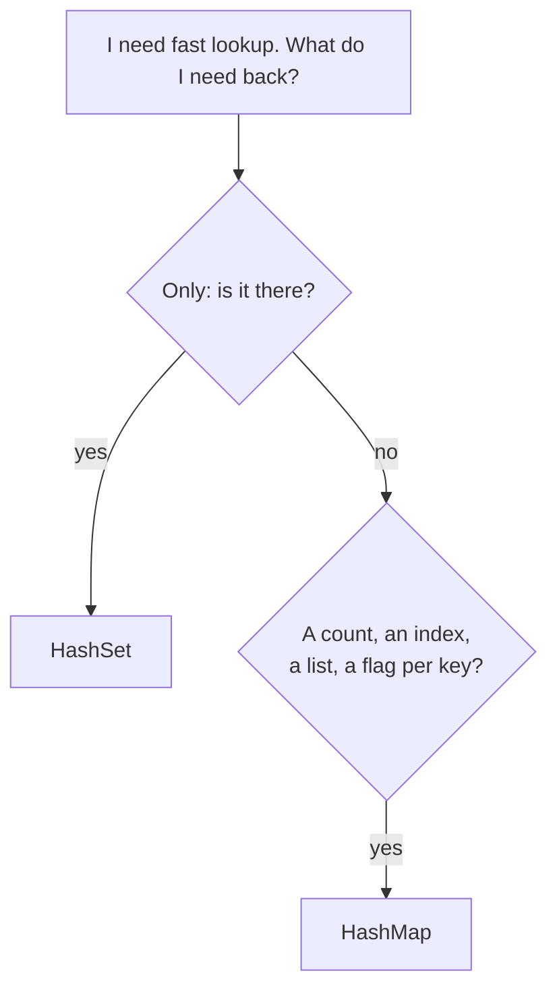

# HashSet vs HashMap

> A set stores **keys only**. A map stores **keys with values**. Pick the set when you only need "is it there?", and the map when you need to attach information.

#### 1. What Is It?

| | `HashSet<T>` | `HashMap<K, V>` |
|---|---|---|
| Stores | items | key → value pairs |
| Question answered | "is `x` present?" | "what is the value for `k`?" |
| Duplicates | none | none for keys (values may repeat) |
| Main operations | `add`, `contains`, `remove` | `put`, `get`, `containsKey`, `remove` |
| Cost | `O(1)` average | `O(1)` average |
| Memory | one entry per item | one entry per key, plus the value |

Under the hood, Java's `HashSet` **is a `HashMap`** where every key maps to the same dummy value.

#### 2. How It Works

**The decision**



| Task | Use | Why |
|---|---|---|
| Has this value appeared? | `HashSet` | only presence matters |
| How many times did it appear? | `HashMap<K, Int>` | needs a count |
| At which index? | `HashMap<K, Int>` | needs an index |
| Group items by a key | `HashMap<K, MutableList<V>>` | needs a list per key |
| Visited nodes in a graph | `HashSet` | only presence |
| Distance to each node | `HashMap` (or array) | needs a value |

**Example: Two Sum.**

- *Does a pair exist?* → `HashSet` of values seen (note 7).
- *Return the indices.* → `HashMap<value, index>`.

```text
nums = [2, 7, 11, 15], target 9
set:  after 2 → {2};  at 7, complement 2 is in the set → "yes, a pair exists"   (but which indices? the set doesn't know)
map:  after 2 → {2: 0}; at 7, complement 2 → index 0 → answer [0, 1]
```

**Converting between them**

| Need | Code |
|---|---|
| Set of a map's keys | `map.keys` (a `Set`) |
| Map from a set (flag per item) | `set.associateWith { true }` |
| Count distinct from counts | `map.size` |

A `HashMap<K, Boolean>` used only as a set is a code smell: use a `HashSet<K>`.

#### 3. Brute Force vs Optimized

| Task | Brute force | Hash |
|---|---|---|
| Does a pair sum to `target`? | all pairs `O(n²)` | set, `O(n)` |
| Indices of the pair | all pairs `O(n²)` | map, `O(n)` |
| Count of each value | nested loops `O(n²)` | map, `O(n)` |

```kotlin
// Brute force: count occurrences with nested loops
fun countBrute(nums: IntArray): Map<Int, Int> {
    val result = HashMap<Int, Int>()
    for (x in nums) {
        var c = 0
        for (y in nums) if (x == y) c++
        result[x] = c
    }
    return result
}
```

#### 4. Kotlin Code

```kotlin
// Set: does a pair exist?
fun hasPair(nums: IntArray, target: Int): Boolean {
    val seen = HashSet<Int>()
    for (x in nums) {
        if (target - x in seen) return true       // check first
        seen.add(x)                                // then add
    }
    return false
}

// Map: return the indices (Two Sum, LeetCode 1)
fun twoSum(nums: IntArray, target: Int): IntArray {
    val indexOf = HashMap<Int, Int>()              // value -> index
    for ((i, x) in nums.withIndex()) {
        val j = indexOf[target - x]
        if (j != null) return intArrayOf(j, i)
        indexOf[x] = i
    }
    return intArrayOf()
}

// Map: count occurrences
fun countValues(nums: IntArray): Map<Int, Int> {
    val count = HashMap<Int, Int>()
    for (x in nums) count[x] = (count[x] ?: 0) + 1
    return count
}

// Set: the distinct count is the size
fun distinctCount(nums: IntArray): Int = nums.toHashSet().size
```

Checks: `hasPair(intArrayOf(2, 7, 11, 15), 9)` → `true`. `hasPair(intArrayOf(3), 6)` → `false`. `hasPair(intArrayOf(3, 3), 6)` → `true`. `twoSum(intArrayOf(2, 7, 11, 15), 9)` → `[0, 1]`. `countValues(intArrayOf(1, 2, 1, 3, 1))` → `{1=3, 2=1, 3=1}`. `distinctCount(intArrayOf(1, 2, 1, 3, 1))` → `3`. `countBrute(...)` gives the same map.

#### 5. Complexity

| | Time | Space |
|---|---|---|
| Set / map build | `O(n)` | `O(n)` |
| `contains` / `get` | `O(1)` average | |
| Map uses about | | 1.5 to 2 times the set's memory for the same keys |

#### 6. Common Mistakes

1. **Using a map when a set is enough** (extra memory, extra code).
2. **Using a set when you need the index or a count** and then scanning the array again.
3. **A `HashMap<K, Boolean>` as a set.**
4. **Forgetting `?: 0`** when counting with `map[k]`.
5. **Adding before checking** in Two Sum (an element pairs with itself).
6. **Using `map[k]!!`** without checking the key exists.

#### 7. Say This in the Interview

1. "I only need to know if a value was seen, so a `HashSet` is enough. If I needed the index or the count, I'd use a `HashMap`."
2. "Both give `O(1)` average lookups and `O(n)` space. The set is a bit lighter."
3. "In Two Sum, the set tells me a pair exists, and the map gives me the indices."

#### 8. Quick Check

1. Which one for "count how many times each word appears"?
2. Which one for "has this node been visited?"
3. Which one for "return the indices of the two numbers"?

<details>
<summary>Answers</summary>

1. `HashMap<String, Int>`.
2. `HashSet`.
3. `HashMap<Int, Int>` (value to index).

</details>

#### 9. Related LeetCode Questions

| # | Question | Idea |
|---|---|---|
| 1 | [Two Sum](https://leetcode.com/problems/two-sum/) (Easy) | map: value to index |
| 217 | [Contains Duplicate](https://leetcode.com/problems/contains-duplicate/) (Easy) | set |
| 242 | [Valid Anagram](https://leetcode.com/problems/valid-anagram/) (Easy) | counts (map or array) |
| 49 | [Group Anagrams](https://leetcode.com/problems/group-anagrams/) (Medium) | map of lists |
| 387 | [First Unique Character in a String](https://leetcode.com/problems/first-unique-character-in-a-string/) (Easy) | counts |
| 202 | [Happy Number](https://leetcode.com/problems/happy-number/) (Easy) | set |
