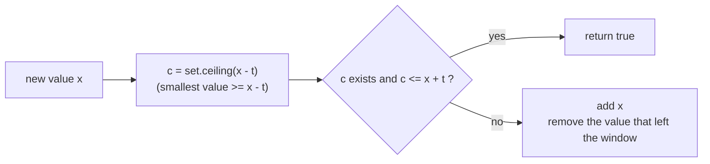

# Duplicate Detection

> The most common HashSet pattern. Walk once, and the first time `add` returns `false`, you found a duplicate.

#### 1. What Is It?

**Duplicate detection** asks if any value appears more than once. Three common variants:

| Variant | Question | Tool |
|---|---|---|
| **Contains Duplicate** (217) | is there any duplicate? | `HashSet` |
| **Contains Duplicate II** (219) | duplicate within distance `k` (`|i − j| ≤ k`)? | `HashSet` of the last `k` values (a window) |
| **Contains Duplicate III** (220) | two values within `valueDiff` and indexes within `k`? | `TreeSet` of the window |

**Signals:** "duplicate", "appears twice", "repeated", "within k positions", "almost equal".

#### 2. How It Works

**Variant 1.** Walk the array. `if (!seen.add(x)) return true`.

```text
[1, 2, 3, 1]
add 1 → ok   add 2 → ok   add 3 → ok   add 1 → already there → DUPLICATE
```

**Variant 2 (within `k`).** Keep a set of only the **last `k` values**. When the window grows past `k`, remove the value that left.

```text
nums = [1, 0, 1, 1], k = 1
i=0: add 1.               window {1}
i=1: add 0.               window {1, 0} → size 2 > k → remove nums[0] = 1 → {0}
i=2: add 1 → ok.          window {0, 1} → remove nums[1] → {1}
i=3: add 1 → already there → DUPLICATE within distance 1
```

**Variant 3 (values close, indexes close).** For `x`, you need any value in the window within `[x − t, x + t]`. A `TreeSet` finds the **smallest value `≥ x − t`** with `ceiling(x − t)`. If it is `≤ x + t`, you have a pair. Use `Long` to avoid overflow.



#### 3. Brute Force vs Optimized

| Variant | Brute force | Optimized |
|---|---|---|
| I | all pairs `O(n²)`, or sort `O(n log n)` | set `O(n)` |
| II | check the next `k` items for each: `O(n · k)` | window set `O(n)` |
| III | check the next `k` items: `O(n · k)` | `TreeSet` `O(n log k)` |

```kotlin
// Brute force, variant II
fun containsNearbyDuplicateBrute(nums: IntArray, k: Int): Boolean {
    for (i in nums.indices) {
        for (j in i + 1..minOf(i + k, nums.size - 1)) if (nums[i] == nums[j]) return true
    }
    return false
}
```

#### 4. Kotlin Code

```kotlin
import java.util.TreeSet

// I. Contains Duplicate (LeetCode 217)
fun containsDuplicate(nums: IntArray): Boolean {
    val seen = HashSet<Int>()
    for (x in nums) if (!seen.add(x)) return true
    return false
}

// II. Contains Duplicate II (LeetCode 219)
fun containsNearbyDuplicate(nums: IntArray, k: Int): Boolean {
    val window = HashSet<Int>()
    for (i in nums.indices) {
        if (!window.add(nums[i])) return true
        if (window.size > k) window.remove(nums[i - k])         // the value that left the window
    }
    return false
}

// III. Contains Duplicate III (LeetCode 220)
fun containsNearbyAlmostDuplicate(nums: IntArray, indexDiff: Int, valueDiff: Int): Boolean {
    val window = TreeSet<Long>()
    for (i in nums.indices) {
        val x = nums[i].toLong()
        val c = window.ceiling(x - valueDiff)                    // smallest value >= x - valueDiff
        if (c != null && c <= x + valueDiff) return true
        window.add(x)
        if (i >= indexDiff) window.remove(nums[i - indexDiff].toLong())
    }
    return false
}
```

Checks: `containsDuplicate(intArrayOf(1, 2, 3, 1))` → `true`; `(intArrayOf(1, 2, 3, 4))` → `false`. `containsNearbyDuplicate(intArrayOf(1, 2, 3, 1), 3)` → `true`. `containsNearbyDuplicate(intArrayOf(1, 0, 1, 1), 1)` → `true`. `containsNearbyDuplicate(intArrayOf(1, 2, 3, 1, 2, 3), 2)` → `false`. `containsNearbyDuplicateBrute(intArrayOf(1, 2, 3, 1, 2, 3), 2)` → `false`. `containsNearbyAlmostDuplicate(intArrayOf(1, 2, 3, 1), 3, 0)` → `true`. `containsNearbyAlmostDuplicate(intArrayOf(1, 5, 9, 1, 5, 9), 2, 3)` → `false`. `containsNearbyAlmostDuplicate(intArrayOf(Int.MAX_VALUE, Int.MIN_VALUE), 1, 1)` → `false` (using `Long` avoids overflow).

Trace of `containsNearbyDuplicate(intArrayOf(1, 2, 3, 1, 2, 3), 2)`: windows (size at most 2): `{1}`, `{1, 2}`, then add `3` → size 3 > 2 → remove `nums[0] = 1` → `{2, 3}`; add `1` → ok → remove `nums[1] = 2` → `{3, 1}`; add `2` → ok → remove `nums[2] = 3` → `{1, 2}`; add `3` → ok. No duplicate within distance 2 → `false`.

#### 5. Complexity

| | Time | Space |
|---|---|---|
| I | `O(n)` | `O(n)` |
| II | `O(n)` | `O(k)` |
| III | `O(n log k)` | `O(k)` |
| Sort alternative for I | `O(n log n)` | `O(1)` extra |

#### 6. Common Mistakes

1. **Adding first, checking later** with `contains` + `add` (two lookups) instead of `add`'s return value. Not wrong, only wasteful.
2. **Variant II: not removing** the element that left the window, or removing too early (`k` vs `k + 1`).
3. **Variant III:** `Int` overflow in `x − valueDiff`. Use `Long`.
4. **Variant III:** using a `HashSet` (no `ceiling`).
5. **Treating "within k" as "at most k elements apart" off by one.** Window size is `k` (indexes `i − k` to `i − 1` plus the new one).
6. **Sorting** and losing the index information needed for variants II and III.

#### 7. Say This in the Interview

1. "I walk the array once with a `HashSet`. When `add` returns false I've found a duplicate. `O(n)` time and `O(n)` space. If space is tight, sorting gives `O(n log n)` with `O(1)` extra."
2. "For 'within `k`', I only keep the last `k` values in the set, so the space is `O(k)`."
3. "For 'values within `t`', I need the closest value in the window, so I use a `TreeSet` and check `ceiling(x − t)`. That's `O(n log k)`."

#### 8. Quick Check

1. `[1, 2, 3, 1]`, `k = 2`. Is there a duplicate within distance 2?
2. Why `Long` in variant III?
3. Space for variant II?

<details>
<summary>Answers</summary>

1. No. The two `1`s are 3 apart.
2. `x − valueDiff` or `x + valueDiff` can overflow `Int`.
3. `O(k)`.

</details>

#### 9. Related LeetCode Questions

| # | Question | Idea |
|---|---|---|
| 217 | [Contains Duplicate](https://leetcode.com/problems/contains-duplicate/) (Easy) | `add` returns false |
| 219 | [Contains Duplicate II](https://leetcode.com/problems/contains-duplicate-ii/) (Easy) | window set |
| 220 | [Contains Duplicate III](https://leetcode.com/problems/contains-duplicate-iii/) (Hard) | `TreeSet` + `ceiling` |
| 287 | [Find the Duplicate Number](https://leetcode.com/problems/find-the-duplicate-number/) (Medium) | set, or Floyd for `O(1)` space |
| 442 | [Find All Duplicates in an Array](https://leetcode.com/problems/find-all-duplicates-in-an-array/) (Medium) | set, or sign marking |
| 36 | [Valid Sudoku](https://leetcode.com/problems/valid-sudoku/) (Medium) | duplicates per row, column, box |
