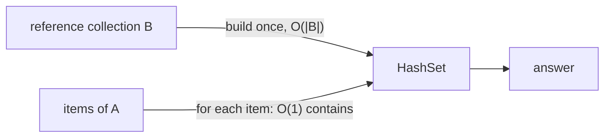

# Fast Membership / Lookup Pattern

> If you keep asking "is `x` in this collection?", put the collection in a set **once**. Each question then costs `O(1)` instead of `O(n)`.

#### 1. What Is It?

The **fast membership pattern**: you have a collection (the **reference**) and many things to check against it.

```text
for each item in A:
    if item is in B → do something
```

If `B` is a **list**, `item in B` scans it: `O(|B|)`. If `B` is a **set**, it is `O(1)`. So the loop goes from `O(|A| · |B|)` to `O(|A| + |B|)`.

**Signals:** "for each X, check if it is in Y", "stones that are jewels", "banned words", "allowed characters", "valid values", "words in a dictionary".

#### 2. How It Works

1. **Build the set once** from the reference collection: `O(|B|)`.
2. **Loop** over the other collection and ask `contains`: `O(|A|)`.



**Jewels and Stones.** `jewels = "aA"`, `stones = "aAAbbbb"`. Count stones that are jewels.

```text
jewelSet = {a, A}
a → yes (1)   A → yes (2)   A → yes (3)   b → no   b → no   b → no   b → no
answer 3
```

**Unique Email Addresses (LeetCode 929).** Normalise each address (remove everything after `+` in the local part, remove dots in the local part), add to a set, return the set size.

```text
test.email+alex@leetcode.com           → testemail@leetcode.com
test.e.mail+bob.cathy@leetcode.com     → testemail@leetcode.com     (same)
testemail+david@lee.tcode.com          → testemail@lee.tcode.com    (different domain)
set size = 2
```

**Missing Number (LeetCode 268).** Put all numbers in a set. Check each `i` from `0` to `n` for the one that is missing.

**Other uses:** a set of **banned words**, a set of **stop words**, a set of **vowels** (`"aeiou"`), a set of **forbidden cells** in a grid, a set of **dead ends** in a lock puzzle.

#### 3. Brute Force vs Optimized

| Approach | Time | Space |
|---|---|---|
| Nested loops / `list.contains` | `O(|A| · |B|)` | `O(1)` |
| Build a set of `B`, loop over `A` | `O(|A| + |B|)` | `O(|B|)` |
| (sorted `B`) binary search | `O(|A| log |B|)` | `O(1)` |

```kotlin
// Brute force: a scan for every stone
fun numJewelsBrute(jewels: String, stones: String): Int {
    var count = 0
    for (s in stones) {
        for (j in jewels) if (s == j) { count++; break }
    }
    return count
}
```

#### 4. Kotlin Code

```kotlin
// Jewels and Stones (LeetCode 771)
fun numJewelsInStones(jewels: String, stones: String): Int {
    val jewelSet = jewels.toHashSet()                      // a Set<Char>
    var count = 0
    for (s in stones) if (s in jewelSet) count++
    return count
}

// Unique Email Addresses (LeetCode 929)
fun numUniqueEmails(emails: Array<String>): Int {
    val unique = HashSet<String>()
    for (email in emails) {
        val local = email.substringBefore('@')
        val domain = email.substringAfter('@')
        val clean = local.substringBefore('+').replace(".", "")
        unique.add("$clean@$domain")
    }
    return unique.size
}

// Missing Number (LeetCode 268) with a set
fun missingNumber(nums: IntArray): Int {
    val present = nums.toHashSet()
    for (i in 0..nums.size) if (i !in present) return i
    return -1
}

// Words that are in the dictionary
fun filterKnown(words: List<String>, dictionary: List<String>): List<String> {
    val dict = dictionary.toHashSet()
    return words.filter { it in dict }
}
```

Checks: `numJewelsInStones("aA", "aAAbbbb")` → `3`. `numJewelsInStones("z", "ZZ")` → `0` (case matters). `numJewelsBrute("aA", "aAAbbbb")` → `3`. `numUniqueEmails(arrayOf("test.email+alex@leetcode.com", "test.e.mail+bob.cathy@leetcode.com", "testemail+david@lee.tcode.com"))` → `2`. `numUniqueEmails(arrayOf("a@leetcode.com", "b@leetcode.com", "c@leetcode.com"))` → `3`. `missingNumber(intArrayOf(3, 0, 1))` → `2`. `missingNumber(intArrayOf(0, 1))` → `2`. `filterKnown(listOf("cat", "dog", "bird"), listOf("cat", "bird"))` → `["cat", "bird"]`.

#### 5. Complexity

| | Time | Space |
|---|---|---|
| Build the set | `O(|B|)` | `O(|B|)` |
| Each lookup | `O(1)` average | |
| Whole pattern | `O(|A| + |B|)` | `O(|B|)` |

#### 6. Common Mistakes

1. **Using `list.contains` inside a loop.**
2. **Building the set inside the loop** (rebuilt every time, `O(|A| · |B|)` again).
3. **Using the larger collection** as the set when the smaller one would save memory.
4. **Forgetting normalisation** (case, dots, whitespace) before adding to the set.
5. **Using `String.contains` / `indexOf`** when you need set membership of whole items.
6. **Mutating the reference collection** after building the set (they go out of sync).

#### 7. Say This in the Interview

1. "I'm checking membership many times, so I'll put the reference list into a `HashSet` once. Each check is `O(1)`, so the total is `O(A + B)` instead of `O(A × B)`."
2. "The price is `O(B)` extra space. If `B` is sorted and memory is tight, binary search is `O(A log B)` with no extra space."
3. "I normalise values first (for example lowercase) so equal things hash the same."

#### 8. Quick Check

1. Time of the jewels problem with a set, for `J` jewels and `S` stones?
2. Why build the set before the loop?
3. What does the set store in Unique Emails?

<details>
<summary>Answers</summary>

1. `O(J + S)`.
2. Building it inside the loop would repeat `O(|B|)` work for every item.
3. The cleaned (normalised) addresses.

</details>

#### 9. Related LeetCode Questions

| # | Question | Idea |
|---|---|---|
| 771 | [Jewels and Stones](https://leetcode.com/problems/jewels-and-stones/) (Easy) | set of jewels |
| 929 | [Unique Email Addresses](https://leetcode.com/problems/unique-email-addresses/) (Easy) | normalise, then a set |
| 268 | [Missing Number](https://leetcode.com/problems/missing-number/) (Easy) | check `0..n` against a set |
| 1832 | [Check if the Sentence Is Pangram](https://leetcode.com/problems/check-if-the-sentence-is-pangram/) (Easy) | set of letters |
| 2215 | [Find the Difference of Two Arrays](https://leetcode.com/problems/find-the-difference-of-two-arrays/) (Easy) | two sets |
| 1805 | [Number of Different Integers in a String](https://leetcode.com/problems/number-of-different-integers-in-a-string/) (Easy) | set of cleaned numbers |
