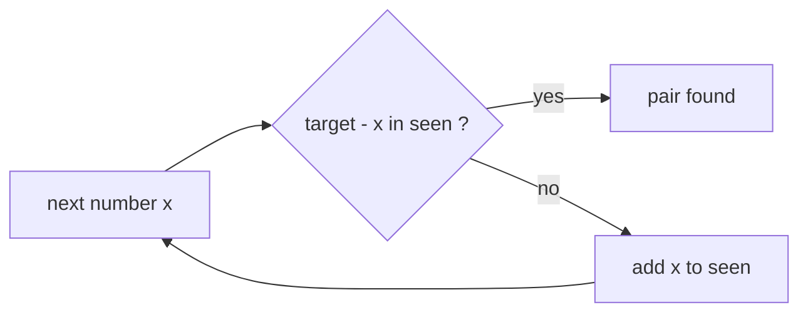

# Two Sum / Complement Lookup with HashSet

> For each number `x`, ask: "have I already seen `target − x`?" One pass, `O(n)`. Check **first**, then add.

#### 1. What Is It?

**Complement lookup:** for each `x`, the partner that completes the goal is the **complement** (`target − x` for a sum, `x + d` or `x − d` for a difference). A `HashSet` of values seen so far answers "is the complement there?" in `O(1)`.

| Question | Complement of `x` | Tool |
|---|---|---|
| Is there a pair with sum `target`? | `target − x` | `HashSet` |
| Return the **indices** of that pair | `target − x` | `HashMap<value, index>` (note 3) |
| Is there a pair with difference `d`? | `x + d` and `x − d` | `HashSet` |
| Pair with sum `target` in a **BST** (Two Sum IV) | `target − x` | `HashSet` + any traversal |

**Signals:** "two numbers that add up to", "pair with sum", "difference of", "complement", "exists a pair".

#### 2. How It Works

`nums = [2, 7, 11, 15]`, `target = 9`

```text
seen = {}
x = 2   complement 7   in seen? no   → add 2    seen = {2}
x = 7   complement 2   in seen? YES  → pair (2, 7)
```

**Order matters: check, then add.**

```text
target = 6, nums = [3]
add first:  seen = {3}, then complement of 3 is 3 → found!   WRONG (one 3 pairing with itself)
check first: seen = {}, complement 3 not found → add 3 → no pair   RIGHT
nums = [3, 3]: second 3 finds the first 3 → pair   RIGHT
```



**Difference version.** A pair with `|a − b| = d`: for `x`, check both `x + d` and `x − d`. (For `d = 0` it is a duplicate check.)

```text
[5, 20, 3, 2, 50, 80], d = 78
x = 5: need 83 or -73  no    x = 20: no   x = 3: no   x = 2: no   x = 50: no
x = 80: need 158 or 2 → 2 is in seen → pair (2, 80)
```

**Two Sum IV (BST).** Traverse the tree (any order). For each node value `v`, check `k − v` in the set, then add `v`.

**When the array is sorted,** two pointers do the same in `O(1)` space (see the Two Pointers patterns).

#### 3. Brute Force vs Optimized

| Approach | Time | Space |
|---|---|---|
| Check every pair | `O(n²)` | `O(1)` |
| Sort + two pointers | `O(n log n)` | `O(1)` |
| **HashSet, one pass** | **`O(n)`** | `O(n)` |

```kotlin
// Brute force: all pairs
fun hasPairBrute(nums: IntArray, target: Int): Boolean {
    for (i in nums.indices) for (j in i + 1 until nums.size) if (nums[i] + nums[j] == target) return true
    return false
}
```

#### 4. Kotlin Code

```kotlin
class TreeNode(val value: Int, var left: TreeNode? = null, var right: TreeNode? = null)

// Does a pair with this sum exist?
fun hasPairWithSum(nums: IntArray, target: Int): Boolean {
    val seen = HashSet<Int>()
    for (x in nums) {
        if (target - x in seen) return true      // 1. check the complement
        seen.add(x)                               // 2. then add
    }
    return false
}

// Does a pair with this absolute difference exist?
fun hasPairWithDifference(nums: IntArray, d: Int): Boolean {
    val seen = HashSet<Int>()
    for (x in nums) {
        if (x + d in seen || x - d in seen) return true
        seen.add(x)
    }
    return false
}

// Two Sum IV - Input is a BST (LeetCode 653)
fun findTarget(root: TreeNode?, k: Int): Boolean {
    val seen = HashSet<Int>()
    fun dfs(node: TreeNode?): Boolean {
        if (node == null) return false
        if (k - node.value in seen) return true
        seen.add(node.value)
        return dfs(node.left) || dfs(node.right)
    }
    return dfs(root)
}
```

Checks: `hasPairWithSum(intArrayOf(2, 7, 11, 15), 9)` → `true`. `hasPairWithSum(intArrayOf(3), 6)` → `false`. `hasPairWithSum(intArrayOf(3, 3), 6)` → `true`. `hasPairWithSum(intArrayOf(), 5)` → `false`. `hasPairBrute(intArrayOf(2, 7, 11, 15), 9)` → `true`. `hasPairWithDifference(intArrayOf(5, 20, 3, 2, 50, 80), 78)` → `true`. `hasPairWithDifference(intArrayOf(90, 70, 20, 80, 50), 45)` → `false`. `hasPairWithSum(intArrayOf(Int.MAX_VALUE, 1), Int.MIN_VALUE)` → `true`, which is **wrong**: `Int.MIN_VALUE − 1` overflows to `Int.MAX_VALUE`, so a false pair is found. Use `Long` for the complement when values can be extreme (mistake 5).

BST `TreeNode(5, TreeNode(3, TreeNode(2), TreeNode(4)), TreeNode(6, null, TreeNode(7)))`: `findTarget(root, 9)` → `true` (`2 + 7`). `findTarget(root, 28)` → `false`.

#### 5. Complexity

| | Time | Space |
|---|---|---|
| `hasPairWithSum` | `O(n)` | `O(n)` |
| Sort + two pointers | `O(n log n)` | `O(1)` |
| Two Sum IV | `O(n)` | `O(n)` |

#### 6. Common Mistakes

1. **Adding before checking** (an element pairs with itself).
2. **Using a set when you must return indices** (use a map).
3. **Difference `d = 0`:** a set check of `x + 0` after adding `x` finds itself. Check first, then add (as above).
4. **Duplicates:** `[3, 3]` with target 6 is valid, but `[3]` is not. The check-first order handles both.
5. **Overflow:** `target − x` can overflow `Int`. Use `Long` for extreme values.
6. **Assuming only one pair** exists. If you need all pairs, you need a map of counts.

#### 7. Say This in the Interview

1. "For each number I look for its complement among the numbers I've already seen. A `HashSet` makes that `O(1)`, so the whole thing is `O(n)`."
2. "I check before I add, so a number can't pair with itself."
3. "If I needed the indices I'd use a map from value to index. If the array is sorted I'd use two pointers and save the memory."

#### 8. Quick Check

1. `[1, 5, 3]`, target `6`: found?
2. Why check before adding?
3. When would you pick two pointers over a set?

<details>
<summary>Answers</summary>

1. Yes, `1 + 5`.
2. A single `3` with target `6` would otherwise pair with itself.
3. When the array is already sorted (or sorting is fine) and you want `O(1)` extra space.

</details>

#### 9. Related LeetCode Questions

| # | Question | Idea |
|---|---|---|
| 1 | [Two Sum](https://leetcode.com/problems/two-sum/) (Easy) | map: value to index |
| 653 | [Two Sum IV - Input is a BST](https://leetcode.com/problems/two-sum-iv-input-is-a-bst/) (Easy) | set + traversal |
| 167 | [Two Sum II - Input Array Is Sorted](https://leetcode.com/problems/two-sum-ii-input-array-is-sorted/) (Medium) | two pointers |
| 532 | [K-diff Pairs in an Array](https://leetcode.com/problems/k-diff-pairs-in-an-array/) (Medium) | set of values and a set of pairs |
| 1679 | [Max Number of K-Sum Pairs](https://leetcode.com/problems/max-number-of-k-sum-pairs/) (Medium) | counts of complements |
| 15 | [3Sum](https://leetcode.com/problems/3sum/) (Medium) | sort + two pointers |
