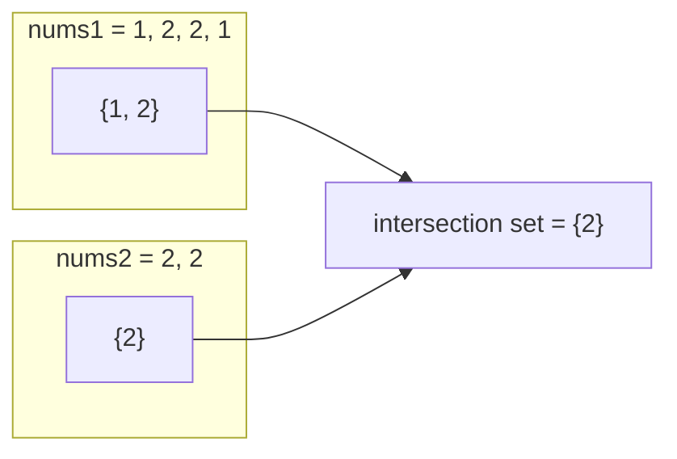

# Intersection / Common Elements

> Elements that are in **both** collections. Put one in a set, check the other. Use a **count map** if duplicates matter.

#### 1. What Is It?

| Question | Result | Tool |
|---|---|---|
| **Intersection of Two Arrays** (349) | each common value **once** | two sets |
| **Intersection of Two Arrays II** (350) | each common value as many times as it appears in **both** | `HashMap` of counts (or sort + two pointers) |
| Common elements of **sorted** arrays | | two pointers, `O(1)` space |
| Common elements of **many** lists | | intersect set by set |

**Signals:** "common", "in both", "intersection", "shared", "appears in all".

#### 2. How It Works



**Version I (unique).** Build a set from `nums1`. Walk `nums2`; if the value is in the set, add it to the result set.

```text
nums1 = [1, 2, 2, 1] → set {1, 2}
nums2 = [2, 2]       → 2 is in the set → result {2}
answer [2]
```

**Version II (with multiplicity).** Count `nums1` in a map. Walk `nums2`; for each value with a count `> 0`, add it to the result and **decrement** the count.

```text
nums1 = [4, 9, 5]  → counts {4:1, 9:1, 5:1}
nums2 = [9, 4, 9, 8, 4]
9 → count 1 → take, now 0     4 → take, now 0     9 → count 0 → skip     8 → absent     4 → count 0 → skip
answer [9, 4]
```

**Sorted arrays (two pointers).** Walk both with pointers `i`, `j`. Equal → add, move both. Otherwise move the smaller one. `O(m + n)` time, `O(1)` extra space.

**Follow-ups interviewers ask**

| Follow-up | Answer |
|---|---|
| Arrays are already sorted | two pointers, no set |
| `nums1` is much smaller than `nums2` | put the **smaller** one in the map |
| `nums2` is on disk, too big for memory | load the smaller array in a map and stream the big one; or sort externally and merge |

#### 3. Brute Force vs Optimized

| Approach | Time | Space |
|---|---|---|
| Nested loops | `O(m · n)` | `O(1)` |
| **Set / map** | `O(m + n)` | `O(min(m, n))` if you load the smaller one |
| Sort + two pointers | `O(m log m + n log n)` | `O(1)` extra |

```kotlin
// Brute force: for each value of nums1, scan nums2
fun intersectionBrute(nums1: IntArray, nums2: IntArray): List<Int> =
    nums1.filter { it in nums2 }.distinct()                    // 'in' on an IntArray scans it
```

#### 4. Kotlin Code

```kotlin
// Intersection of Two Arrays (LeetCode 349)
fun intersection(nums1: IntArray, nums2: IntArray): IntArray {
    val set1 = nums1.toHashSet()
    val result = HashSet<Int>()
    for (x in nums2) if (x in set1) result.add(x)
    return result.toIntArray()
}

// Same idea with the built-in set operation
fun intersectionBuiltIn(nums1: IntArray, nums2: IntArray): IntArray =
    nums1.toSet().intersect(nums2.toSet()).toIntArray()

// Intersection of Two Arrays II (LeetCode 350): with counts
fun intersect(nums1: IntArray, nums2: IntArray): IntArray {
    val count = HashMap<Int, Int>()
    for (x in nums1) count[x] = (count[x] ?: 0) + 1
    val result = ArrayList<Int>()
    for (x in nums2) {
        val c = count[x] ?: 0
        if (c > 0) {
            result.add(x)
            count[x] = c - 1
        }
    }
    return result.toIntArray()
}

// Sorted arrays: two pointers, O(1) extra space
fun intersectSorted(a: IntArray, b: IntArray): IntArray {
    val result = ArrayList<Int>()
    var i = 0
    var j = 0
    while (i < a.size && j < b.size) {
        when {
            a[i] == b[j] -> { result.add(a[i]); i++; j++ }
            a[i] < b[j] -> i++
            else -> j++
        }
    }
    return result.toIntArray()
}
```

Checks: `intersection(intArrayOf(1, 2, 2, 1), intArrayOf(2, 2))` → `[2]`. `intersection(intArrayOf(4, 9, 5), intArrayOf(9, 4, 9, 8, 4))` → `[9, 4]` (any order). `intersectionBuiltIn(...)` agrees. `intersect(intArrayOf(1, 2, 2, 1), intArrayOf(2, 2))` → `[2, 2]`. `intersect(intArrayOf(4, 9, 5), intArrayOf(9, 4, 9, 8, 4))` → `[9, 4]`. `intersectSorted(intArrayOf(1, 2, 2, 3), intArrayOf(2, 2, 4))` → `[2, 2]`. `intersection(intArrayOf(), intArrayOf(1))` → `[]`. `intersectionBrute(intArrayOf(1, 2, 2, 1), intArrayOf(2, 2))` → `[2]`.

#### 5. Complexity

| | Time | Space |
|---|---|---|
| Sets (I) | `O(m + n)` | `O(m)` |
| Count map (II) | `O(m + n)` | `O(m)` |
| Two pointers (sorted) | `O(m + n)` | `O(1)` extra |
| Sort first, then two pointers | `O(m log m + n log n)` | `O(1)` extra |

#### 6. Common Mistakes

1. **Using a list for the result in version I** and getting duplicates. Use a set.
2. **Version II:** not decrementing the count (returns too many).
3. **Version II:** using a set (loses multiplicity).
4. **Two pointers on unsorted arrays.**
5. **Building the set from the bigger array** when the smaller one would use less memory.
6. **Forgetting empty arrays.**

#### 7. Say This in the Interview

1. "I put one array in a set and scan the other. That's `O(m + n)` time. I'd load the smaller array to save memory."
2. "If duplicates must be counted, I use a map of counts and decrement as I match."
3. "If both arrays are sorted, two pointers need no extra memory."

#### 8. Quick Check

1. Version I result for `[1, 1]` and `[1, 1, 1]`?
2. Version II result for the same?
3. When do two pointers beat a set?

<details>
<summary>Answers</summary>

1. `[1]`.
2. `[1, 1]` (the smaller count).
3. When both arrays are sorted, since they use `O(1)` extra space.

</details>

#### 9. Related LeetCode Questions

| # | Question | Idea |
|---|---|---|
| 349 | [Intersection of Two Arrays](https://leetcode.com/problems/intersection-of-two-arrays/) (Easy) | sets |
| 350 | [Intersection of Two Arrays II](https://leetcode.com/problems/intersection-of-two-arrays-ii/) (Easy) | count map |
| 1213 | [Intersection of Three Sorted Arrays](https://leetcode.com/problems/intersection-of-three-sorted-arrays/) (Easy, premium) | three pointers |
| 160 | [Intersection of Two Linked Lists](https://leetcode.com/problems/intersection-of-two-linked-lists/) (Easy) | set of nodes, or two pointers |
| 2215 | [Find the Difference of Two Arrays](https://leetcode.com/problems/find-the-difference-of-two-arrays/) (Easy) | the other set operation |
| 1002 | [Find Common Characters](https://leetcode.com/problems/find-common-characters/) (Easy) | minimum counts |
