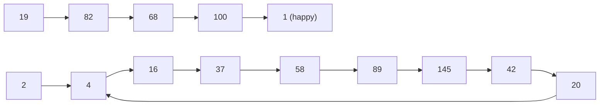

# Visited / Seen Pattern

> "Have I been here before?" A `HashSet` of visited items stops loops and repeated work. It is the safety net of graph search and cycle detection.

#### 1. What Is It?

The **visited / seen pattern** records what you have already processed, so you do not process it again.

| Use | What is "seen" | Why |
|---|---|---|
| Graph BFS / DFS | visited nodes | avoid infinite loops on cycles |
| Grid search | visited cells (or mark in place) | avoid going back |
| **Happy Number** | numbers in the sequence | detect a cycle |
| First repeated character | characters so far | stop at the first repeat |
| State search (lock, puzzle) | visited states | do not redo a state (note 17) |

**Signals:** "cycle", "loop forever", "visited", "already seen", "first repeated", "graph with cycles".

#### 2. How It Works

**Generic template**

```text
seen = {}
add the start to seen
while there is work:
    take the next item
    for each next state / neighbour:
        if it is not in seen:
            add it to seen          ← mark when you ADD it to the work list
            add it to the work list
```

**Mark as seen when you add it to the queue, not when you remove it** (for BFS). Otherwise the same item can enter the queue many times.

**Happy Number (LeetCode 202).** Repeatedly replace `n` by the sum of the squares of its digits. It is *happy* if it reaches `1`, and unhappy if it loops. Keep a set of the numbers seen. If a number repeats, it is a cycle.



```text
19 → 82 → 68 → 100 → 1       reaches 1 → happy
2 → 4 → 16 → 37 → 58 → 89 → 145 → 42 → 20 → 4   ← 4 is seen again → cycle → not happy
```

**First repeated character.** Walk the string. If `add` returns `false`, that character is the first repeat.

**Graph reachability (Find if Path Exists in Graph, LeetCode 1971).** BFS from `source` with a visited set. If you reach `destination`, return `true`.

**Alternative for cycles without extra memory:** Floyd's slow/fast pointers (Happy Number, linked-list cycle), `O(1)` space.

#### 3. Brute Force vs Optimized

| Task | Without `seen` | With a `HashSet` |
|---|---|---|
| Graph search | infinite loop on a cycle | `O(V + E)` |
| Happy Number | run forever, or a fixed step cap | stop at the first repeat |
| First repeated char | compare every pair `O(n²)` | one pass `O(n)` |

```kotlin
// Brute force: first repeated character by comparing all pairs
fun firstRepeatedBrute(s: String): Char? {
    for (j in s.indices) for (i in 0 until j) if (s[i] == s[j]) return s[j]
    return null
}
```

#### 4. Kotlin Code

```kotlin
// Happy Number (LeetCode 202): a set detects the cycle
fun isHappy(n: Int): Boolean {
    fun next(x: Int): Int {
        var sum = 0
        var v = x
        while (v > 0) { val d = v % 10; sum += d * d; v /= 10 }
        return sum
    }
    val seen = HashSet<Int>()
    var cur = n
    while (cur != 1 && seen.add(cur)) cur = next(cur)      // add returns false on a repeat
    return cur == 1
}

// First repeated character
fun firstRepeatedChar(s: String): Char? {
    val seen = HashSet<Char>()
    for (c in s) if (!seen.add(c)) return c
    return null
}

// Find if Path Exists in Graph (LeetCode 1971): BFS with a visited set
fun validPath(n: Int, edges: Array<IntArray>, source: Int, destination: Int): Boolean {
    val graph = Array(n) { mutableListOf<Int>() }
    for ((a, b) in edges) { graph[a].add(b); graph[b].add(a) }
    val visited = HashSet<Int>()
    val queue = ArrayDeque<Int>()
    queue.addLast(source)
    visited.add(source)
    while (queue.isNotEmpty()) {
        val node = queue.removeFirst()
        if (node == destination) return true
        for (next in graph[node]) {
            if (visited.add(next)) queue.addLast(next)       // mark when adding to the queue
        }
    }
    return false
}
```

Checks: `isHappy(19)` → `true`. `isHappy(2)` → `false`. `isHappy(1)` → `true`. `firstRepeatedChar("abccbaacz")` → `'c'`. `firstRepeatedChar("abc")` → `null`. `firstRepeatedBrute("abccbaacz")` → `'c'`. `validPath(3, arrayOf(intArrayOf(0, 1), intArrayOf(1, 2), intArrayOf(2, 0)), 0, 2)` → `true`. `validPath(6, arrayOf(intArrayOf(0, 1), intArrayOf(0, 2), intArrayOf(3, 5), intArrayOf(5, 4), intArrayOf(4, 3)), 0, 5)` → `false`. `validPath(1, arrayOf(), 0, 0)` → `true`.

#### 5. Complexity

| | Time | Space |
|---|---|---|
| Graph BFS with `visited` | `O(V + E)` | `O(V)` |
| Happy Number (set) | `O(log n)` per step, the sequence is short | `O(number of steps)` |
| First repeated char | `O(n)` | `O(alphabet)` |

#### 6. Common Mistakes

1. **No visited set** on a graph with cycles.
2. **Marking visited when removing from the queue** (duplicates in the queue).
3. **Forgetting to mark the start** as visited.
4. **Using a `List` for `visited`** (`O(n)` lookups).
5. **Happy Number:** using a fixed loop count instead of detecting the cycle.
6. **Sharing one visited set across independent searches** that need a fresh one.

#### 7. Say This in the Interview

1. "I keep a `HashSet` of visited nodes and mark a node when I add it to the queue, so each node is processed once and cycles can't trap me. That's `O(V + E)`."
2. "For Happy Number, a repeated value means a cycle, so I stop when `add` returns false."
3. "If I wanted `O(1)` space for the cycle check, I could use Floyd's slow and fast pointers."

#### 8. Quick Check

1. When do you mark a node visited in BFS?
2. Why does `isHappy(2)` end?
3. What does `visited.add(next)` returning `false` tell you?

<details>
<summary>Answers</summary>

1. When you **add** it to the queue.
2. The sequence repeats a number (`4`), and the set detects it.
3. `next` was already visited, so skip it.

</details>

#### 9. Related LeetCode Questions

| # | Question | Idea |
|---|---|---|
| 202 | [Happy Number](https://leetcode.com/problems/happy-number/) (Easy) | seen set or Floyd |
| 1971 | [Find if Path Exists in Graph](https://leetcode.com/problems/find-if-path-exists-in-graph/) (Easy) | BFS + visited |
| 200 | [Number of Islands](https://leetcode.com/problems/number-of-islands/) (Medium) | visited cells |
| 141 | [Linked List Cycle](https://leetcode.com/problems/linked-list-cycle/) (Easy) | set of nodes, or Floyd |
| 133 | [Clone Graph](https://leetcode.com/problems/clone-graph/) (Medium) | visited map |
| 207 | [Course Schedule](https://leetcode.com/problems/course-schedule/) (Medium) | visited states for a cycle |
