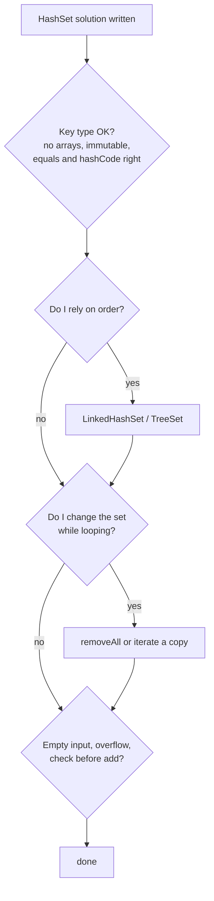

# Common HashSet Edge Cases

> Read this before a hashing interview and run through it at the end of every solution. Most set bugs are on this list.

#### 1. What Is It?

These are the situations where HashSet solutions crash, give wrong answers, or turn slow. They fall into five groups:

1. **keys that don't hash or compare as you expect** (arrays, mutable objects, floating point),
2. **order assumptions** (`HashSet` has no order),
3. **mutation problems** (changing the set while iterating, changing a key after adding it),
4. **size and extreme values** (empty input, `Int` limits),
5. **complexity traps** (`list.contains`, hash collisions).

#### 2. How It Works

**The checklist**

| # | Edge case | What goes wrong | Fix |
|---|---|---|---|
| 1 | `HashSet<IntArray>` | arrays compare by **identity**, so equal arrays are "different" | use `List<Int>`, a `String` key, or a data class |
| 2 | A mutable object as a key, then changed | it sits in the wrong bucket and `contains` fails | use immutable keys, or remove before changing |
| 3 | Class without `equals` / `hashCode` | two equal-looking objects are different | use a `data class` |
| 4 | Expecting sorted or insertion order | `HashSet` order is arbitrary | `LinkedHashSet` / `TreeSet` |
| 5 | Modifying the set inside `for (x in set)` | `ConcurrentModificationException` | `removeAll { }`, or iterate over a copy |
| 6 | Empty input | `max`, `first`, `last` of an empty collection crash | check `isEmpty()` first |
| 7 | Checking `contains` before `add` (two lookups) | works, but slower | `if (!set.add(x))` |
| 8 | Adding before checking (Two Sum) | an element pairs with itself | check first, then add |
| 9 | `Int` overflow for `target − x`, `x + 1` | wrong membership | use `Long` |
| 10 | `Double` / `Float` keys | `0.1 + 0.2` is not `0.3` | avoid, or round to an integer key |
| 11 | `-0.0` vs `0.0` | different hash codes | normalise |
| 12 | `String` case and whitespace | `"Cat"` and `"cat"` differ | normalise (`lowercase()`, `trim()`) |
| 13 | `Char` vs `String` | `'a'` and `"a"` are different keys | keep types consistent |
| 14 | `Int` and `Long` mixed | `1` and `1L` are different keys | one numeric type |
| 15 | Comparing boxed `Integer`s with `===` | identity, not value | use `==` |
| 16 | `HashSet<Pair<Int, Int>>` for a grid | fine for small grids, slow for huge ones | encode as `r * cols + c` in an `Int`/`Long` |
| 17 | A set where an array would do (`0..25`, `0..n`) | extra overhead | `BooleanArray` |
| 18 | Many collisions (bad `hashCode`) | `O(n)` operations | a good `hashCode`; avoid constant hashes |
| 19 | `TreeSet` with a comparator inconsistent with `equals` | elements "disappear" | make the comparator total and consistent |
| 20 | `TreeSet` with `null` | `NullPointerException` | avoid nulls |
| 21 | Very large sets | memory (each `Int` is boxed) | `BooleanArray`, bitset, or sort + scan |
| 22 | Shared mutable set between calls (class field) | old data leaks into new tests | create a new set per call |



#### 3. Brute Force vs Optimized

| Habit | Better |
|---|---|
| `HashSet<IntArray>` | `HashSet<List<Int>>` or `HashSet<String>` |
| `Pair(r, c)` in a hot loop | `r * cols + c` |
| `if (!set.contains(x)) set.add(x)` | `if (set.add(x))` |
| `HashSet<Int>` for letters | `BooleanArray(26)` |

```kotlin
// The classic trap: arrays in a set
val bad = HashSet<IntArray>()
bad.add(intArrayOf(1, 2))
println(bad.contains(intArrayOf(1, 2)))                // false: different array objects

// Fix 1: a List (compares by content)
val good = HashSet<List<Int>>()
good.add(listOf(1, 2))
println(good.contains(listOf(1, 2)))                   // true

// Fix 2: a string key
val keys = HashSet<String>()
keys.add("1,2")
println(keys.contains("1,2"))                          // true
```

#### 4. Kotlin Code

```kotlin
// A data class gets equals and hashCode for free
data class Point(val r: Int, val c: Int)

fun demo() {
    val set = HashSet<Point>()
    set.add(Point(1, 2))
    println(Point(1, 2) in set)                        // true

    // Safe removal while looping
    val nums = mutableSetOf(1, 2, 3, 4, 5, 6)
    nums.removeAll { it % 2 == 0 }
    println(nums)                                      // [1, 3, 5]

    // Compact grid key
    val cols = 10
    val visited = HashSet<Int>()
    visited.add(3 * cols + 4)                          // cell (3, 4)
    println((3 * cols + 4) in visited)                 // true
}

// Overflow-safe complement check
fun hasPairSafe(nums: IntArray, target: Int): Boolean {
    val seen = HashSet<Long>()
    for (x in nums) {
        if (target.toLong() - x in seen) return true
        seen.add(x.toLong())
    }
    return false
}

// Normalised string keys
fun countDistinctWords(words: List<String>): Int = words.map { it.trim().lowercase() }.toHashSet().size
```

Checks: the three prints for arrays show `false`, `true`, `true`. `demo()` prints `true`, `[1, 3, 5]`, `true`. `hasPairSafe(intArrayOf(Int.MAX_VALUE, 1), Int.MIN_VALUE)` → `false` (correct: no such pair). `hasPairSafe(intArrayOf(2, 7), 9)` → `true`. `countDistinctWords(listOf("Cat", " cat", "CAT ", "dog"))` → `2`.

#### 5. Complexity

| Fix | Effect |
|---|---|
| `add`'s return value | one lookup instead of two |
| Int cell id | no `Pair` allocation per cell |
| `BooleanArray` for small ranges | no hashing at all |
| `LinkedHashSet` / `TreeSet` | order at `O(1)` / `O(log n)` |

#### 6. Common Mistakes

1. **Arrays or lists that you mutate as set elements.**
2. **Expecting `HashSet` to keep order.**
3. **Removing from the set you are looping over.**
4. **Forgetting normalisation of strings.**
5. **Using `==` on boxed values with `===` semantics.**
6. **Ignoring overflow near `Int.MAX_VALUE`.**
7. **Not testing the empty set.**

#### 7. Say This in the Interview

1. "Before I finish I'll check: the key type, the empty input, duplicates, order assumptions, and overflow."
2. "Arrays don't work as set elements in Kotlin because they compare by identity, so I'd use a list or a string key."
3. "I check the complement before adding, so one element doesn't pair with itself."

#### 8. Quick Check

1. Does `hashSetOf(intArrayOf(1)).contains(intArrayOf(1))` return true?
2. How do you remove all negatives from a mutable set in one safe call?
3. What happens to a key if you change a field that its `hashCode` uses?

<details>
<summary>Answers</summary>

1. No (`false`): different array objects.
2. `set.removeAll { it < 0 }`.
3. The set can no longer find it, because it is stored in the bucket of its old hash.

</details>

#### 9. Related LeetCode Questions

| # | Question | Idea |
|---|---|---|
| 217 | [Contains Duplicate](https://leetcode.com/problems/contains-duplicate/) (Easy) | set basics |
| 36 | [Valid Sudoku](https://leetcode.com/problems/valid-sudoku/) (Medium) | string keys or sets per unit |
| 49 | [Group Anagrams](https://leetcode.com/problems/group-anagrams/) (Medium) | a good key |
| 128 | [Longest Consecutive Sequence](https://leetcode.com/problems/longest-consecutive-sequence/) (Medium) | overflow, duplicates |
| 705 | [Design HashSet](https://leetcode.com/problems/design-hashset/) (Easy) | how buckets work |
| 1 | [Two Sum](https://leetcode.com/problems/two-sum/) (Easy) | check before add |
