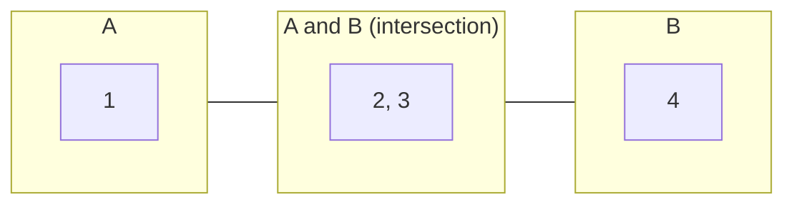

# Set Union / Intersection / Difference

> Kotlin has the three set operations built in. Know what each means, the one-line code, and its cost.

#### 1. What Is It?

For two sets `A` and `B`:

| Operation | Meaning | Kotlin | Result for `A = {1, 2, 3}`, `B = {2, 3, 4}` |
|---|---|---|---|
| **Union** `A ∪ B` | in `A` **or** `B` | `A union B` or `A + B` | `{1, 2, 3, 4}` |
| **Intersection** `A ∩ B` | in **both** | `A intersect B` | `{2, 3}` |
| **Difference** `A − B` | in `A` but **not** in `B` | `A subtract B` or `A - B` | `{1}` |
| **Symmetric difference** | in exactly one | `(A - B) + (B - A)` | `{1, 4}` |
| **Subset** | every item of `A` is in `B` | `B.containsAll(A)` | `false` |

**Signals:** "common", "in either", "only in the first", "missing from", "difference of two arrays", "is a subset".

#### 2. How It Works



- **Union** = `A` only + both + `B` only = `{1, 2, 3, 4}`.
- **Intersection** = the middle = `{2, 3}`.
- **A − B** = `A` only = `{1}`. **B − A** = `B` only = `{4}`.

**Mutating versions** (change the set in place):

| Kotlin | Effect |
|---|---|
| `a.addAll(b)` | `a = a ∪ b` |
| `a.retainAll(b)` | `a = a ∩ b` |
| `a.removeAll(b)` | `a = a − b` |

The infix versions (`union`, `intersect`, `subtract`) return a **new** set and leave the originals unchanged.

**Find the Difference of Two Arrays (LeetCode 2215).** Return `[distinct values only in nums1, distinct values only in nums2]`.

```text
nums1 = [1, 2, 3, 3]   nums2 = [1, 1, 2, 2]
set1 = {1, 2, 3}       set2 = {1, 2}
set1 − set2 = {3}      set2 − set1 = {}
answer [[3], []]
```

**Cost.** Each operation walks the smaller or larger set once and does `O(1)` lookups: `O(|A| + |B|)`. Intersection can be done in `O(min(|A|, |B|))` by iterating the smaller set and checking the larger.

#### 3. Brute Force vs Optimized

| Task | Brute force | With sets |
|---|---|---|
| Common values | nested loops `O(m · n)` | `O(m + n)` |
| Values only in `A` | for each `a`, scan `B` `O(m · n)` | `O(m + n)` |
| Union without duplicates | add, check `contains` on a list `O(n²)` | `O(m + n)` |

```kotlin
// Brute force difference: for each element of a, scan b
fun differenceBrute(a: IntArray, b: IntArray): List<Int> =
    a.filter { x -> b.none { it == x } }.distinct()
```

#### 4. Kotlin Code

```kotlin
fun demo() {
    val a = setOf(1, 2, 3)
    val b = setOf(2, 3, 4)
    println(a union b)                          // [1, 2, 3, 4]
    println(a intersect b)                      // [2, 3]
    println(a subtract b)                       // [1]
    println((a - b) + (b - a))                  // [1, 4]   symmetric difference
    println(b.containsAll(setOf(2, 3)))         // true     {2, 3} is a subset of b
}

// Find the Difference of Two Arrays (LeetCode 2215)
fun findDifference(nums1: IntArray, nums2: IntArray): List<List<Int>> {
    val s1 = nums1.toSet()
    val s2 = nums2.toSet()
    return listOf((s1 - s2).toList(), (s2 - s1).toList())
}

// Is one string made of letters of another (subset of characters)?
fun usesOnlyLettersOf(word: String, allowed: String): Boolean =
    allowed.toSet().containsAll(word.toSet())

// Pangram: the letters cover the whole alphabet (LeetCode 1832)
fun checkIfPangram(sentence: String): Boolean = sentence.toSet().size == 26

// Common elements of several lists, using retainAll
fun commonOfAll(lists: List<List<Int>>): Set<Int> {
    val result = lists.first().toMutableSet()
    for (l in lists.drop(1)) result.retainAll(l.toSet())
    return result
}
```

Checks: `demo()` prints `[1, 2, 3, 4]`, `[2, 3]`, `[1]`, `[1, 4]`, `true`. `findDifference(intArrayOf(1, 2, 3), intArrayOf(2, 4, 6))` → `[[1, 3], [4, 6]]`. `findDifference(intArrayOf(1, 2, 3, 3), intArrayOf(1, 1, 2, 2))` → `[[3], []]`. `usesOnlyLettersOf("cab", "abcd")` → `true`. `usesOnlyLettersOf("cabz", "abcd")` → `false`. `checkIfPangram("thequickbrownfoxjumpsoverthelazydog")` → `true`. `checkIfPangram("leetcode")` → `false`. `commonOfAll(listOf(listOf(1, 2, 3), listOf(2, 3, 4), listOf(3, 2, 9)))` → `[2, 3]`. `differenceBrute(intArrayOf(1, 2, 3), intArrayOf(2, 4, 6))` → `[1, 3]`.

#### 5. Complexity

| | Time | Space |
|---|---|---|
| `union`, `intersect`, `subtract` | `O(m + n)` | `O(m + n)` (a new set) |
| `addAll`, `retainAll`, `removeAll` | `O(n)` for the other collection's size | in place |
| `containsAll` | `O(|A|)` with a set `B` | |
| Intersection smartly | `O(min(m, n))` | |

#### 6. Common Mistakes

1. **Forgetting that `intersect`, `union`, `subtract` return new sets** and the originals are unchanged.
2. **Using `retainAll` with a `List` argument** (`O(n · m)`). Convert it to a set first.
3. **Using lists** (`a.filter { it in b }` with `b` a list: `O(m · n)`).
4. **Mixing up `A − B` and `B − A`.** Difference is not symmetric.
5. **Calling `.first()`** on an empty list in `commonOfAll`.
6. **Treating duplicates as significant** (sets drop them; use a count map if you need multiplicity).

#### 7. Say This in the Interview

1. "Kotlin has `union`, `intersect` and `subtract`. Each is `O(m + n)` with hash sets."
2. "I convert the lists to sets first, so the membership checks are `O(1)`."
3. "If duplicates count, I use a map of counts instead of sets."

#### 8. Quick Check

1. `{1, 2} − {2, 3}`?
2. Does `a union b` change `a`?
3. How do you check that `A` is a subset of `B`?

<details>
<summary>Answers</summary>

1. `{1}`.
2. No. It returns a new set. Use `addAll` to change `a`.
3. `b.containsAll(a)`.

</details>

#### 9. Related LeetCode Questions

| # | Question | Idea |
|---|---|---|
| 2215 | [Find the Difference of Two Arrays](https://leetcode.com/problems/find-the-difference-of-two-arrays/) (Easy) | two differences |
| 349 | [Intersection of Two Arrays](https://leetcode.com/problems/intersection-of-two-arrays/) (Easy) | intersection |
| 1832 | [Check if the Sentence Is Pangram](https://leetcode.com/problems/check-if-the-sentence-is-pangram/) (Easy) | set size is 26 |
| 389 | [Find the Difference](https://leetcode.com/problems/find-the-difference/) (Easy) | the added letter |
| 1002 | [Find Common Characters](https://leetcode.com/problems/find-common-characters/) (Easy) | intersection with counts |
| 575 | [Distribute Candies](https://leetcode.com/problems/distribute-candies/) (Easy) | distinct count |
