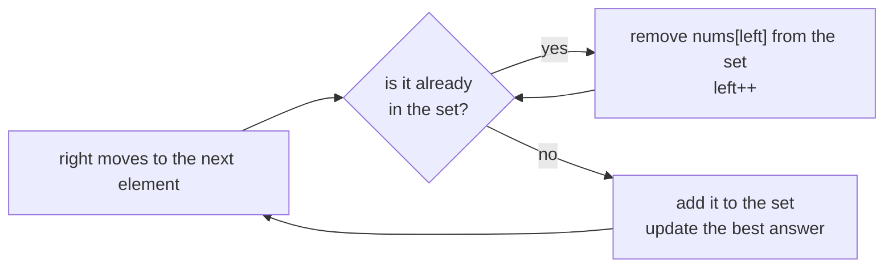

# HashSet + Sliding Window

> A window that must contain **no duplicates**. The set holds the window's items. When a new item is already inside, shrink from the left until it is not.

#### 1. What Is It?

In a **sliding window** problem, the window `[left, right]` must stay **valid**. When validity means **"all elements are different"**, a `HashSet` of the window's elements checks it in `O(1)`.

| Question | Window rule |
|---|---|
| **Longest Substring Without Repeating Characters** (3) | no repeated character |
| **Maximum Erasure Value** (1695) | no repeated number; maximise the **sum** |
| **Contains Duplicate II** (219) | window of size `k`, find a duplicate (note 4) |
| **Longest Nice / Distinct subarray** variants | distinct elements |

**Signals:** "longest substring/subarray with all distinct", "no repeats", "unique elements", "maximum sum of a subarray of unique elements".

#### 2. How It Works



```text
Maximum Erasure Value: [4, 2, 4, 5, 6]
right=0 (4): set {4}         sum 4
right=1 (2): set {4, 2}      sum 6
right=2 (4): 4 is in the set → remove nums[0]=4 (sum 2), left=1 → add 4 → set {2, 4}  sum 6
right=3 (5): set {2, 4, 5}   sum 11
right=4 (6): set {2,4,5,6}   sum 17   ← best
answer 17
```

**Why `O(n)`:** `left` and `right` each move forward at most `n` times. Each element is added once and removed at most once.

**Set vs map.** A **set** is enough when you only need "is it in the window?". If you want to jump `left` straight past the earlier copy, store the **last index** in a `HashMap` (a faster variant of the same idea).

**Set vs array.** For lowercase letters, `BooleanArray(26)` replaces the set.

#### 3. Brute Force vs Optimized

| Approach | Time | Space |
|---|---|---|
| Check every subarray for duplicates | `O(n³)` (or `O(n²)` with a set per start) | `O(n)` |
| **Sliding window + set** | **`O(n)`** | `O(window)` |

```kotlin
// Brute force: for each start, extend until a duplicate appears. O(n^2).
fun maximumUniqueSubarrayBrute(nums: IntArray): Int {
    var best = 0
    for (i in nums.indices) {
        val seen = HashSet<Int>()
        var sum = 0
        for (j in i until nums.size) {
            if (!seen.add(nums[j])) break
            sum += nums[j]
        }
        best = maxOf(best, sum)
    }
    return best
}
```

#### 4. Kotlin Code

```kotlin
// Longest Substring Without Repeating Characters (LeetCode 3)
fun lengthOfLongestSubstring(s: String): Int {
    val window = HashSet<Char>()
    var left = 0
    var best = 0
    for (right in s.indices) {
        while (!window.add(s[right])) {            // already inside: shrink from the left
            window.remove(s[left])
            left++
        }
        best = maxOf(best, right - left + 1)
    }
    return best
}

// Maximum Erasure Value (LeetCode 1695): the best sum of a subarray with all distinct values
fun maximumUniqueSubarray(nums: IntArray): Int {
    val window = HashSet<Int>()
    var left = 0
    var sum = 0
    var best = 0
    for (right in nums.indices) {
        while (!window.add(nums[right])) {
            window.remove(nums[left])
            sum -= nums[left]
            left++
        }
        sum += nums[right]
        best = maxOf(best, sum)
    }
    return best
}

// Same as the first one, with a map of last positions (jumps left in one step)
fun lengthOfLongestSubstringMap(s: String): Int {
    val last = HashMap<Char, Int>()
    var left = 0
    var best = 0
    for (right in s.indices) {
        val prev = last[s[right]]
        if (prev != null && prev >= left) left = prev + 1
        last[s[right]] = right
        best = maxOf(best, right - left + 1)
    }
    return best
}
```

Checks: `lengthOfLongestSubstring("abcabcbb")` → `3`. `("bbbbb")` → `1`. `("pwwkew")` → `3`. `("")` → `0`. `("dvdf")` → `3` (`vdf`). `lengthOfLongestSubstringMap("dvdf")` → `3`. `maximumUniqueSubarray(intArrayOf(4, 2, 4, 5, 6))` → `17`. `maximumUniqueSubarray(intArrayOf(5, 2, 1, 2, 5, 2, 1, 2, 5))` → `8` (`5 + 2 + 1`). `maximumUniqueSubarray(intArrayOf(10))` → `10`. `maximumUniqueSubarrayBrute(intArrayOf(4, 2, 4, 5, 6))` → `17`.

#### 5. Complexity

| | Time | Space |
|---|---|---|
| Set window | `O(n)` | `O(min(n, alphabet))` |
| Map of last positions | `O(n)` | `O(min(n, alphabet))` |
| Brute force | `O(n²)` | `O(n)` |

#### 6. Common Mistakes

1. **Using `if` instead of `while`** to shrink. One removal may not clear the duplicate.
2. **Forgetting to update the running sum** when removing from the left.
3. **Adding the new element before the shrink loop finishes** (the `while (!add)` pattern avoids this).
4. **Map version:** moving `left` backwards. Use `prev >= left`.
5. **Window length off by one.** It is `right − left + 1`.
6. **Using the whole array's set** instead of the window's set.

#### 7. Say This in the Interview

1. "The window must have all distinct elements, so I keep a `HashSet` of what's inside. When the next element is already in the set, I shrink from the left until it isn't."
2. "Each element is added once and removed at most once, so it's `O(n)`."
3. "I update the sum as the window changes, so I don't recompute it."

#### 8. Quick Check

1. Longest distinct window in `"abba"`?
2. Why `while` and not `if`?
3. What does `window.add(x)` returning `false` tell you?

<details>
<summary>Answers</summary>

1. `2` (`ab` or `ba`).
2. A new element's earlier copy might be several positions from `left`, so more than one removal may be needed.
3. `x` is already in the window, so you must shrink.

</details>

#### 9. Related LeetCode Questions

| # | Question | Idea |
|---|---|---|
| 3 | [Longest Substring Without Repeating Characters](https://leetcode.com/problems/longest-substring-without-repeating-characters/) (Medium) | set window |
| 1695 | [Maximum Erasure Value](https://leetcode.com/problems/maximum-erasure-value/) (Medium) | set window + sum |
| 219 | [Contains Duplicate II](https://leetcode.com/problems/contains-duplicate-ii/) (Easy) | fixed-size window |
| 904 | [Fruit Into Baskets](https://leetcode.com/problems/fruit-into-baskets/) (Medium) | window with at most 2 types |
| 2401 | [Longest Nice Subarray](https://leetcode.com/problems/longest-nice-subarray/) (Medium) | window with a bit mask |
| 424 | [Longest Repeating Character Replacement](https://leetcode.com/problems/longest-repeating-character-replacement/) (Medium) | window with counts |
