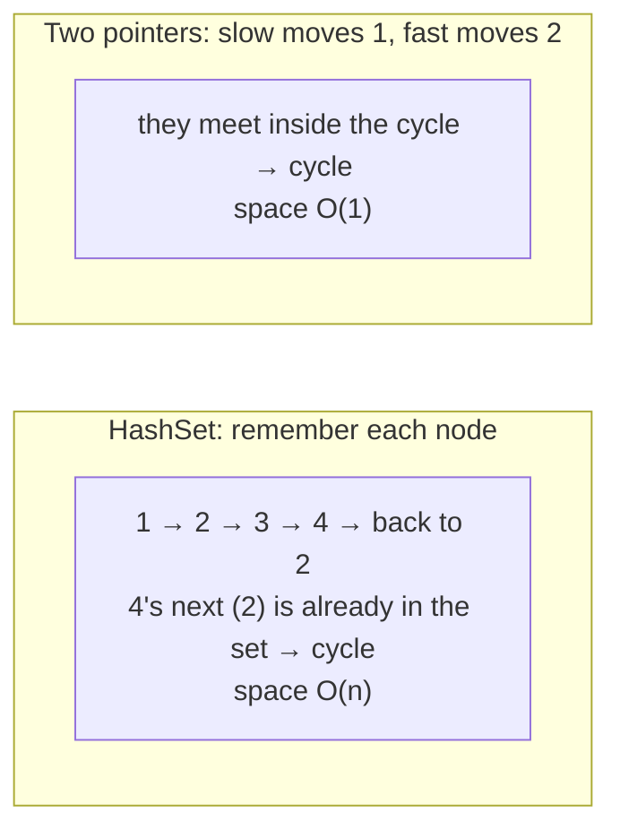

# HashSet + Two Pointers

> A set gives `O(1)` lookups but uses `O(n)` memory. **Two pointers** often do the same job in `O(1)` memory when the data is sorted or the structure allows it. Know both, and say the trade-off.

#### 1. What Is It?

Many problems can be solved in two ways:

| | HashSet | Two pointers |
|---|---|---|
| Idea | remember what you've seen | move two indexes using order or speed |
| Time | `O(n)` | `O(n)` (after sorting `O(n log n)`) |
| Space | `O(n)` | **`O(1)`** |
| Needs | nothing | **sorted** data, or a structure like a linked list |

**Typical pairs**

| Problem | HashSet answer | Two-pointer answer |
|---|---|---|
| Pair with a sum | seen set (note 7) | sort, then left + right |
| Intersection of two arrays | set (note 8) | sort both, two pointers |
| Cycle in a linked list | set of visited nodes | slow and fast pointers (Floyd) |
| Duplicate in `1..n` | seen set | Floyd on the array, or sort |
| Happy Number | seen set | slow and fast on the sequence |

**Signals:** "O(1) extra space", "without extra memory", "in place", "the array is sorted".

#### 2. How It Works

**Linked-list cycle.**



**Sorted pair sum.** `[1, 3, 4, 6, 8]`, target `10`:

```text
left=0 (1), right=4 (8): 9 < 10 → left++
left=1 (3), right=4 (8): 11 > 10 → right--
left=1 (3), right=3 (6): 9  < 10 → left++
left=2 (4), right=3 (6): 10 = 10 → found
```

**Rule of thumb for interviews**

1. Start with the **set** solution: it is easy and correct.
2. Say its cost: `O(n)` extra space.
3. Offer the **two-pointer** version if the data is sorted or the structure allows it, and say it uses `O(1)` space.
4. Mention the trade-off: sorting changes the order and costs `O(n log n)`, and you lose the original indexes.

#### 3. Brute Force vs Optimized

| Problem | Brute force | Set | Two pointers |
|---|---|---|---|
| Pair with sum, unsorted | `O(n²)` | `O(n)`, `O(n)` space | sort first: `O(n log n)`, `O(1)` space |
| Linked-list cycle | `O(n²)` | `O(n)`, `O(n)` space | `O(n)`, `O(1)` space |
| Find the duplicate (`1..n`) | `O(n²)` | `O(n)`, `O(n)` space | Floyd `O(n)`, `O(1)` space |

```kotlin
// Brute force pair sum: all pairs
fun hasPairBrute(nums: IntArray, target: Int): Boolean {
    for (i in nums.indices) for (j in i + 1 until nums.size) if (nums[i] + nums[j] == target) return true
    return false
}
```

#### 4. Kotlin Code

```kotlin
class ListNode(var value: Int) { var next: ListNode? = null }

// Linked List Cycle (LeetCode 141): HashSet, O(n) space
fun hasCycleSet(head: ListNode?): Boolean {
    val seen = HashSet<ListNode>()
    var cur = head
    while (cur != null) {
        if (!seen.add(cur)) return true
        cur = cur.next
    }
    return false
}

// Linked List Cycle: two pointers, O(1) space
fun hasCycleTwoPointers(head: ListNode?): Boolean {
    var slow = head
    var fast = head
    while (fast != null && fast.next != null) {
        slow = slow!!.next
        fast = fast.next!!.next
        if (slow === fast) return true
    }
    return false
}

// Find the Duplicate Number (LeetCode 287): HashSet
fun findDuplicateSet(nums: IntArray): Int {
    val seen = HashSet<Int>()
    for (x in nums) if (!seen.add(x)) return x
    return -1
}

// Find the Duplicate Number: Floyd, O(1) space (values are 1..n in an array of n + 1)
fun findDuplicateFloyd(nums: IntArray): Int {
    var slow = nums[0]
    var fast = nums[0]
    do {
        slow = nums[slow]
        fast = nums[nums[fast]]
    } while (slow != fast)
    slow = nums[0]
    while (slow != fast) {
        slow = nums[slow]
        fast = nums[fast]
    }
    return slow
}

// Pair with a sum: sort + two pointers, O(1) extra space
fun hasPairTwoPointers(nums: IntArray, target: Int): Boolean {
    val a = nums.sortedArray()
    var left = 0
    var right = a.size - 1
    while (left < right) {
        val sum = a[left] + a[right]
        when {
            sum == target -> return true
            sum < target -> left++
            else -> right--
        }
    }
    return false
}
```

Checks: for a list `1 → 2 → 3 → 4` whose tail points back to `2`: `hasCycleSet` → `true`, `hasCycleTwoPointers` → `true`. For `1 → 2 → 3`: both `false`. `findDuplicateSet(intArrayOf(1, 3, 4, 2, 2))` → `2`. `findDuplicateFloyd(intArrayOf(1, 3, 4, 2, 2))` → `2`. `findDuplicateFloyd(intArrayOf(3, 1, 3, 4, 2))` → `3`. `hasPairTwoPointers(intArrayOf(8, 1, 6, 3, 4), 10)` → `true`. `hasPairTwoPointers(intArrayOf(1, 2, 3), 7)` → `false`. `hasPairBrute(intArrayOf(8, 1, 6, 3, 4), 10)` → `true`.

#### 5. Complexity

| | Time | Space |
|---|---|---|
| Set solutions | `O(n)` | `O(n)` |
| Floyd cycle / duplicate | `O(n)` | `O(1)` |
| Sort + two pointers | `O(n log n)` | `O(1)` extra (if sorting in place) |

#### 6. Common Mistakes

1. **Using two pointers on unsorted data** (for a sum or intersection).
2. **Forgetting that sorting destroys the original order and indexes** (Two Sum asks for indexes).
3. **Floyd on the duplicate problem without the guarantee** (`1..n` in `n + 1` slots, no `0`).
4. **Using a set when the interviewer asked for `O(1)` space.**
5. **Using `==` for node comparison** in a cycle check (use `===` for identity).
6. **Skipping the null checks** (`fast.next`) in the linked-list loop.

#### 7. Say This in the Interview

1. "The simple solution uses a `HashSet` in `O(n)` time and `O(n)` space. If I must use `O(1)` space, I can use two pointers: slow and fast for the cycle, or sorting plus left and right for the pair sum."
2. "Sorting costs `O(n log n)` and loses the original indexes, so if the question asks for indexes I keep the set or map."
3. "For the duplicate in `1..n`, Floyd's algorithm treats the array as a linked list and finds the cycle start: `O(n)` time, `O(1)` space."

#### 8. Quick Check

1. Which approach uses `O(1)` space for a linked-list cycle?
2. Why can't you use left/right pointers on an unsorted pair-sum array?
3. What do you lose by sorting the array in Two Sum?

<details>
<summary>Answers</summary>

1. Slow and fast pointers (Floyd).
2. The pointer moves rely on order: you cannot know whether to move `left` or `right` otherwise.
3. The original indexes.

</details>

#### 9. Related LeetCode Questions

| # | Question | Idea |
|---|---|---|
| 141 | [Linked List Cycle](https://leetcode.com/problems/linked-list-cycle/) (Easy) | set vs Floyd |
| 287 | [Find the Duplicate Number](https://leetcode.com/problems/find-the-duplicate-number/) (Medium) | set vs Floyd |
| 167 | [Two Sum II - Input Array Is Sorted](https://leetcode.com/problems/two-sum-ii-input-array-is-sorted/) (Medium) | two pointers |
| 202 | [Happy Number](https://leetcode.com/problems/happy-number/) (Easy) | set vs Floyd |
| 349 | [Intersection of Two Arrays](https://leetcode.com/problems/intersection-of-two-arrays/) (Easy) | set vs sort + two pointers |
| 160 | [Intersection of Two Linked Lists](https://leetcode.com/problems/intersection-of-two-linked-lists/) (Easy) | set of nodes vs pointer switching |
