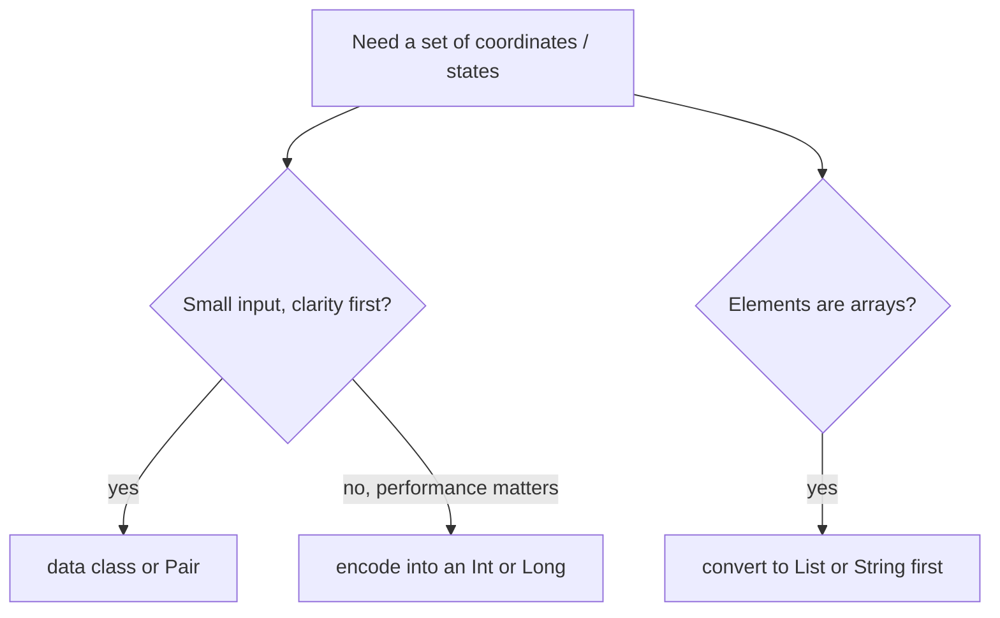

# HashSet with Custom Objects

> A set decides "same or different" with `equals` and `hashCode`. For your own classes, use a **`data class`**, or write both functions yourself.

#### 1. What Is It?

A `HashSet<T>` finds an item with `hashCode()` (which bucket?) and then compares with `equals()` (is it the same?). The two must agree:

> **If `a == b`, then `a.hashCode() == b.hashCode()`.**

| Type | `equals` / `hashCode` | Works in a set? |
|---|---|---|
| `Int`, `String`, `Char`, `Long` | by value | yes |
| `Pair`, `Triple`, `List`, `data class` | by value of the contents | yes |
| `IntArray`, `Array<T>` | by **identity** | **no** (use `List`) |
| Normal `class` (no override) | by **identity** | only the same object |

**Signals:** "set of points", "visited coordinates", "set of states", "unique pairs", "set of objects", "unique shapes".

#### 2. How It Works

```kotlin
class P(val x: Int, val y: Int)            // no equals / hashCode: identity only
data class Q(val x: Int, val y: Int)       // equals, hashCode, toString, copy: by value
```

```text
setOf(P(1, 2)).contains(P(1, 2))   → false   (two different objects)
setOf(Q(1, 2)).contains(Q(1, 2))   → true    (equal by value)
```

**Choices for a coordinate**

| Key | Pros | Cons |
|---|---|---|
| `Pair<Int, Int>` | built in, short | boxing, a little slow |
| `data class Point(val r: Int, val c: Int)` | clear names | boxing, a little slow |
| `r * cols + c` (an `Int` / `Long`) | fastest, least memory | you must decode it (`id / cols`, `id % cols`) |
| `"$r,$c"` (a `String`) | easy to write | slow, wasteful |



**Mutable keys.** Do not change a key's fields after it is in a set. The set looks for it in the old bucket and fails to find it.

```text
val p = MutablePoint(1, 2); set.add(p)
p.x = 5            → the hash changed, but the set still stores p in the old bucket
set.contains(p)    → false (!), even though p is in the set
```

**Writing `equals` and `hashCode` by hand** (when a data class is not possible, for example you only want to compare some fields):

```kotlin
class User(val id: Int, val name: String) {
    override fun equals(other: Any?): Boolean = other is User && other.id == id
    override fun hashCode(): Int = id.hashCode()        // use the same fields as equals
}
```

#### 3. Brute Force vs Optimized

| Approach | Cost |
|---|---|
| Keep a `List<Point>` and check `contains` | `O(n)` per check |
| `HashSet<Point>` with a data class | `O(1)` per check |
| `HashSet<Int>` with an encoded id | `O(1)`, faster and smaller |

```kotlin
// Brute force: a list of points, scanning for duplicates
fun uniquePointsBrute(points: List<Pair<Int, Int>>): Int {
    val out = mutableListOf<Pair<Int, Int>>()
    for (p in points) if (p !in out) out.add(p)           // O(n) scan
    return out.size
}
```

#### 4. Kotlin Code

```kotlin
data class Point(val r: Int, val c: Int)

class Plain(val x: Int)                                   // no equals / hashCode

fun uniquePoints(points: List<Point>): Int = points.toHashSet().size

// Number of distinct cells visited by a walk: U, D, L, R
fun distinctCellsVisited(moves: String): Int {
    val visited = HashSet<Point>()
    var r = 0
    var c = 0
    visited.add(Point(r, c))
    for (m in moves) {
        when (m) { 'U' -> r--; 'D' -> r++; 'L' -> c--; 'R' -> c++ }
        visited.add(Point(r, c))
    }
    return visited.size
}

// Path Crossing (LeetCode 1496): does the path visit a point twice?
fun isPathCrossing(path: String): Boolean {
    val visited = HashSet<Pair<Int, Int>>()
    var x = 0
    var y = 0
    visited.add(x to y)
    for (ch in path) {
        when (ch) { 'N' -> y++; 'S' -> y--; 'E' -> x++; 'W' -> x-- }
        if (!visited.add(x to y)) return true
    }
    return false
}

// Compact key for a grid cell
fun cellId(r: Int, c: Int, cols: Int) = r * cols + c

// Unique pairs regardless of order: (a, b) and (b, a) are the same
fun uniqueUnorderedPairs(pairs: List<Pair<Int, Int>>): Int =
    pairs.map { (a, b) -> if (a <= b) a to b else b to a }.toHashSet().size
```

Checks: `setOf(Plain(1)).contains(Plain(1))` → `false`. `setOf(Point(1, 2)).contains(Point(1, 2))` → `true`. `uniquePoints(listOf(Point(1, 2), Point(1, 2), Point(2, 1)))` → `2`. `distinctCellsVisited("RRLU")` → `4` (cells `(0,0)`, `(0,1)`, `(0,2)`, then back to `(0,1)`, then `(-1,1)`). `isPathCrossing("NES")` → `false`. `isPathCrossing("NESWW")` → `true`. `cellId(3, 4, 10)` → `34`. `uniqueUnorderedPairs(listOf(1 to 2, 2 to 1, 3 to 4))` → `2`. `uniquePointsBrute(listOf(1 to 2, 1 to 2, 2 to 1))` → `2`.

Trace of `distinctCellsVisited("RRLU")`: start `(0,0)`; `R` → `(0,1)`; `R` → `(0,2)`; `L` → `(0,1)` (already visited); `U` → `(-1,1)`. Set size `4`.

#### 5. Complexity

| | Time | Space |
|---|---|---|
| `add` / `contains` with a good `hashCode` | `O(1)` average | |
| Data class hash | `O(number of fields)` | |
| Encoded `Int` key | `O(1)` | smallest |
| List scan | `O(n)` | |

#### 6. Common Mistakes

1. **A normal class with no `equals` / `hashCode`** in a set. Every object is "different".
2. **Overriding `equals` but not `hashCode`** (or the other way round). The set breaks.
3. **Using `var` fields in a key** and changing them.
4. **Arrays as elements** (identity comparison).
5. **`hashCode` using different fields from `equals`.**
6. **Encoding a cell as `r * cols + c` with the wrong `cols`** (rows and columns swapped).

#### 7. Say This in the Interview

1. "A set uses `equals` and `hashCode`. For my own type I'll use a data class so equality is by value."
2. "For a grid I could encode the cell as `r * cols + c` in an `Int`, which is faster and smaller than a `Pair`."
3. "I'll keep keys immutable, so they never move to the wrong bucket after being added."

#### 8. Quick Check

1. Why does `setOf(Plain(1)).contains(Plain(1))` return false?
2. Which one is a good coordinate key for speed?
3. What must be true about `equals` and `hashCode`?

<details>
<summary>Answers</summary>

1. `Plain` uses identity equality, so two objects are different.
2. An encoded `Int` or `Long` (`r * cols + c`).
3. Equal objects must have equal hash codes.

</details>

#### 9. Related LeetCode Questions

| # | Question | Idea |
|---|---|---|
| 1496 | [Path Crossing](https://leetcode.com/problems/path-crossing/) (Easy) | set of points |
| 463 | [Island Perimeter](https://leetcode.com/problems/island-perimeter/) (Easy) | neighbours of cells |
| 874 | [Walking Robot Simulation](https://leetcode.com/problems/walking-robot-simulation/) (Medium) | set of obstacles |
| 694 | [Number of Distinct Islands](https://leetcode.com/problems/number-of-distinct-islands/) (Medium, premium) | set of shapes (note 18) |
| 447 | [Number of Boomerangs](https://leetcode.com/problems/number-of-boomerangs/) (Medium) | map of distances |
| 149 | [Max Points on a Line](https://leetcode.com/problems/max-points-on-a-line/) (Hard) | map of slopes |
