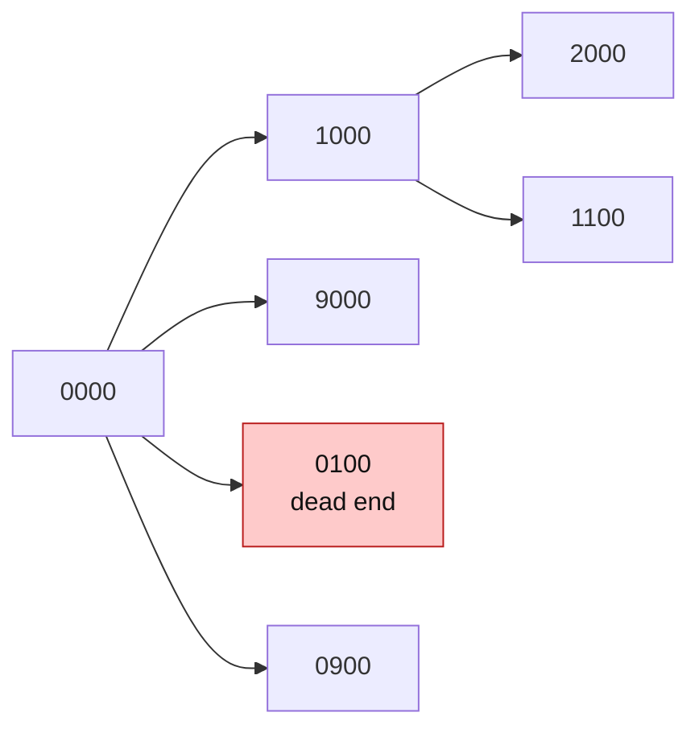

# HashSet in Graph / State-Space Problems

> In a state-space search each **state** is a node, and a **move** is an edge. The `visited` set of states keeps BFS from repeating work or looping forever.

#### 1. What Is It?

In a **state-space** (implicit graph) problem, there is no graph given. The **nodes are states** (a word, a lock code, a board), and the **edges are allowed moves**. You search with BFS or DFS, and keep a **`HashSet` of visited states**.

| Problem | State | Move |
|---|---|---|
| **Open the Lock** (752) | a 4-digit code (`"0202"`) | turn one wheel one step |
| **Word Ladder** (127) | a word | change one letter to another word in the list |
| **Sliding Puzzle** (773) | the board as a string | slide a tile into the empty cell |
| **Minimum Genetic Mutation** (433) | a gene string | change one character |
| **Perfect Squares** (279) | the remaining number | subtract a square |

**Signals:** "minimum number of steps/moves/changes to reach", "transform A into B", "target state", "dead ends".

#### 2. How It Works

```text
1. Put the start state in the queue and in visited.
2. Pop a state. If it is the target, return the number of steps.
3. For each neighbour state (one allowed move):
      if it is not in visited (and not forbidden): add to visited, add to the queue.
4. Level by level: BFS gives the minimum number of moves.
```

**Dead ends are just pre-filled visited states.** Put them in the `visited` set at the start, and BFS never enters them.

*Open the Lock. Each state has 8 neighbours (4 wheels, up or down). `"0100"` is a dead end.*



**Word Ladder (LeetCode 127).** `beginWord = "hit"`, `endWord = "cog"`, words `hot, dot, dog, lot, log, cog`. Neighbours of a word: change one letter (26 options per position) and keep it if the new word is in the word set. Removing a word from the set when you reach it is the same as marking it visited.

```text
hit → hot → dot / lot → dog / log → cog     length 5 (counting words)
```

**Why a set, not a list?** There can be millions of states, and `contains` is checked for every neighbour. `O(1)` vs `O(n)` is the difference between passing and a timeout.

#### 3. Brute Force vs Optimized

| Approach | Time |
|---|---|
| DFS without `visited` | infinite loops |
| DFS exploring all paths | exponential |
| **BFS + `visited` set** | `O(states × moves)` |
| Bidirectional BFS | about the square root of the states explored |

```kotlin
// Visited as a list: contains is O(n), far too slow for big state spaces
fun bfsWithListVisited(start: String, target: String, neighbours: (String) -> List<String>): Int {
    val visited = mutableListOf(start)                    // BAD: 'in visited' scans the list
    val queue = ArrayDeque<Pair<String, Int>>()
    queue.addLast(start to 0)
    while (queue.isNotEmpty()) {
        val (s, d) = queue.removeFirst()
        if (s == target) return d
        for (n in neighbours(s)) if (n !in visited) { visited.add(n); queue.addLast(n to d + 1) }
    }
    return -1
}
```

#### 4. Kotlin Code

```kotlin
// Open the Lock (LeetCode 752)
fun openLock(deadends: Array<String>, target: String): Int {
    val visited = HashSet<String>(deadends.toList())       // dead ends are pre-visited
    if ("0000" in visited) return -1
    val queue = ArrayDeque<String>()
    queue.addLast("0000")
    visited.add("0000")
    var turns = 0
    while (queue.isNotEmpty()) {
        repeat(queue.size) {
            val state = queue.removeFirst()
            if (state == target) return turns
            for (i in 0 until 4) {
                for (delta in intArrayOf(1, 9)) {            // +1 or -1 (mod 10)
                    val chars = state.toCharArray()
                    chars[i] = '0' + ((chars[i] - '0' + delta) % 10)
                    val next = String(chars)
                    if (visited.add(next)) queue.addLast(next)
                }
            }
        }
        turns++
    }
    return -1
}

// Word Ladder (LeetCode 127)
fun ladderLength(beginWord: String, endWord: String, wordList: List<String>): Int {
    val words = wordList.toHashSet()
    if (endWord !in words) return 0
    val queue = ArrayDeque<String>()
    queue.addLast(beginWord)
    words.remove(beginWord)
    var steps = 1
    while (queue.isNotEmpty()) {
        repeat(queue.size) {
            val word = queue.removeFirst()
            if (word == endWord) return steps
            val chars = word.toCharArray()
            for (i in chars.indices) {
                val original = chars[i]
                for (c in 'a'..'z') {
                    chars[i] = c
                    val next = String(chars)
                    if (words.remove(next)) queue.addLast(next)      // remove = mark visited
                }
                chars[i] = original
            }
        }
        steps++
    }
    return 0
}

// Perfect Squares (LeetCode 279): BFS over the remaining number
fun numSquares(n: Int): Int {
    val visited = HashSet<Int>()
    val queue = ArrayDeque<Int>()
    queue.addLast(n)
    var steps = 0
    while (queue.isNotEmpty()) {
        steps++
        repeat(queue.size) {
            val rest = queue.removeFirst()
            var s = 1
            while (s * s <= rest) {
                val next = rest - s * s
                if (next == 0) return steps
                if (visited.add(next)) queue.addLast(next)
                s++
            }
        }
    }
    return steps
}
```

Checks: `openLock(arrayOf("0201", "0101", "0102", "1212", "2002"), "0202")` → `6`. `openLock(arrayOf("8888"), "0009")` → `1`. `openLock(arrayOf("8887", "8889", "8878", "8898", "8788", "8988", "7888", "9888"), "8888")` → `-1`. `openLock(arrayOf("0000"), "8888")` → `-1`. `ladderLength("hit", "cog", listOf("hot", "dot", "dog", "lot", "log", "cog"))` → `5`. `ladderLength("hit", "cog", listOf("hot", "dot", "dog", "lot", "log"))` → `0`. `numSquares(12)` → `3` (`4 + 4 + 4`). `numSquares(13)` → `2` (`4 + 9`).

#### 5. Complexity

| | Time | Space |
|---|---|---|
| Open the Lock | `O(10⁴ · 8)` states × moves | `O(10⁴)` |
| Word Ladder | `O(N · L · 26)` for `N` words of length `L` | `O(N · L)` |
| Perfect Squares | `O(n √n)` | `O(n)` |

#### 6. Common Mistakes

1. **No visited set** (infinite loop).
2. **Marking visited when you pop** instead of when you push (duplicates in the queue).
3. **Forgetting to add the start state** to `visited`.
4. **Forgetting to check that the start itself is a dead end.**
5. **Using a `List` for visited.**
6. **A state that does not capture everything** that matters (two different situations map to one state).
7. **Counting steps wrongly** (levels vs nodes).

#### 7. Say This in the Interview

1. "This is a shortest-path problem on an implicit graph: the states are the nodes and the moves are the edges. BFS gives the minimum number of moves."
2. "I keep a `HashSet` of visited states and mark a state when I enqueue it. Dead ends go in the set at the start."
3. "The cost is the number of states times the number of moves per state."

#### 8. Quick Check

1. Why BFS and not DFS for "minimum number of moves"?
2. How do you handle forbidden states?
3. Neighbours of the lock state `0000`?

<details>
<summary>Answers</summary>

1. BFS reaches every state in the fewest moves first. DFS may find a longer path first.
2. Add them to the visited set before starting.
3. Eight: `1000, 9000, 0100, 0900, 0010, 0090, 0001, 0009`.

</details>

#### 9. Related LeetCode Questions

| # | Question | Idea |
|---|---|---|
| 752 | [Open the Lock](https://leetcode.com/problems/open-the-lock/) (Medium) | visited + dead ends |
| 127 | [Word Ladder](https://leetcode.com/problems/word-ladder/) (Hard) | word graph |
| 433 | [Minimum Genetic Mutation](https://leetcode.com/problems/minimum-genetic-mutation/) (Medium) | same as Word Ladder |
| 773 | [Sliding Puzzle](https://leetcode.com/problems/sliding-puzzle/) (Hard) | board as a string |
| 279 | [Perfect Squares](https://leetcode.com/problems/perfect-squares/) (Medium) | BFS on numbers |
| 1306 | [Jump Game III](https://leetcode.com/problems/jump-game-iii/) (Medium) | visited indexes |
