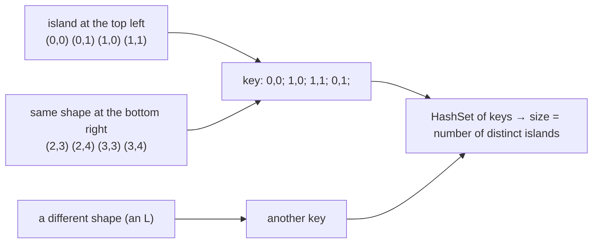

# Deduplication of Complex States

> When a state is **more than one number**, you must put **all of it** in the visited key. And when you need **unique shapes**, turn each shape into a canonical key.

#### 1. What Is It?

A **state** is everything that decides what can happen next. If your state is only `(row, col)`, but the right answer also depends on, say, how many walls you can still break, then two visits to the same cell are **different states**, and a visited set of cells will give wrong answers.

| Problem | State | Key |
|---|---|---|
| **Shortest Path in a Grid with Obstacles Elimination** (1293) | `(row, col, removals left)` | `(r · cols + c) · (k + 1) + left` |
| **Number of Distinct Islands** (694) | the **shape** of an island | a string of coordinates relative to the island's start |
| **Group Anagrams** (49) | a word | its sorted letters |
| **Shortest Path to Get All Keys** (864) | `(row, col, keys mask)` | position plus a bitmask |

**Signals:** "with at most `k` ...", "keys", "shape", "same structure", "up to rotation / translation", "group equivalent items".

#### 2. How It Works

**Rule 1: include everything that matters.** Visited must record `(position, extra info)`, or the same cell with better extra info is wrongly skipped.

```text
Grid with obstacle removal, k = 1:
cell (2, 0) reached with 1 removal left   → state (2, 0, 1)
cell (2, 0) reached with 0 removals left  → state (2, 0, 0)    a DIFFERENT state, worse
A visited set of only (2, 0) would block the better one if the worse one came first.
```

**Rule 2: encode compactly.** Combine the numbers into one `Int` or `Long` with arithmetic, or into a `String`/`data class`. A `HashSet<Long>` is much lighter than a `HashSet<List<Int>>`.

**Rule 3: canonical keys for equivalence.** To count unique shapes, record each shape in a **form that is the same for equal shapes**. For islands, write each cell's coordinates **relative to the island's first cell**, visited in a **fixed DFS order**.



```text
Distinct Islands: [[1,1,0,0,0],[1,1,0,0,0],[0,0,0,1,1],[0,0,0,1,1]]
island 1 cells (0,0) (0,1) (1,0) (1,1)  → relative to (0,0)
island 2 cells (2,3) (2,4) (3,3) (3,4)  → relative to (2,3)  → the same relative coordinates → same key
distinct islands = 1
```

**Other canonical forms:** sorted letters (anagrams), sorted tuple (unordered pair), a mask (set of keys), a normalised string (lowercase, trimmed).

#### 3. Brute Force vs Optimized

| Problem | Brute force | Set of keys |
|---|---|---|
| Distinct islands | compare every pair of shapes `O(k² · size)` | one key each, `O(total cells)` |
| Obstacle elimination | DFS over all paths, exponential | BFS with `(r, c, left)` visited, `O(R · C · k)` |
| Group anagrams | compare every pair | key = sorted letters |

```kotlin
// Brute force for distinct islands: compare shapes pairwise (sketch)
fun sameShape(a: List<Pair<Int, Int>>, b: List<Pair<Int, Int>>) = a == b      // lists of relative coordinates
// ... then compare every island with every earlier one: O(k^2) comparisons
```

#### 4. Kotlin Code

```kotlin
// Shortest Path in a Grid with Obstacles Elimination (LeetCode 1293)
fun shortestPath(grid: Array<IntArray>, k: Int): Int {
    val rows = grid.size
    val cols = grid[0].size
    if (rows == 1 && cols == 1) return 0
    val visited = HashSet<Int>()                             // key = (r * cols + c) * (k + 1) + removalsLeft
    fun key(r: Int, c: Int, left: Int) = (r * cols + c) * (k + 1) + left
    val queue = ArrayDeque<IntArray>()                       // [r, c, removalsLeft]
    queue.addLast(intArrayOf(0, 0, k))
    visited.add(key(0, 0, k))
    val dirs = arrayOf(intArrayOf(1, 0), intArrayOf(-1, 0), intArrayOf(0, 1), intArrayOf(0, -1))
    var steps = 0
    while (queue.isNotEmpty()) {
        steps++
        repeat(queue.size) {
            val (r, c, left) = queue.removeFirst()
            for ((dr, dc) in dirs) {
                val nr = r + dr
                val nc = c + dc
                if (nr !in 0 until rows || nc !in 0 until cols) continue
                val nl = left - grid[nr][nc]                 // a wall (1) costs one removal
                if (nl < 0) continue
                if (nr == rows - 1 && nc == cols - 1) return steps
                if (visited.add(key(nr, nc, nl))) queue.addLast(intArrayOf(nr, nc, nl))
            }
        }
    }
    return -1
}

// Number of Distinct Islands (LeetCode 694, premium): a canonical shape key
fun numDistinctIslands(grid: Array<IntArray>): Int {
    val rows = grid.size
    val cols = grid[0].size
    val shapes = HashSet<String>()
    fun dfs(r: Int, c: Int, r0: Int, c0: Int, sb: StringBuilder) {
        if (r !in 0 until rows || c !in 0 until cols || grid[r][c] != 1) return
        grid[r][c] = 0                                       // mark visited
        sb.append(r - r0).append(',').append(c - c0).append(';')   // relative coordinates
        dfs(r + 1, c, r0, c0, sb)                            // fixed order: down, up, right, left
        dfs(r - 1, c, r0, c0, sb)
        dfs(r, c + 1, r0, c0, sb)
        dfs(r, c - 1, r0, c0, sb)
    }
    for (r in 0 until rows) for (c in 0 until cols) {
        if (grid[r][c] == 1) {
            val sb = StringBuilder()
            dfs(r, c, r, c, sb)
            shapes.add(sb.toString())
        }
    }
    return shapes.size
}

// Group Anagrams (LeetCode 49): the key is the sorted letters
fun groupAnagrams(strs: Array<String>): List<List<String>> =
    strs.groupBy { String(it.toCharArray().also { a -> a.sort() }) }.values.toList()
```

Checks: `shortestPath(arrayOf(intArrayOf(0, 0, 0), intArrayOf(1, 1, 0), intArrayOf(0, 0, 0), intArrayOf(0, 1, 1), intArrayOf(0, 0, 0)), 1)` → `6`. `shortestPath(arrayOf(intArrayOf(0, 1, 1), intArrayOf(1, 1, 1), intArrayOf(1, 0, 0)), 1)` → `-1`. `numDistinctIslands(arrayOf(intArrayOf(1, 1, 0, 0, 0), intArrayOf(1, 1, 0, 0, 0), intArrayOf(0, 0, 0, 1, 1), intArrayOf(0, 0, 0, 1, 1)))` → `1`. `numDistinctIslands(arrayOf(intArrayOf(1, 1, 0, 1, 1), intArrayOf(1, 0, 0, 0, 0), intArrayOf(0, 0, 0, 0, 1), intArrayOf(1, 1, 0, 1, 1)))` → `3`. `groupAnagrams(arrayOf("eat", "tea", "tan", "ate", "nat", "bat"))` → `[["eat","tea","ate"],["tan","nat"],["bat"]]` (group order may differ).

#### 5. Complexity

| | Time | Space |
|---|---|---|
| Obstacle elimination | `O(R · C · k)` states | `O(R · C · k)` |
| Distinct islands | `O(R · C)` | `O(R · C)` for shapes |
| Group anagrams | `O(n · L log L)` | `O(n · L)` |

#### 6. Common Mistakes

1. **A visited key that leaves out part of the state** (wrong answers).
2. **A key that includes too much** (state explosion, memory blowup).
3. **Shape keys using absolute coordinates** (same shapes at different places look different).
4. **A different DFS order for each island** (the same shape gives different keys). Use one fixed order.
5. **Forgetting to mark visited cells** in the island DFS (or mutating a grid you must keep).
6. **Key collisions** from a bad encoding (check that every part has its own range, for example `left` in `0..k`).
7. **Putting `String` keys in a `List<Int>`** and forgetting its identity/equality semantics (it is fine with `List`, wrong with arrays).

#### 7. Say This in the Interview

1. "My state is not just the cell. It's the cell and how many obstacles I can still remove, so the visited set stores all three numbers. Otherwise I might skip a better visit."
2. "I encode the state into one integer so the set is small and fast."
3. "To count distinct shapes, I turn each island into a canonical string of coordinates relative to its first cell, using a fixed traversal order, and count the strings in a set."

#### 8. Quick Check

1. Why is `(row, col)` alone not enough for obstacle elimination?
2. Why record coordinates relative to the start cell?
3. What is the key for the cell `(1, 2)` with 1 removal left, `cols = 3`, `k = 1`?

<details>
<summary>Answers</summary>

1. Arriving with more removals left is better. One visited cell would hide that.
2. So two islands with the same shape in different places give the same key.
3. `(1 · 3 + 2) · (1 + 1) + 1 = 5 · 2 + 1 = 11`.

</details>

#### 9. Related LeetCode Questions

| # | Question | Idea |
|---|---|---|
| 1293 | [Shortest Path in a Grid with Obstacles Elimination](https://leetcode.com/problems/shortest-path-in-a-grid-with-obstacles-elimination/) (Hard) | state `(r, c, k)` |
| 694 | [Number of Distinct Islands](https://leetcode.com/problems/number-of-distinct-islands/) (Medium, premium) | canonical shape key |
| 49 | [Group Anagrams](https://leetcode.com/problems/group-anagrams/) (Medium) | sorted letters as the key |
| 864 | [Shortest Path to Get All Keys](https://leetcode.com/problems/shortest-path-to-get-all-keys/) (Hard) | state with a bitmask |
| 1306 | [Jump Game III](https://leetcode.com/problems/jump-game-iii/) (Medium) | visited indexes |
| 752 | [Open the Lock](https://leetcode.com/problems/open-the-lock/) (Medium) | state as a string (note 17) |
