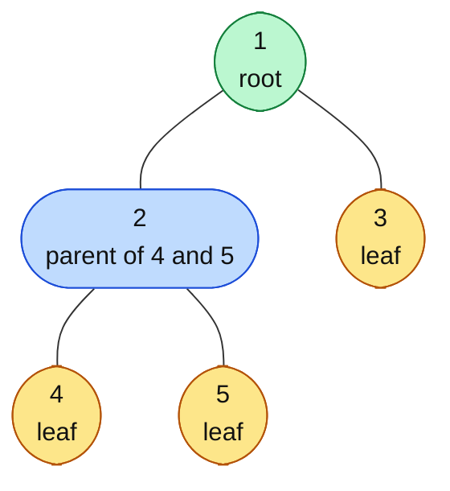

# Tree Basics

> A tree is the shape of anything with a "boss and reports" structure. Almost every FAANG tree question starts from these few words.

#### 1. What Is It?

A **tree** is a data structure for **hierarchical** data. It is made of **nodes** joined by **edges**, with **one root** at the top and **no cycles**.

- A tree with `N` nodes always has exactly `N − 1` edges.
- There is exactly **one path** between any two nodes.
- Every node except the root has **one parent**.

**Where trees appear:** file systems, the HTML DOM, company org charts, JSON, database indexes, autocomplete (Trie), and the call stack of every recursive function.

**Why interviewers love trees:** a tree is *recursive*. Every subtree is a smaller tree, so most tree problems are solved with a few lines of recursion.

#### 2. How It Works

*Node 1 is the root. Nodes 3, 4 and 5 are leaves. The nodes 2, 4, 5 form a subtree.*



| Word | Meaning | In the picture |
|---|---|---|
| **Root** | the top node, no parent | `1` |
| **Parent / child** | node directly above / below | `2` is the parent of `4` and `5` |
| **Sibling** | same parent | `4` and `5`, also `2` and `3` |
| **Leaf** | no children | `3`, `4`, `5` |
| **Ancestor / descendant** | anywhere above / below on the same path | `1` is an ancestor of `5` |
| **Subtree** | a node plus everything under it | the tree rooted at `2` |
| **Level** | distance from the root, root is level 0 | `4` is on level 2 |
| **Depth of a node** | edges from the root **down to the node** | depth of `5` is 2 |
| **Height of a node** | edges from the node **down to its deepest leaf** | height of `2` is 1, height of `1` is 2 |
| **Height of the tree** | height of the root | 2 |

**Depth looks down from the root. Height looks down from the node.** A leaf has height 0.

> **LeetCode counts nodes, not edges.** "Maximum Depth of Binary Tree" returns the number of **nodes** on the longest root-to-leaf path. Our example gives `3`, while its height in edges is `2`. Read the question carefully.

**Kinds of trees**

| Kind | Rule |
|---|---|
| Binary tree | every node has at most 2 children (note 2) |
| Binary Search Tree (BST) | binary tree where left `<` node `<` right (note 7) |
| N-ary tree | a node can have any number of children (note 21) |
| Balanced tree | height stays about `log n` (note 10) |
| Trie | a tree of characters (Trie folder) |
| Heap | a complete tree with a parent-vs-child rule (Heap folder) |

**Tree vs graph:** a tree is a connected graph with no cycle and a root. If a question gives you a tree, you never need a `visited` set, because there is only one way to reach any node.

#### 3. Brute Force vs Optimized

Why store hierarchical or sorted data in a tree instead of a list?

| Operation | Unsorted list | Sorted array | Balanced BST |
|---|---|---|---|
| Search | `O(n)` | `O(log n)` | `O(log n)` |
| Insert | `O(1)` | `O(n)` (shift) | `O(log n)` |
| Delete | `O(n)` | `O(n)` | `O(log n)` |
| Find min / max | `O(n)` | `O(1)` | `O(log n)` |

A balanced tree is the only one where **search, insert and delete are all fast**.

```kotlin
// Brute force: height by walking the tree with an explicit queue (level count)
fun heightBfs(root: TreeNode?): Int {
    if (root == null) return 0
    val queue = ArrayDeque<TreeNode>()
    queue.addLast(root)
    var levels = 0
    while (queue.isNotEmpty()) {
        repeat(queue.size) {
            val node = queue.removeFirst()
            node.left?.let { queue.addLast(it) }
            node.right?.let { queue.addLast(it) }
        }
        levels++
    }
    return levels                              // number of NODES on the longest path
}
```

The recursive version (next section) is shorter and is what you should write first.

#### 4. Kotlin Code

```kotlin
class TreeNode(
    val value: Int,
    var left: TreeNode? = null,
    var right: TreeNode? = null
)

// Count all nodes
fun countNodes(root: TreeNode?): Int {
    if (root == null) return 0
    return 1 + countNodes(root.left) + countNodes(root.right)
}

// Count leaves
fun countLeaves(root: TreeNode?): Int {
    if (root == null) return 0
    if (root.left == null && root.right == null) return 1
    return countLeaves(root.left) + countLeaves(root.right)
}

// Height in EDGES (a single node has height 0; an empty tree has -1)
fun height(root: TreeNode?): Int {
    if (root == null) return -1
    return 1 + maxOf(height(root.left), height(root.right))
}
```

Tree used for the checks: `val root = TreeNode(1, TreeNode(2, TreeNode(4), TreeNode(5)), TreeNode(3))`

Checks: `countNodes(root)` → `5`. `countLeaves(root)` → `3`. `height(root)` → `2`. `heightBfs(root)` → `3` (nodes). `height(null)` → `-1`. `countNodes(null)` → `0`.

The one idea behind every tree solution:

```text
solve(node):
    if node is null: return the base answer
    left  = solve(node.left)
    right = solve(node.right)
    return combine(node, left, right)
```

#### 5. Complexity

| | Time | Space |
|---|---|---|
| Visit every node (count, height, leaves) | `O(n)` | `O(h)` recursion stack |
| Balanced tree, `h` | `O(log n)` | |
| Skewed tree (a chain), `h` | `O(n)` | |

`h` is the height. Space `O(h)` is the call stack, not extra data.

#### 6. Common Mistakes

1. **Mixing up depth and height.** Depth goes down from the root. Height goes down from the node.
2. **Counting nodes vs edges.** LeetCode answers count nodes.
3. **Forgetting `root == null`.** Every recursive function needs it first.
4. **Saying "tree" when the input may have a cycle or two roots.** Then it is a graph.
5. **Assuming the tree is balanced.** It may be a chain, so recursion depth is `n`.
6. **Confusing leaf with "a node with one child missing".** A leaf has **no** children.

#### 7. Say This in the Interview

1. "A tree with `n` nodes has `n − 1` edges, and each subtree is itself a tree, so I'll solve it with recursion."
2. "The base case is a null node. Then I combine the answers of the left and right subtrees."
3. "Time is `O(n)` because I visit each node once. Space is `O(h)` for the call stack: `O(log n)` if balanced, `O(n)` if skewed."

#### 8. Quick Check

1. A tree has 7 nodes. How many edges?
2. What is the height (in edges) of a tree with only a root?
3. A leaf is at depth 3. What is its height?

<details>
<summary>Answers</summary>

1. `6` (`N − 1`).
2. `0`.
3. `0`. Every leaf has height 0, whatever its depth.

</details>

#### 9. Related LeetCode Questions

| # | Question | Idea |
|---|---|---|
| 104 | [Maximum Depth of Binary Tree](https://leetcode.com/problems/maximum-depth-of-binary-tree/) (Easy) | recursion, nodes |
| 111 | [Minimum Depth of Binary Tree](https://leetcode.com/problems/minimum-depth-of-binary-tree/) (Easy) | careful with one child |
| 226 | [Invert Binary Tree](https://leetcode.com/problems/invert-binary-tree/) (Easy) | swap children |
| 100 | [Same Tree](https://leetcode.com/problems/same-tree/) (Easy) | compare two trees |
| 222 | [Count Complete Tree Nodes](https://leetcode.com/problems/count-complete-tree-nodes/) (Easy) | counting with a shortcut |
| 543 | [Diameter of Binary Tree](https://leetcode.com/problems/diameter-of-binary-tree/) (Easy) | height + global best |
