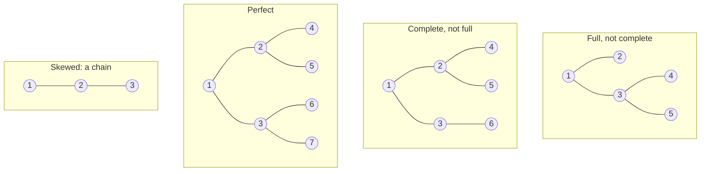

# Binary Tree

> A tree where each node has at most two children, called **left** and **right**. Most tree questions on LeetCode are about binary trees.

#### 1. What Is It?

A **binary tree** is a tree where every node has **0, 1 or 2 children**. The two children have names: `left` and `right`. They are **not interchangeable**: a node with only a right child is different from a node with only a left child.

Why it matters: it is the base of **BST** (searching), **heap** (priority queue), **expression trees**, and nearly all tree interview questions.

**Names for special shapes. Learn these, they are asked often:**

| Shape | Rule |
|---|---|
| **Full** (strict) | every node has **0 or 2** children |
| **Complete** | all levels are full except maybe the last, and the last is filled **from the left** |
| **Perfect** | all internal nodes have 2 children and all leaves are on the **same level** |
| **Balanced** | the left and right heights of every node differ by at most 1 |
| **Skewed** (degenerate) | every node has one child: it is a linked list |

#### 2. How It Works

*The same 7 nodes (or fewer) in different shapes.*



**Facts to remember** (height `h` counted in edges, so a single node has `h = 0`):

| Fact | Formula |
|---|---|
| Max nodes on level `i` | `2^i` |
| Max nodes in a tree of height `h` | `2^(h+1) − 1` |
| Min height of a tree with `n` nodes | `⌊log₂ n⌋` |
| Perfect tree with `n` nodes | height `log₂(n + 1) − 1` |
| Leaves in a full binary tree | internal nodes + 1 |

**Complete tree trick (Count Complete Tree Nodes).** If the left-most path and the right-most path have the same length, the tree is **perfect** and has `2^depth − 1` nodes, with no counting needed. If not, count the two subtrees recursively. Only one side is ever non-perfect at each level, so this costs `O(log² n)`, not `O(n)`.

**Check "complete" with BFS.** Walk level by level, including the `null` children. Once you have seen a `null`, you must never see a real node again.

#### 3. Brute Force vs Optimized

| Problem | Brute force | Optimized |
|---|---|---|
| Count nodes of a complete tree | visit every node, `O(n)` | compare left and right depth, `O(log² n)` |
| Is it complete? | build an array and check indexes | BFS with a "seen null" flag, `O(n)` |

```kotlin
// Brute force: just count every node
fun countNodesBrute(root: TreeNode?): Int =
    if (root == null) 0 else 1 + countNodesBrute(root.left) + countNodesBrute(root.right)
```

#### 4. Kotlin Code

```kotlin
// Full binary tree: every node has 0 or 2 children
fun isFull(root: TreeNode?): Boolean {
    if (root == null) return true
    if ((root.left == null) != (root.right == null)) return false     // exactly one child
    return isFull(root.left) && isFull(root.right)
}

// Complete binary tree: BFS, nulls may only appear at the end
fun isComplete(root: TreeNode?): Boolean {
    if (root == null) return true
    val queue = ArrayDeque<TreeNode?>()
    queue.addLast(root)
    var seenNull = false
    while (queue.isNotEmpty()) {
        val node = queue.removeFirst()
        if (node == null) {
            seenNull = true
        } else {
            if (seenNull) return false                 // a real node after a gap
            queue.addLast(node.left)
            queue.addLast(node.right)
        }
    }
    return true
}

// Count Complete Tree Nodes (LeetCode 222): O(log^2 n)
fun countCompleteNodes(root: TreeNode?): Int {
    if (root == null) return 0
    var l = 0
    var r = 0
    var a = root
    var b = root
    while (a != null) { l++; a = a.left }              // length of the left-most path
    while (b != null) { r++; b = b.right }             // length of the right-most path
    if (l == r) return (1 shl l) - 1                   // perfect tree: 2^l - 1 nodes
    return 1 + countCompleteNodes(root.left) + countCompleteNodes(root.right)
}
```

Trees for the checks:

- `a = TreeNode(1, TreeNode(2), TreeNode(3, TreeNode(4), TreeNode(5)))` is full but not complete.
- `b = TreeNode(1, TreeNode(2, TreeNode(4), TreeNode(5)), TreeNode(3, TreeNode(6)))` is complete but not full.

Checks: `isFull(a)` → `true`. `isFull(b)` → `false` (node 3 has one child). `isComplete(a)` → `false`. `isComplete(b)` → `true`. `countCompleteNodes(b)` → `6`. A perfect tree of 7 nodes → `7`.

Trace `countCompleteNodes(b)`: left path `1,2,4` = 3, right path `1,3` = 2, not equal, so `1 + count(2) + count(3)`. `count(2)`: both paths have length 2, so `2² − 1 = 3`. `count(3)`: left path `3,6` = 2, right path `3` = 1, so `1 + count(6) + count(null) = 1 + 1 + 0 = 2`. Total `1 + 3 + 2 = 6`.

#### 5. Complexity

| | Time | Space |
|---|---|---|
| `isFull` | `O(n)` | `O(h)` |
| `isComplete` (BFS) | `O(n)` | `O(n)` |
| `countCompleteNodes` | `O(log² n)` | `O(log n)` |

#### 6. Common Mistakes

1. **Mixing up full, complete and perfect.** Perfect is the strongest: it is both full and complete.
2. **"Complete" checked only by node counts.** The last level must also be filled left to right.
3. **Ignoring `null` children in the BFS** for `isComplete`. You must enqueue them to see the gaps.
4. **Using `2^h` instead of `2^(h+1) − 1`** for the node count.
5. **Counting a one-child node as a leaf.** A leaf has no children.

#### 7. Say This in the Interview

1. "A binary tree has at most two children per node. Left and right are different positions."
2. "A complete tree is filled level by level from the left. That is exactly the shape a heap uses, so it can be stored in an array."
3. "For a complete tree, if the left and right depth match, the subtree is perfect and I can use `2^d − 1` without visiting it."

#### 8. Quick Check

1. How many nodes does a perfect binary tree of height 3 (edges) have?
2. Is a tree where every node has exactly one child complete?
3. Can a full binary tree have exactly 4 nodes?

<details>
<summary>Answers</summary>

1. `2^(3+1) − 1 = 15`.
2. Only if it has 1 or 2 nodes. With 3 or more nodes a chain is not complete (the second level would have a missing left child).
3. No. A full binary tree has `internal + 1` leaves, so the node count is always odd (1, 3, 5, ...).

</details>

#### 9. Related LeetCode Questions

| # | Question | Idea |
|---|---|---|
| 222 | [Count Complete Tree Nodes](https://leetcode.com/problems/count-complete-tree-nodes/) (Easy) | perfect-subtree shortcut |
| 958 | [Check Completeness of a Binary Tree](https://leetcode.com/problems/check-completeness-of-a-binary-tree/) (Medium) | BFS with a null flag |
| 110 | [Balanced Binary Tree](https://leetcode.com/problems/balanced-binary-tree/) (Easy) | heights (note 10) |
| 894 | [All Possible Full Binary Trees](https://leetcode.com/problems/all-possible-full-binary-trees/) (Medium) | recursion on sizes |
| 226 | [Invert Binary Tree](https://leetcode.com/problems/invert-binary-tree/) (Easy) | swap left and right |
