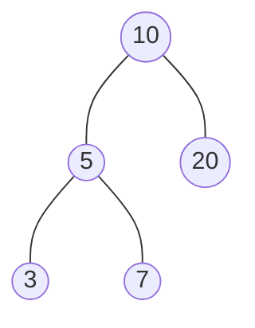

# Tree Representation / TreeNode

> How a tree lives in memory, and how to build one quickly for your own tests. Most LeetCode problems give you a `TreeNode`.

#### 1. What Is It?

A **`TreeNode`** is one element of a tree. It stores a **value** and references to its **children**. You hold only the `root`. Every other node is reached by following child references.

There are three common ways to store a tree:

| Way | Node holds | Best for |
|---|---|---|
| **Linked nodes** (default) | `value`, `left`, `right` | any binary tree, all interview questions |
| **N-ary node** | `value`, a list of `children` | file systems, DOM, org charts |
| **Array** | nothing but values; position gives the shape | **complete** trees (heap) |

#### 2. How It Works

**Linked nodes.** `null` means "no child here".



```text
root → 10
10.left → 5      10.right → 20
5.left  → 3      5.right  → 7
3, 7, 20 have left = null and right = null
```

**Array form for a complete tree.** Store the nodes level by level. Then for the node at index `i` (starting at 0):

| Relation | Index |
|---|---|
| left child | `2i + 1` |
| right child | `2i + 2` |
| parent | `(i − 1) / 2` |

```text
tree:   1            array: [1, 2, 3, 4, 5, 6]
       / \                    0  1  2  3  4  5
      2   3
     / \ /           left child of index 1 (value 2) = index 3 (value 4)
    4  5 6           parent of index 5 (value 6)    = (5 - 1) / 2 = index 2 (value 3)
```

This is exactly how a **heap** is stored (Heap folder). It wastes space for non-complete trees, so it is not used for general trees.

**LeetCode's input format.** Tests are written as a level-order list with `null` for missing children: `[1,2,3,null,null,4,5]`. Reading it:

```text
level 0: 1
level 1: 2 3                (children of 1)
level 2: null null 4 5      (2 has no children; 3 has children 4 and 5)
```

You should be able to **draw the tree from the list** in 20 seconds, and **write a small helper to build it** for your own tests.

#### 3. Brute Force vs Optimized

| Task | Naive | Better |
|---|---|---|
| Build many test trees | write long nested `TreeNode(...)` calls | one `buildTree(listOf(...))` helper |
| Store a *complete* tree | nodes with pointers (`2` pointers per node) | array with index math (no pointers) |
| Print a tree to debug | guess | level-order list with `null` |

```kotlin
// Naive: nested constructors get hard to read for big trees
val t = TreeNode(1, TreeNode(2), TreeNode(3, TreeNode(4), TreeNode(5)))
```

#### 4. Kotlin Code

```kotlin
class TreeNode(
    val value: Int,
    var left: TreeNode? = null,
    var right: TreeNode? = null
)

// N-ary node: any number of children
class NaryNode(val value: Int, val children: MutableList<NaryNode> = mutableListOf())

// Build a binary tree from LeetCode's level-order format
fun buildTree(values: List<Int?>): TreeNode? {
    if (values.isEmpty() || values[0] == null) return null
    val root = TreeNode(values[0]!!)
    val queue = ArrayDeque<TreeNode>()
    queue.addLast(root)
    var i = 1
    while (queue.isNotEmpty() && i < values.size) {
        val node = queue.removeFirst()
        val leftValue = values[i++]
        if (leftValue != null) {
            node.left = TreeNode(leftValue)
            queue.addLast(node.left!!)
        }
        if (i < values.size) {
            val rightValue = values[i++]
            if (rightValue != null) {
                node.right = TreeNode(rightValue)
                queue.addLast(node.right!!)
            }
        }
    }
    return root
}

// Turn a tree back into a level-order list (nulls inside, trailing nulls removed)
fun toLevelList(root: TreeNode?): List<Int?> {
    val result = mutableListOf<Int?>()
    val queue = ArrayDeque<TreeNode?>()
    queue.addLast(root)
    while (queue.isNotEmpty()) {
        val node = queue.removeFirst()
        if (node == null) { result.add(null); continue }
        result.add(node.value)
        queue.addLast(node.left)
        queue.addLast(node.right)
    }
    while (result.isNotEmpty() && result.last() == null) result.removeAt(result.size - 1)
    return result
}

// Array form of a complete tree
fun leftChild(i: Int) = 2 * i + 1
fun rightChild(i: Int) = 2 * i + 2
fun parent(i: Int) = (i - 1) / 2
```

Checks: `toLevelList(buildTree(listOf(1, 2, 3, null, null, 4, 5)))` → `[1, 2, 3, null, null, 4, 5]`. `buildTree(listOf(1, 2, 3, null, null, 4, 5))` has root `1`, `root.left.value = 2` (a leaf), `root.right.left.value = 4`. `buildTree(emptyList())` → `null`. `leftChild(1)` → `3`, `rightChild(1)` → `4`, `parent(5)` → `2`.

In the following notes, `buildTree(...)` means this helper.

#### 5. Complexity

| | Time | Space |
|---|---|---|
| Create or access a node | `O(1)` | `O(1)` |
| `buildTree`, `toLevelList` | `O(n)` | `O(n)` queue |
| Array index math | `O(1)` | none |
| Reaching a node from the root | `O(h)` | |

#### 6. Common Mistakes

1. **Reading the list as "children of the previous item".** The list is by **level**, and `null`s mark the missing slots under real nodes only.
2. **Forgetting that `null`s do not have children** in the list. After a `null` there are no extra `null`s for its children.
3. **Using the array formulas for a tree that is not complete.** They only work when no gap exists (or you accept wasted slots).
4. **Mutating `value`** when it is a `val`. To "change a value" you replace the node (see note 8).
5. **Using `!!` on a child that may be null.** Use `?.` or an explicit check.

#### 7. Say This in the Interview

1. "A tree node stores a value and two nullable references. I only hold the root."
2. "The input `[1,2,3,null,null,4,5]` is level order. Node 2 has no children, and node 3 has children 4 and 5."
3. "A complete tree can be stored in an array: the children of `i` are `2i + 1` and `2i + 2`. That is how heaps work."

#### 8. Quick Check

1. In the list `[5, 3, 8, 1, null, null, 9]`, who are the children of `3`? Of `8`?
2. A heap array is `[10, 8, 9, 4, 5]`. Who are the children of `9`?

<details>
<summary>Answers</summary>

1. `3` has left child `1` and no right child. `8` has no left child and right child `9`.
2. Index of `9` is 2. Children are indexes `5` and `6`, which do not exist, so `9` is a leaf.

</details>

#### 9. Related LeetCode Questions

| # | Question | Idea |
|---|---|---|
| 104 | [Maximum Depth of Binary Tree](https://leetcode.com/problems/maximum-depth-of-binary-tree/) (Easy) | read a list, use recursion |
| 108 | [Convert Sorted Array to Binary Search Tree](https://leetcode.com/problems/convert-sorted-array-to-binary-search-tree/) (Easy) | build a tree from an array |
| 105 | [Construct Binary Tree from Preorder and Inorder Traversal](https://leetcode.com/problems/construct-binary-tree-from-preorder-and-inorder-traversal/) (Medium) | build a tree (note 15) |
| 297 | [Serialize and Deserialize Binary Tree](https://leetcode.com/problems/serialize-and-deserialize-binary-tree/) (Hard) | tree to text and back (note 16) |
| 559 | [Maximum Depth of N-ary Tree](https://leetcode.com/problems/maximum-depth-of-n-ary-tree/) (Easy) | N-ary node |
