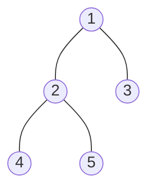

# DFS Traversal

> Go as deep as you can down one branch, then come back. Preorder, inorder and postorder are the same DFS with the "visit" at a different moment.

#### 1. What Is It?

**DFS (depth-first search)** explores one branch fully before it tries the next. On a tree it is a recursion over `left` and `right`.

The three orders differ only in **when you process the node**:

| Order | Visit order | Use |
|---|---|---|
| **Preorder** | node, left, right | copy a tree, serialize, "process the parent first" |
| **Inorder** | left, node, right | **BST gives sorted order**, kth smallest, validate BST |
| **Postorder** | left, right, node | height, diameter, delete a tree, "need children first" |

DFS is the default for **path, subtree, height and recursive dependency** problems. Use BFS (note 5) for **levels**.

#### 2. How It Works



```text
Preorder   (node, left, right):  1 → 2 → 4 → 5 → 3
Inorder    (left, node, right):  4 → 2 → 5 → 1 → 3
Postorder  (left, right, node):  4 → 5 → 2 → 3 → 1
```

**Where the "visit" line goes**

```text
dfs(node):
    if node is null: return
    [preorder: process node here]
    dfs(node.left)
    [inorder: process node here]
    dfs(node.right)
    [postorder: process node here]
```

**Two ways to pass information**

| Style | Idea | Examples |
|---|---|---|
| **Top-down** | pass data from parent to child (parameters) | current depth, remaining sum, bounds |
| **Bottom-up** | return data from child to parent | height, diameter, balanced, max path sum |

**Iterative DFS** uses your own stack (LIFO). Push the right child first so the left is processed first. The recursion's call stack does the same job automatically.

**Postorder iteratively:** run "node, right, left" with a stack, then **reverse** the result.

#### 3. Brute Force vs Optimized

| Approach | Time | Space | Note |
|---|---|---|---|
| Recursive DFS | `O(n)` | `O(h)` stack | shortest code, use first |
| Iterative DFS (own stack) | `O(n)` | `O(h)` | safe when depth may be 100,000 |
| Morris traversal | `O(n)` | `O(1)` | temporary links, advanced, rarely needed |

If the tree can be a long chain (10⁵ nodes), the recursive version can hit `StackOverflowError` on the JVM. Say it, and offer the iterative version.

#### 4. Kotlin Code

```kotlin
class TreeNode(val value: Int, var left: TreeNode? = null, var right: TreeNode? = null)

// Recursive versions (LeetCode 144, 94, 145)
fun preorder(root: TreeNode?, out: MutableList<Int> = mutableListOf()): List<Int> {
    if (root == null) return out
    out.add(root.value)
    preorder(root.left, out)
    preorder(root.right, out)
    return out
}

fun inorder(root: TreeNode?, out: MutableList<Int> = mutableListOf()): List<Int> {
    if (root == null) return out
    inorder(root.left, out)
    out.add(root.value)
    inorder(root.right, out)
    return out
}

fun postorder(root: TreeNode?, out: MutableList<Int> = mutableListOf()): List<Int> {
    if (root == null) return out
    postorder(root.left, out)
    postorder(root.right, out)
    out.add(root.value)
    return out
}

// Iterative preorder: push right first
fun preorderIterative(root: TreeNode?): List<Int> {
    val out = mutableListOf<Int>()
    if (root == null) return out
    val stack = ArrayDeque<TreeNode>()
    stack.addLast(root)
    while (stack.isNotEmpty()) {
        val node = stack.removeLast()
        out.add(node.value)
        node.right?.let { stack.addLast(it) }
        node.left?.let { stack.addLast(it) }
    }
    return out
}

// Iterative inorder: go left as far as possible, then pop and go right
fun inorderIterative(root: TreeNode?): List<Int> {
    val out = mutableListOf<Int>()
    val stack = ArrayDeque<TreeNode>()
    var cur = root
    while (cur != null || stack.isNotEmpty()) {
        while (cur != null) {
            stack.addLast(cur)
            cur = cur.left
        }
        val node = stack.removeLast()
        out.add(node.value)
        cur = node.right
    }
    return out
}

// Iterative postorder: (node, right, left) and reverse
fun postorderIterative(root: TreeNode?): List<Int> {
    val out = mutableListOf<Int>()
    if (root == null) return out
    val stack = ArrayDeque<TreeNode>()
    stack.addLast(root)
    while (stack.isNotEmpty()) {
        val node = stack.removeLast()
        out.add(node.value)
        node.left?.let { stack.addLast(it) }
        node.right?.let { stack.addLast(it) }
    }
    return out.reversed()
}
```

Tree: `val root = TreeNode(1, TreeNode(2, TreeNode(4), TreeNode(5)), TreeNode(3))`

Checks: `preorder(root)` → `[1, 2, 4, 5, 3]`. `inorder(root)` → `[4, 2, 5, 1, 3]`. `postorder(root)` → `[4, 5, 2, 3, 1]`. The three iterative versions give the same lists. `preorder(null)` → `[]`.

Dry run of `inorderIterative` on the tree:

```text
cur=1: push 1, cur=2 → push 2, cur=4 → push 4, cur=null.   stack [1,2,4]
pop 4 → out [4].  cur = 4.right = null
pop 2 → out [4,2]. cur = 5 → push 5, cur = null.  stack [1,5]
pop 5 → out [4,2,5]. cur = null
pop 1 → out [4,2,5,1]. cur = 3 → push 3. pop 3 → out [4,2,5,1,3]
```

#### 5. Complexity

| | Time | Space |
|---|---|---|
| Any DFS traversal | `O(n)`, each node once | `O(h)` stack |
| Balanced tree | `O(n)` | `O(log n)` |
| Skewed tree | `O(n)` | `O(n)` |
| Morris traversal | `O(n)` | `O(1)` |

#### 6. Common Mistakes

1. **No base case.** Always `if (root == null) return` first.
2. **Pushing left before right** in iterative preorder. You will visit the right side first.
3. **Postorder iterative:** forgetting to reverse, or pushing in the wrong order.
4. **Using the wrong order for the job.** Need a sorted BST list? Inorder. Need children results? Postorder.
5. **Mutating a shared list in recursion** without a plan (copy when saving a path).
6. **Recursion on a 10⁵-deep chain.** It can overflow the stack.

#### 7. Say This in the Interview

1. "I'll use DFS. Preorder if I need the parent first, inorder for a BST, and postorder if I need the children first."
2. "Time is `O(n)` since each node is visited once. Space is `O(h)` for the call stack."
3. "If the tree can be very deep, I'll switch to an explicit stack to avoid a stack overflow."

#### 8. Quick Check

1. Which traversal of a BST gives sorted values?
2. Preorder is `[1, 2, 3]` and inorder is `[2, 1, 3]`. What is the tree?
3. Why push the right child before the left in iterative preorder?

<details>
<summary>Answers</summary>

1. Inorder.
2. Root `1`, left child `2`, right child `3`.
3. A stack is last-in-first-out. The left child is pushed last, so it is popped first.

</details>

#### 9. Related LeetCode Questions

| # | Question | Idea |
|---|---|---|
| 144 | [Binary Tree Preorder Traversal](https://leetcode.com/problems/binary-tree-preorder-traversal/) (Easy) | node, left, right |
| 94 | [Binary Tree Inorder Traversal](https://leetcode.com/problems/binary-tree-inorder-traversal/) (Easy) | left, node, right |
| 145 | [Binary Tree Postorder Traversal](https://leetcode.com/problems/binary-tree-postorder-traversal/) (Easy) | iterative: reverse |
| 104 | [Maximum Depth of Binary Tree](https://leetcode.com/problems/maximum-depth-of-binary-tree/) (Easy) | bottom-up |
| 230 | [Kth Smallest Element in a BST](https://leetcode.com/problems/kth-smallest-element-in-a-bst/) (Medium) | iterative inorder |
| 114 | [Flatten Binary Tree to Linked List](https://leetcode.com/problems/flatten-binary-tree-to-linked-list/) (Medium) | preorder idea |
