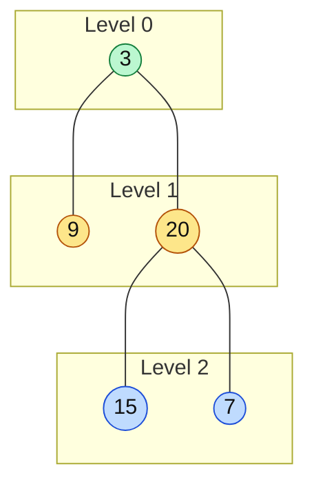

# BFS / Level Order Traversal

> Visit the tree one level at a time, with a queue. Use it for anything that says "level", "row", "side view" or "minimum depth".

#### 1. What Is It?

**BFS (breadth-first search)** on a tree visits the root, then all nodes on level 1, then all nodes on level 2, and so on. It uses a **queue** (first in, first out).

**Signals**

- "level order", "by level", "each row"
- "right side view", "left side view"
- "minimum depth" (the first leaf found is the closest)
- "zigzag", "average of each level", "largest value in each row"

BFS vs DFS on a tree:

| | BFS | DFS |
|---|---|---|
| Order | level by level | branch by branch |
| Uses | queue | recursion or stack |
| Memory | `O(width)` (widest level) | `O(height)` |
| Best for | levels, nearest leaf | paths, subtree values, height |

#### 2. How It Works



**The key trick: process one level at a time.** Read `queue.size` **before** the inner loop. That number is exactly the nodes on the current level.

```text
queue = [3]
level 0: size = 1 → take 3, add 9, 20          level = [3]        queue = [9, 20]
level 1: size = 2 → take 9 (no kids), take 20, add 15, 7
                                               level = [9, 20]    queue = [15, 7]
level 2: size = 2 → take 15, take 7            level = [15, 7]    queue = []
result: [[3], [9, 20], [15, 7]]
```

**Variants (same loop, different "level" handling)**

| Question | Change |
|---|---|
| Right side view | keep the **last** node of each level |
| Left side view | keep the **first** node of each level |
| Average / sum / max per level | compute from the level's values |
| Zigzag (note 19) | reverse every second level |
| Minimum depth | stop at the **first leaf** |
| Level order bottom-up | reverse the final list |

#### 3. Brute Force vs Optimized

| Approach | Idea | Time | Space |
|---|---|---|---|
| DFS with a `depth` parameter | add the value to `result[depth]` | `O(n)` | `O(h)` + output |
| BFS with a queue | one level per loop | `O(n)` | `O(width)` |

Both are `O(n)`. BFS is the standard answer. The DFS version is a nice alternative if the interviewer asks for recursion.

```kotlin
// DFS alternative: use the depth to pick the right list
fun levelOrderDfs(root: TreeNode?): List<List<Int>> {
    val result = mutableListOf<MutableList<Int>>()
    fun dfs(node: TreeNode?, depth: Int) {
        if (node == null) return
        if (depth == result.size) result.add(mutableListOf())
        result[depth].add(node.value)
        dfs(node.left, depth + 1)
        dfs(node.right, depth + 1)
    }
    dfs(root, 0)
    return result
}
```

#### 4. Kotlin Code

```kotlin
// Binary Tree Level Order Traversal (LeetCode 102)
fun levelOrder(root: TreeNode?): List<List<Int>> {
    val result = mutableListOf<List<Int>>()
    if (root == null) return result
    val queue = ArrayDeque<TreeNode>()
    queue.addLast(root)
    while (queue.isNotEmpty()) {
        val size = queue.size                          // nodes on this level
        val level = mutableListOf<Int>()
        repeat(size) {
            val node = queue.removeFirst()
            level.add(node.value)
            node.left?.let { queue.addLast(it) }
            node.right?.let { queue.addLast(it) }
        }
        result.add(level)
    }
    return result
}

// Average of Levels (LeetCode 637)
fun averageOfLevels(root: TreeNode?): List<Double> {
    val result = mutableListOf<Double>()
    if (root == null) return result
    val queue = ArrayDeque<TreeNode>()
    queue.addLast(root)
    while (queue.isNotEmpty()) {
        val size = queue.size
        var sum = 0L
        repeat(size) {
            val node = queue.removeFirst()
            sum += node.value
            node.left?.let { queue.addLast(it) }
            node.right?.let { queue.addLast(it) }
        }
        result.add(sum.toDouble() / size)
    }
    return result
}

// Minimum Depth (LeetCode 111): the first leaf found is the answer
fun minDepthBfs(root: TreeNode?): Int {
    if (root == null) return 0
    val queue = ArrayDeque<TreeNode>()
    queue.addLast(root)
    var depth = 0
    while (queue.isNotEmpty()) {
        depth++
        repeat(queue.size) {
            val node = queue.removeFirst()
            if (node.left == null && node.right == null) return depth
            node.left?.let { queue.addLast(it) }
            node.right?.let { queue.addLast(it) }
        }
    }
    return depth
}

// Level order bottom-up (LeetCode 107)
fun levelOrderBottom(root: TreeNode?): List<List<Int>> = levelOrder(root).reversed()
```

Tree: `val root = buildTree(listOf(3, 9, 20, null, null, 15, 7))` (`buildTree` is in note 3).

Checks: `levelOrder(root)` → `[[3], [9, 20], [15, 7]]`. `levelOrderDfs(root)` → same. `averageOfLevels(root)` → `[3.0, 14.5, 11.0]`. `minDepthBfs(root)` → `2` (leaf `9` is on level 1, counted as 2 nodes). `levelOrderBottom(root)` → `[[15, 7], [9, 20], [3]]`. `levelOrder(null)` → `[]`.

#### 5. Complexity

| | Time | Space |
|---|---|---|
| Level order (BFS) | `O(n)` | `O(w)`, `w` = widest level (up to `n / 2`) |
| Level order (DFS) | `O(n)` | `O(h)` + output |
| Min depth (BFS) | `O(n)` worst, often much less | `O(w)` |

#### 6. Common Mistakes

1. **Using `queue.size` inside the loop condition.** It changes as you add children. Save it first.
2. **Using a `MutableList` as a queue** and calling `removeAt(0)` (`O(n)`). Use `ArrayDeque`.
3. **Forgetting `root == null`.**
4. **Minimum depth with one child:** a node with one child is **not** a leaf. Do not stop there.
5. **Adding `null` children to the queue** and then crashing on them.
6. **Integer overflow** when summing a level. Use `Long`.

#### 7. Say This in the Interview

1. "Level order needs a queue. I read the queue size at the start of each round, so I know exactly how many nodes belong to this level."
2. "Time `O(n)`. Space is `O(w)`, the widest level, up to about `n / 2` in a complete tree."
3. "For minimum depth, BFS is better than DFS: it stops at the first leaf instead of visiting the whole tree."

#### 8. Quick Check

1. What does `levelOrder` return for a tree with only the root `7`?
2. For the right side view, which node of each level do you keep?

<details>
<summary>Answers</summary>

1. `[[7]]`.
2. The last node of the level (the right-most one).

</details>

#### 9. Related LeetCode Questions

| # | Question | Idea |
|---|---|---|
| 102 | [Binary Tree Level Order Traversal](https://leetcode.com/problems/binary-tree-level-order-traversal/) (Medium) | queue + level size |
| 107 | [Binary Tree Level Order Traversal II](https://leetcode.com/problems/binary-tree-level-order-traversal-ii/) (Medium) | reverse the result |
| 637 | [Average of Levels in Binary Tree](https://leetcode.com/problems/average-of-levels-in-binary-tree/) (Easy) | sum per level |
| 111 | [Minimum Depth of Binary Tree](https://leetcode.com/problems/minimum-depth-of-binary-tree/) (Easy) | first leaf |
| 199 | [Binary Tree Right Side View](https://leetcode.com/problems/binary-tree-right-side-view/) (Medium) | last of each level |
| 103 | [Binary Tree Zigzag Level Order Traversal](https://leetcode.com/problems/binary-tree-zigzag-level-order-traversal/) (Medium) | reverse alternate levels |
| 515 | [Find Largest Value in Each Tree Row](https://leetcode.com/problems/find-largest-value-in-each-tree-row/) (Medium) | max per level |
