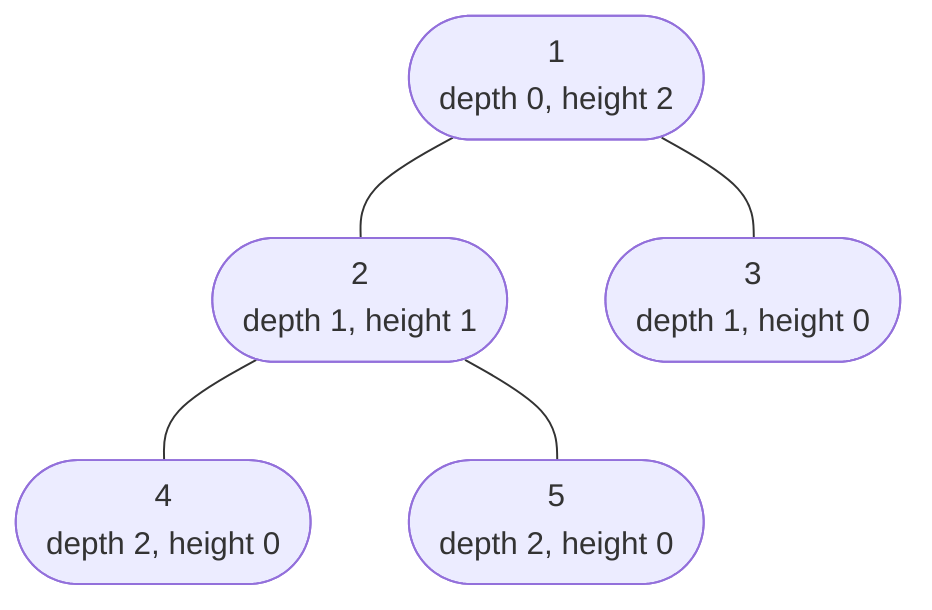

# Height / Depth of Tree

> The first real tree recursion. Height, max depth and min depth are the pattern behind balanced, diameter and max path sum.

#### 1. What Is It?

- **Depth of a node** = edges from the root down to that node.
- **Height of a node** = edges from that node down to its deepest leaf.
- **Maximum depth of a tree** (LeetCode 104) = the number of **nodes** on the longest root-to-leaf path. This equals `height + 1`.
- **Minimum depth** (LeetCode 111) = the number of nodes on the **shortest** root-to-**leaf** path.

**Signals:** "how deep", "longest path from root", "closest leaf", "is the tree balanced".

#### 2. How It Works



**Max depth** is a bottom-up recursion:

```text
maxDepth(null) = 0
maxDepth(node) = 1 + max(maxDepth(left), maxDepth(right))
```

```text
maxDepth(4) = 1 + max(0, 0) = 1        maxDepth(5) = 1
maxDepth(2) = 1 + max(1, 1) = 2        maxDepth(3) = 1
maxDepth(1) = 1 + max(2, 1) = 3
```

**Min depth has a trap.** If a node has only one child, the missing side is **not** a leaf, so it must not give a depth of 1.

```text
    1
     \
      2          minDepth = 2   (the only leaf is 2)
                 NOT 1: node 1 is not a leaf, it has a right child
```

Rule: if one child is `null`, take the depth of the **other** child. Only when both children exist take the `min`.

**Depth of a given node (top-down).** Pass the current depth down the recursion, and return it when you find the target.

#### 3. Brute Force vs Optimized

| Approach | Time | Space | Note |
|---|---|---|---|
| Recursive DFS | `O(n)` | `O(h)` | the standard answer |
| BFS, count levels | `O(n)` | `O(w)` | no recursion, good for very deep trees |
| Naive: recompute heights in every call | `O(n²)` | `O(h)` | the mistake behind slow "balanced" and "diameter" solutions (notes 10, 11) |

```kotlin
// Iterative max depth with a stack of (node, depth). No recursion, so no stack overflow.
fun maxDepthIterative(root: TreeNode?): Int {
    if (root == null) return 0
    val stack = ArrayDeque<Pair<TreeNode, Int>>()
    stack.addLast(root to 1)
    var best = 0
    while (stack.isNotEmpty()) {
        val (node, depth) = stack.removeLast()
        best = maxOf(best, depth)
        node.left?.let { stack.addLast(it to depth + 1) }
        node.right?.let { stack.addLast(it to depth + 1) }
    }
    return best
}
```

#### 4. Kotlin Code

```kotlin
// Maximum Depth of Binary Tree (LeetCode 104): number of nodes on the longest path
fun maxDepth(root: TreeNode?): Int {
    if (root == null) return 0
    return 1 + maxOf(maxDepth(root.left), maxDepth(root.right))
}

// Minimum Depth of Binary Tree (LeetCode 111)
fun minDepth(root: TreeNode?): Int {
    if (root == null) return 0
    if (root.left == null) return 1 + minDepth(root.right)     // only a right child
    if (root.right == null) return 1 + minDepth(root.left)     // only a left child
    return 1 + minOf(minDepth(root.left), minDepth(root.right))
}

// Depth (in edges) of the node with a given value, or -1 if it is not in the tree
fun depthOf(root: TreeNode?, target: Int, depth: Int = 0): Int {
    if (root == null) return -1
    if (root.value == target) return depth
    val left = depthOf(root.left, target, depth + 1)
    if (left != -1) return left
    return depthOf(root.right, target, depth + 1)
}

// Height of a given node in edges, using the same idea
fun heightInEdges(root: TreeNode?): Int =
    if (root == null) -1 else 1 + maxOf(heightInEdges(root.left), heightInEdges(root.right))
```

Trees:

- `t = TreeNode(1, TreeNode(2, TreeNode(4), TreeNode(5)), TreeNode(3))`
- `chain = TreeNode(1, null, TreeNode(2, null, TreeNode(3)))` (a right-skewed chain)

Checks: `maxDepth(t)` → `3`. `minDepth(t)` → `2` (path `1 → 3`). `maxDepth(chain)` → `3`. `minDepth(chain)` → `3`, **not** `1`. `maxDepthIterative(t)` → `3`. `depthOf(t, 5)` → `2`. `depthOf(t, 9)` → `-1`. `heightInEdges(t)` → `2`. `maxDepth(null)` → `0`.

#### 5. Complexity

| | Time | Space |
|---|---|---|
| `maxDepth`, `minDepth`, `depthOf` | `O(n)` | `O(h)` |
| `minDepth` (BFS) | `O(n)` worst case | `O(w)` |
| Balanced tree | | `O(log n)` |
| Chain | | `O(n)` |

#### 6. Common Mistakes

1. **Returning `0` for a null child in `minDepth`** and so picking the empty side. Handle the one-child case.
2. **Mixing up counting nodes and counting edges.** `maxDepth` returns nodes, so a single node is `1`.
3. **No base case** for `null`.
4. **Computing height again inside the recursion** for every node (turns `O(n)` into `O(n²)`).
5. **Using `min` for max depth**, or `max` for min depth.
6. **Deep chain + recursion** can overflow the stack. Use the iterative version.

#### 7. Say This in the Interview

1. "The depth of a tree is `1 +` the larger depth of its two subtrees. The base case is a null node with depth 0."
2. "For minimum depth, a node with a single child is not a leaf. I must use the child that exists."
3. "Time `O(n)`, space `O(h)` for recursion."

#### 8. Quick Check

1. `maxDepth` of a single node?
2. `minDepth` of a root with only a left child?
3. How do you make `maxDepth` safe for a chain of a million nodes?

<details>
<summary>Answers</summary>

1. `1`.
2. `1 + minDepth(left)`. If the left child is a leaf, the answer is `2`.
3. Use the iterative version (explicit stack) or BFS, so the JVM call stack is not used.

</details>

#### 9. Related LeetCode Questions

| # | Question | Idea |
|---|---|---|
| 104 | [Maximum Depth of Binary Tree](https://leetcode.com/problems/maximum-depth-of-binary-tree/) (Easy) | `1 + max(left, right)` |
| 111 | [Minimum Depth of Binary Tree](https://leetcode.com/problems/minimum-depth-of-binary-tree/) (Easy) | one-child trap |
| 559 | [Maximum Depth of N-ary Tree](https://leetcode.com/problems/maximum-depth-of-n-ary-tree/) (Easy) | max over children |
| 110 | [Balanced Binary Tree](https://leetcode.com/problems/balanced-binary-tree/) (Easy) | height in every call (note 10) |
| 543 | [Diameter of Binary Tree](https://leetcode.com/problems/diameter-of-binary-tree/) (Easy) | height + global best (note 11) |
| 1448 | [Count Good Nodes in Binary Tree](https://leetcode.com/problems/count-good-nodes-in-binary-tree/) (Medium) | pass max down |
