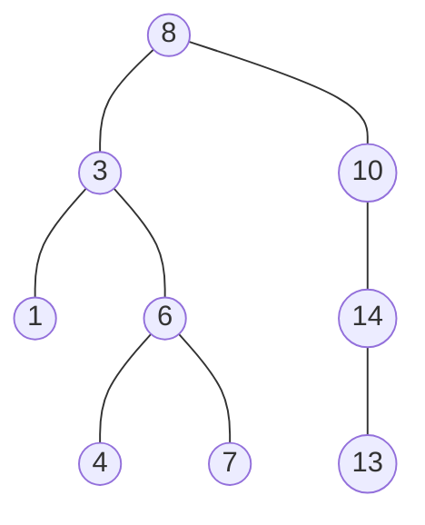
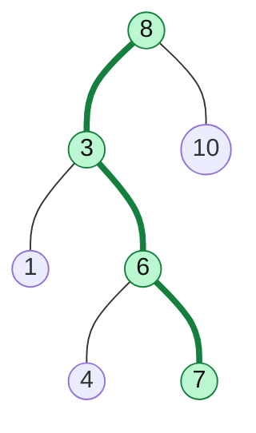

# Binary Search Tree (BST)

> A binary tree with an ordering rule, so you can search by going **left or right** at every step, like binary search.

#### 1. What Is It?

A **Binary Search Tree** is a binary tree where, for **every** node:

- everything in the **left** subtree is **smaller** than the node,
- everything in the **right** subtree is **larger** than the node.

(Most problems say "no duplicates". If duplicates are allowed, the rule says where they go, for example "left `<=`".)

**Why it matters**

- Search, insert and delete take **`O(h)`**, which is `O(log n)` when the tree is balanced.
- An **inorder traversal gives the values in sorted order**. This one fact solves many BST questions.

**Signals:** "binary search tree", "sorted", "kth smallest", "closest value", "inorder successor", "range".

#### 2. How It Works



**Search for 7:** go left or right by comparing. Each comparison throws away half of the tree (if it is balanced).

```text
at 8:  7 < 8  → go left
at 3:  7 > 3  → go right
at 6:  7 > 6  → go right
at 7:  found
```



**Facts**

| Fact | Meaning |
|---|---|
| Smallest value | go left until you cannot (left-most node) |
| Largest value | go right until you cannot (right-most node) |
| Inorder traversal | sorted, ascending |
| Balanced BST | height `≈ log₂ n`, so operations are `O(log n)` |
| Skewed BST (inserted in sorted order) | height `n`, so operations become `O(n)` |

*Inserting 1, 2, 3, 4 in that order creates a chain, which is as slow as a linked list.* This is why **self-balancing** trees (AVL, Red-Black) exist (note 21).

#### 3. Brute Force vs Optimized

| Operation | Plain binary tree | BST |
|---|---|---|
| Search a value | visit all nodes, `O(n)` | follow one path, `O(h)` |
| Find min / max | `O(n)` | `O(h)` |
| Sorted order | collect and sort, `O(n log n)` | inorder, `O(n)` |
| Kth smallest | collect and sort | inorder, stop at `k` (note 20) |

```kotlin
// Brute force: ignore the BST rule and search every node
fun containsBrute(root: TreeNode?, target: Int): Boolean {
    if (root == null) return false
    return root.value == target || containsBrute(root.left, target) || containsBrute(root.right, target)
}
```

#### 4. Kotlin Code

```kotlin
class TreeNode(val value: Int, var left: TreeNode? = null, var right: TreeNode? = null)

// Search in a Binary Search Tree (LeetCode 700): recursive
fun searchBST(root: TreeNode?, target: Int): TreeNode? {
    if (root == null || root.value == target) return root
    return if (target < root.value) searchBST(root.left, target) else searchBST(root.right, target)
}

// Iterative search: O(1) extra space
fun searchBSTIterative(root: TreeNode?, target: Int): TreeNode? {
    var cur = root
    while (cur != null && cur.value != target) {
        cur = if (target < cur.value) cur.left else cur.right
    }
    return cur
}

fun findMin(root: TreeNode): TreeNode {
    var cur = root
    while (cur.left != null) cur = cur.left!!
    return cur
}

fun findMax(root: TreeNode): TreeNode {
    var cur = root
    while (cur.right != null) cur = cur.right!!
    return cur
}

// Build a BST by inserting values one by one (insert is explained in note 8)
fun insertBST(root: TreeNode?, v: Int): TreeNode {
    if (root == null) return TreeNode(v)
    if (v < root.value) root.left = insertBST(root.left, v) else root.right = insertBST(root.right, v)
    return root
}

fun buildBST(values: List<Int>): TreeNode? {
    var root: TreeNode? = null
    for (v in values) root = insertBST(root, v)
    return root
}

fun inorder(root: TreeNode?, out: MutableList<Int> = mutableListOf()): List<Int> {
    if (root == null) return out
    inorder(root.left, out)
    out.add(root.value)
    inorder(root.right, out)
    return out
}
```

Tree: `val root = buildBST(listOf(8, 3, 10, 1, 6, 14, 4, 7, 13))`

Checks: `inorder(root)` → `[1, 3, 4, 6, 7, 8, 10, 13, 14]` (sorted). `searchBST(root, 7)?.value` → `7`. `searchBST(root, 5)` → `null`. `searchBSTIterative(root, 13)?.value` → `13`. `findMin(root!!).value` → `1`. `findMax(root!!).value` → `14`. `buildBST(listOf(1, 2, 3, 4))` has height 3: every node has only a right child.

#### 5. Complexity

| Operation | Balanced | Skewed (worst) |
|---|---|---|
| Search / insert / delete | `O(log n)` | `O(n)` |
| Min / max | `O(log n)` | `O(n)` |
| Inorder traversal | `O(n)` | `O(n)` |
| Space (recursive) | `O(log n)` | `O(n)` |
| Space (iterative search) | `O(1)` | `O(1)` |

#### 6. Common Mistakes

1. **Checking only the parent.** A node deep in the left subtree must be smaller than **every** ancestor on its right side (note 9).
2. **Forgetting that a BST can be skewed.** Always say "`O(h)`, which is `O(log n)` if balanced".
3. **Using `==` order wrongly with duplicates.** Ask: are duplicates allowed, and where do they go?
4. **Searching with `if (a) left else right`** and forgetting the equal case.
5. **Doing a full tree scan for a BST question.** That wastes the ordering.
6. **Assuming inorder works on a normal binary tree.** Sorted order only holds for a BST.

#### 7. Say This in the Interview

1. "In a BST the left subtree is smaller and the right subtree is larger, so each comparison throws away one side. That gives `O(h)`."
2. "An inorder traversal of a BST is sorted. I'll use that."
3. "If the input is sorted, the BST becomes a chain and operations are `O(n)`. A balanced tree such as an AVL or Red-Black tree avoids that."

#### 8. Quick Check

1. Which traversal prints a BST in sorted order?
2. What is the time to search a BST with 1,000,000 nodes that is perfectly balanced? And if it is a chain?
3. Where is the minimum value in a BST?

<details>
<summary>Answers</summary>

1. Inorder.
2. About 20 steps (`log₂ 1,000,000`). A chain needs up to 1,000,000 steps.
3. The left-most node (go left until there is no left child).

</details>

#### 9. Related LeetCode Questions

| # | Question | Idea |
|---|---|---|
| 700 | [Search in a Binary Search Tree](https://leetcode.com/problems/search-in-a-binary-search-tree/) (Easy) | go left or right |
| 938 | [Range Sum of BST](https://leetcode.com/problems/range-sum-of-bst/) (Easy) | skip subtrees out of range |
| 530 | [Minimum Absolute Difference in BST](https://leetcode.com/problems/minimum-absolute-difference-in-bst/) (Easy) | inorder neighbours |
| 108 | [Convert Sorted Array to Binary Search Tree](https://leetcode.com/problems/convert-sorted-array-to-binary-search-tree/) (Easy) | middle as root |
| 230 | [Kth Smallest Element in a BST](https://leetcode.com/problems/kth-smallest-element-in-a-bst/) (Medium) | inorder, stop at k |
| 98 | [Validate Binary Search Tree](https://leetcode.com/problems/validate-binary-search-tree/) (Medium) | bounds (note 9) |
