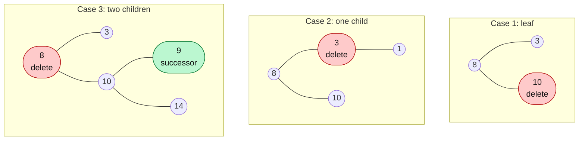

# Search / Insert / Delete in BST

> Search and insert are easy. Delete has three cases and is the one interviewers like.

#### 1. What Is It?

The three basic operations on a Binary Search Tree (BST):

| Operation | Idea | Cost |
|---|---|---|
| **Search** | compare, go left or right until found or `null` | `O(h)` |
| **Insert** | search for where the value would be, attach a new leaf there | `O(h)` |
| **Delete** | find the node, then fix the gap (3 cases) | `O(h)` |

`h` is the height: `O(log n)` if balanced, `O(n)` if the tree is a chain.

**Signals:** "implement a BST", "insert into a BST", "delete a node in a BST".

#### 2. How It Works

**Insert.** A new value always becomes a **leaf**. Walk down as in search. When you reach a `null`, put the new node there.

```text
insert 5 into:   8              8
                / \            / \
               3   10   →     3   10
                                \
                                 5   (5 > 3, so it goes to the right of 3)
```

**Delete: three cases.**



| Case | What to do |
|---|---|
| **1. No children (leaf)** | remove it (return `null`) |
| **2. One child** | replace the node with its child |
| **3. Two children** | replace it with its **inorder successor** (the smallest node in the **right** subtree), then delete that successor from the right subtree |

*Why the successor?* It is larger than everything in the left subtree and smaller than everything else in the right subtree, so the BST rule still holds. (The **predecessor**, the largest in the left subtree, also works.)

```text
delete 8 from:       8                  9
                    / \                / \
                   3   10     →       3   10
                      /  \                  \
                     9    14                14
successor of 8 = smallest in the right subtree = 9
```

> **Kotlin note.** In our `TreeNode`, `value` is a `val`. So instead of copying the successor's value into the node, we **return a new node** with the successor's value. (LeetCode's `TreeNode` has a `var val` and you can copy the value instead.)

#### 3. Brute Force vs Optimized

| Approach | Idea | Cost |
|---|---|---|
| Brute force delete | collect inorder values, remove one, rebuild the tree | `O(n)` time and space |
| BST delete (recursive) | three cases, only walks one path | `O(h)` time |

```kotlin
// Brute force: inorder list → remove → rebuild a balanced BST. Works, but O(n).
fun deleteBrute(root: TreeNode?, key: Int): TreeNode? {
    val sorted = inorder(root).filter { it != key }
    fun build(lo: Int, hi: Int): TreeNode? {
        if (lo > hi) return null
        val mid = (lo + hi) / 2
        return TreeNode(sorted[mid], build(lo, mid - 1), build(mid + 1, hi))
    }
    return build(0, sorted.size - 1)
}
```

#### 4. Kotlin Code

```kotlin
class TreeNode(val value: Int, var left: TreeNode? = null, var right: TreeNode? = null)

// Insert into a BST (LeetCode 701): recursive
fun insertIntoBST(root: TreeNode?, v: Int): TreeNode {
    if (root == null) return TreeNode(v)
    if (v < root.value) root.left = insertIntoBST(root.left, v)
    else root.right = insertIntoBST(root.right, v)
    return root
}

// Insert: iterative, O(1) extra space
fun insertIterative(root: TreeNode?, v: Int): TreeNode {
    if (root == null) return TreeNode(v)
    var cur: TreeNode = root
    while (true) {
        if (v < cur.value) {
            val next = cur.left
            if (next == null) { cur.left = TreeNode(v); break }
            cur = next
        } else {
            val next = cur.right
            if (next == null) { cur.right = TreeNode(v); break }
            cur = next
        }
    }
    return root
}

fun findMin(node: TreeNode): TreeNode {
    var cur = node
    while (cur.left != null) cur = cur.left!!
    return cur
}

// Delete Node in a BST (LeetCode 450)
fun deleteNode(root: TreeNode?, key: Int): TreeNode? {
    if (root == null) return null
    when {
        key < root.value -> root.left = deleteNode(root.left, key)
        key > root.value -> root.right = deleteNode(root.right, key)
        else -> {
            if (root.left == null) return root.right              // case 1 and case 2 (no left)
            if (root.right == null) return root.left              // case 2 (no right)
            val successor = findMin(root.right!!)                 // case 3: smallest in the right subtree
            return TreeNode(
                successor.value,
                root.left,
                deleteNode(root.right, successor.value)           // remove the successor from the right side
            )
        }
    }
    return root
}

fun inorder(root: TreeNode?, out: MutableList<Int> = mutableListOf()): List<Int> {
    if (root == null) return out
    inorder(root.left, out)
    out.add(root.value)
    inorder(root.right, out)
    return out
}
```

Build the tree `5 (3 (2, 4), 6 (null, 7))` with `fun make() = TreeNode(5, TreeNode(3, TreeNode(2), TreeNode(4)), TreeNode(6, null, TreeNode(7)))`.

Checks:

- `inorder(make())` → `[2, 3, 4, 5, 6, 7]`.
- Insert `1`: `inorder(insertIntoBST(make(), 1))` → `[1, 2, 3, 4, 5, 6, 7]`. `insertIterative` gives the same.
- Delete a leaf `2`: `inorder(deleteNode(make(), 2))` → `[3, 4, 5, 6, 7]`.
- Delete `6` (one child): `inorder(deleteNode(make(), 6))` → `[2, 3, 4, 5, 7]`.
- Delete `3` (two children): `inorder(deleteNode(make(), 3))` → `[2, 4, 5, 6, 7]`. The successor `4` takes its place.
- Delete the root `5` (two children): the new root value is `6`, and `inorder` → `[2, 3, 4, 6, 7]`.
- Delete a value that is not there: the tree is unchanged.

Trace of deleting `5`: the successor is the smallest in `6 (null, 7)`, which is `6`. New root = `TreeNode(6, left = 3(2,4), right = deleteNode(6(null,7), 6))`. In that call, `6` has no left child, so it returns `7`. The result is `6 (3 (2, 4), 7)`.

#### 5. Complexity

| | Balanced | Skewed |
|---|---|---|
| Search / insert / delete | `O(log n)` | `O(n)` |
| Extra space, recursive | `O(log n)` | `O(n)` |
| Extra space, iterative insert/search | `O(1)` | `O(1)` |

#### 6. Common Mistakes

1. **Not returning the node** from the recursive call (`root.left = ...` is lost).
2. **Delete with two children:** using the **left** subtree's smallest value, or not deleting the successor from the right subtree afterwards.
3. **Forgetting the one-child cases**, or the `null` base case when the key is missing.
4. **Insert creates a new root** only when the tree is empty. Do not replace the root every time.
5. **Breaking the BST rule** by copying the successor to the wrong place.
6. **Duplicates:** not agreeing on which side they go to.

#### 7. Say This in the Interview

1. "Insert walks down like search and attaches a new leaf. `O(h)`."
2. "Delete has three cases: a leaf, one child, two children. With two children I replace the node with its inorder successor (the smallest value in the right subtree), then delete that successor from the right subtree."
3. "All three are `O(h)`: `O(log n)` for a balanced tree and `O(n)` for a chain."

#### 8. Quick Check

1. Which node replaces a deleted node with two children?
2. After inserting 1, 2, 3 into an empty BST in that order, what does the tree look like?
3. What does `deleteNode` return when the key is not found?

<details>
<summary>Answers</summary>

1. Its inorder successor (smallest in the right subtree), or the predecessor (largest in the left subtree).
2. A chain `1 → 2 → 3` going right: a skewed tree.
3. The same root, unchanged (every recursive call returns its node).

</details>

#### 9. Related LeetCode Questions

| # | Question | Idea |
|---|---|---|
| 700 | [Search in a Binary Search Tree](https://leetcode.com/problems/search-in-a-binary-search-tree/) (Easy) | go left or right |
| 701 | [Insert into a Binary Search Tree](https://leetcode.com/problems/insert-into-a-binary-search-tree/) (Medium) | attach a leaf |
| 450 | [Delete Node in a BST](https://leetcode.com/problems/delete-node-in-a-bst/) (Medium) | three cases |
| 669 | [Trim a Binary Search Tree](https://leetcode.com/problems/trim-a-binary-search-tree/) (Medium) | delete by range |
| 285 | [Inorder Successor in BST](https://leetcode.com/problems/inorder-successor-in-bst/) (Medium, premium) | smallest greater value |
| 235 | [Lowest Common Ancestor of a Binary Search Tree](https://leetcode.com/problems/lowest-common-ancestor-of-a-binary-search-tree/) (Medium) | split point (note 13) |
