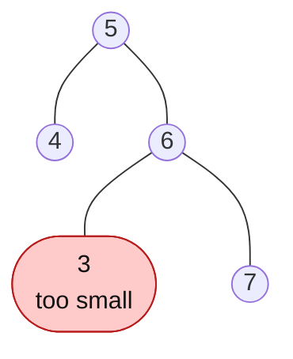

# Validate BST

> The most common BST question. The trap: checking only a node and its children is **not enough**.

#### 1. What Is It?

**Validate BST** asks: "is this binary tree a valid Binary Search Tree?" Every node must be **larger than everything in its left subtree** and **smaller than everything in its right subtree**, not only larger than its left child and smaller than its right child.

**Signals:** "validate", "is it a BST", "check the BST property".

#### 2. How It Works

**The trap.** This tree passes the "compare with children" check at every node, but it is **not** a BST:



`3 < 6` is fine locally. But `3` is in the **right** subtree of `5`, so it must be **greater than 5**. It is not.

**Method 1: pass a valid range down (top-down).** Each node must be inside `(low, high)`. Going left makes `high = node.value`. Going right makes `low = node.value`.

```text
valid(5, low = -∞, high = +∞)             ok
   valid(4, -∞, 5)                        ok
   valid(6, 5, +∞)                        ok
      valid(3, 5, 6):  3 is not in (5, 6)  → FALSE
```

**Method 2: inorder is strictly increasing.** Do an inorder traversal and keep the previous value. If any value is `<=` the previous one, it is not a BST.

```text
inorder of the tree above: 4, 5, 3, 6, 7    3 < 5 → not sorted → not a BST
```

Use `Long` (or `null`) for the bounds. If a node holds `Int.MIN_VALUE` or `Int.MAX_VALUE`, an `Int` bound would wrongly reject it.

#### 3. Brute Force vs Optimized

| Approach | Idea | Time | Space |
|---|---|---|---|
| Brute force | for every node, scan its whole left and right subtrees for bad values | `O(n²)` | `O(h)` |
| Bounds (top-down) | pass `(low, high)` once | `O(n)` | `O(h)` |
| Inorder check | sorted order, compare with the previous | `O(n)` | `O(h)` |

```kotlin
// Brute force: for each node, every value in the left subtree must be smaller, every value in the right bigger
fun isValidBrute(root: TreeNode?): Boolean {
    if (root == null) return true
    fun allSmaller(n: TreeNode?, limit: Int): Boolean =
        n == null || (n.value < limit && allSmaller(n.left, limit) && allSmaller(n.right, limit))
    fun allBigger(n: TreeNode?, limit: Int): Boolean =
        n == null || (n.value > limit && allBigger(n.left, limit) && allBigger(n.right, limit))
    return allSmaller(root.left, root.value) && allBigger(root.right, root.value) &&
        isValidBrute(root.left) && isValidBrute(root.right)
}
```

#### 4. Kotlin Code

```kotlin
class TreeNode(val value: Int, var left: TreeNode? = null, var right: TreeNode? = null)

// Validate Binary Search Tree (LeetCode 98): bounds
fun isValidBST(root: TreeNode?): Boolean {
    fun check(node: TreeNode?, low: Long, high: Long): Boolean {
        if (node == null) return true
        if (node.value <= low || node.value >= high) return false
        return check(node.left, low, node.value.toLong()) &&
               check(node.right, node.value.toLong(), high)
    }
    return check(root, Long.MIN_VALUE, Long.MAX_VALUE)
}

// Same, with an iterative inorder and a "previous value"
fun isValidBSTInorder(root: TreeNode?): Boolean {
    val stack = ArrayDeque<TreeNode>()
    var cur = root
    var prev: Long = Long.MIN_VALUE
    while (cur != null || stack.isNotEmpty()) {
        while (cur != null) {
            stack.addLast(cur)
            cur = cur.left
        }
        val node = stack.removeLast()
        if (node.value <= prev) return false          // must be strictly increasing
        prev = node.value.toLong()
        cur = node.right
    }
    return true
}
```

Trees:

- `a = TreeNode(2, TreeNode(1), TreeNode(3))`
- `b = TreeNode(5, TreeNode(1), TreeNode(4, TreeNode(3), TreeNode(6)))` (4 is in the right of 5 but smaller than 5)
- `c = TreeNode(5, TreeNode(4), TreeNode(6, TreeNode(3), TreeNode(7)))` (the trap above)
- `d = TreeNode(Int.MAX_VALUE)`

Checks: `isValidBST(a)` → `true`. `isValidBST(b)` → `false`. `isValidBST(c)` → `false`. `isValidBST(d)` → `true` (a single node with `Int.MAX_VALUE` works because the bounds are `Long`). `isValidBST(null)` → `true`. `isValidBSTInorder(a)` → `true`; `(b)` → `false`; `(c)` → `false`. `isValidBrute(c)` → `false`.

Trace for `b`: `check(5, -∞, ∞)` ok → `check(1, -∞, 5)` ok → `check(4, 5, ∞)`: `4 <= 5` → false.

#### 5. Complexity

| | Time | Space |
|---|---|---|
| Bounds (recursive) | `O(n)` | `O(h)` |
| Inorder (iterative) | `O(n)` | `O(h)` |
| Brute force | `O(n²)` | `O(h)` |

#### 6. Common Mistakes

1. **Comparing only with the direct children.** This is the classic failing answer.
2. **`Int` bounds** that reject `Int.MIN_VALUE` or `Int.MAX_VALUE`. Use `Long` or nullable bounds.
3. **Using `<` instead of `<=`** when duplicates are not allowed. A BST here needs **strictly** increasing values.
4. **Not updating the bound on one side** (using the parent's bound for both).
5. **Using a global `prev` that is not reset** between test cases (in recursive inorder).
6. **Validating a binary tree with the sorted-list trick without checking strictness.**

#### 7. Say This in the Interview

1. "Checking each node against its children is not enough, because a node must respect **all** its ancestors."
2. "I pass a valid range `(low, high)` down the recursion. Going left tightens `high`, going right tightens `low`."
3. "Alternatively, an inorder traversal must be strictly increasing. Both are `O(n)` time and `O(h)` space."

#### 8. Quick Check

1. Is `[5, 4, 6, null, null, 3, 7]` a valid BST?
2. Why use `Long` for the bounds?
3. What does an inorder traversal of a valid BST look like?

<details>
<summary>Answers</summary>

1. No. `3` is in the right subtree of `5` but is smaller than `5`.
2. A node's value can be `Int.MIN_VALUE` or `Int.MAX_VALUE`, which an `Int` bound could not accept.
3. Strictly increasing (sorted, no repeats).

</details>

#### 9. Related LeetCode Questions

| # | Question | Idea |
|---|---|---|
| 98 | [Validate Binary Search Tree](https://leetcode.com/problems/validate-binary-search-tree/) (Medium) | bounds or inorder |
| 230 | [Kth Smallest Element in a BST](https://leetcode.com/problems/kth-smallest-element-in-a-bst/) (Medium) | inorder |
| 530 | [Minimum Absolute Difference in BST](https://leetcode.com/problems/minimum-absolute-difference-in-bst/) (Easy) | inorder neighbours |
| 501 | [Find Mode in Binary Search Tree](https://leetcode.com/problems/find-mode-in-binary-search-tree/) (Easy) | inorder with a counter |
| 99 | [Recover Binary Search Tree](https://leetcode.com/problems/recover-binary-search-tree/) (Medium) | two swapped nodes in inorder |
| 173 | [Binary Search Tree Iterator](https://leetcode.com/problems/binary-search-tree-iterator/) (Medium) | controlled inorder (note 20) |
