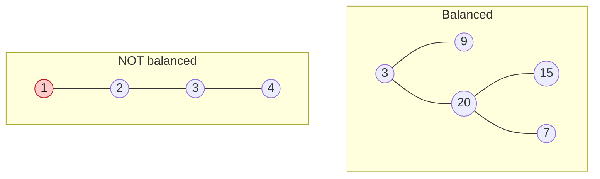

# Balanced Binary Tree

> A tree is balanced if no part of it is much deeper than another. The question teaches the key bottom-up trick: return a value **and** a failure signal from one recursion.

#### 1. What Is It?

A binary tree is **height-balanced** if, for **every node**, the heights of its left and right subtrees differ by **at most 1**.

Why it matters: a balanced tree has height `O(log n)`, so a BST on it is fast. A skewed tree has height `O(n)`.

**Signals:** "balanced", "height difference", "AVL" (self-balancing).

#### 2. How It Works



In the second tree, the root has left height 3 and right height 0. The difference is 3, which is more than 1.

**Slow way (top-down).** At every node, compute the height of both sides and compare, then recurse. Each node's height is computed again and again: `O(n²)` on a chain.

**Fast way (bottom-up).** One recursion that returns the **height**, or `-1` as a **failure signal** meaning "somewhere below, it is not balanced". Once a subtree returns `-1`, pass `-1` all the way up.

```text
height(node):
    if node is null: return 0
    left  = height(node.left);   if left  == -1: return -1
    right = height(node.right);  if right == -1: return -1
    if |left - right| > 1: return -1
    return 1 + max(left, right)
```

The tree is balanced if the final result is **not `-1`**.

#### 3. Brute Force vs Optimized

| Approach | Idea | Time | Space |
|---|---|---|---|
| Top-down | height of both sides at every node | `O(n²)` worst case | `O(h)` |
| Bottom-up | one pass, `-1` signals "unbalanced" | `O(n)` | `O(h)` |

```kotlin
// Brute force (top-down): recomputes heights again and again
fun heightOf(node: TreeNode?): Int =
    if (node == null) 0 else 1 + maxOf(heightOf(node.left), heightOf(node.right))

fun isBalancedBrute(root: TreeNode?): Boolean {
    if (root == null) return true
    if (Math.abs(heightOf(root.left) - heightOf(root.right)) > 1) return false
    return isBalancedBrute(root.left) && isBalancedBrute(root.right)
}
```

#### 4. Kotlin Code

```kotlin
class TreeNode(val value: Int, var left: TreeNode? = null, var right: TreeNode? = null)

// Balanced Binary Tree (LeetCode 110): bottom-up, O(n)
fun isBalanced(root: TreeNode?): Boolean {
    fun height(node: TreeNode?): Int {
        if (node == null) return 0
        val left = height(node.left)
        if (left == -1) return -1                 // already unbalanced below
        val right = height(node.right)
        if (right == -1) return -1
        if (Math.abs(left - right) > 1) return -1 // unbalanced here
        return 1 + maxOf(left, right)
    }
    return height(root) != -1
}
```

Trees (`buildTree` is in note 3):

- `a = buildTree(listOf(3, 9, 20, null, null, 15, 7))`
- `b = buildTree(listOf(1, 2, 2, 3, 3, null, null, 4, 4))`
- `c = TreeNode(1, TreeNode(2, TreeNode(3, TreeNode(4))))` (a left chain)

Checks: `isBalanced(a)` → `true`. `isBalanced(b)` → `false`. `isBalanced(c)` → `false`. `isBalanced(null)` → `true`. `isBalanced(TreeNode(1))` → `true`. `isBalancedBrute(b)` → `false`.

Trace for `b` (`1 (2 (3 (4,4), 3), 2)`): the left `3` has two leaf children, so its height is 2. The right `3` is a leaf, height 1. At node `2` the difference is 1, still ok, height 3. The right `2` is a leaf with height 1. At the root: `3` vs `1`, the difference is 2, so return `-1`.

#### 5. Complexity

| | Time | Space |
|---|---|---|
| Bottom-up | `O(n)` | `O(h)` |
| Top-down | `O(n²)` worst case (chain), `O(n log n)` if balanced | `O(h)` |

#### 6. Common Mistakes

1. **Checking only the root's two heights.** Every node must be balanced.
2. **The top-down approach** repeats height work. It passes small tests but is too slow.
3. **Using `0` as the failure signal.** `0` is a valid height (null). Use `-1`.
4. **Forgetting to stop early** when a child returns `-1` (extra work, but still correct).
5. **Confusing balanced with complete or perfect.** A balanced tree can have gaps.

#### 7. Say This in the Interview

1. "A tree is balanced if at every node the left and right heights differ by at most 1."
2. "The simple version recomputes heights at each node, which is `O(n²)`. I'll do it bottom-up: one recursion returns the height, or `-1` to signal an unbalanced subtree. That is `O(n)`."
3. "This is the same idea I'd use for diameter and maximum path sum: compute something while returning the height."

#### 8. Quick Check

1. Is a tree with only a root balanced?
2. Is a perfect binary tree always balanced?
3. Why can't `0` be the failure signal?

<details>
<summary>Answers</summary>

1. Yes (both sides have height 0).
2. Yes, both sides always have the same height.
3. `0` is the height of an empty subtree, so it is a normal value.

</details>

#### 9. Related LeetCode Questions

| # | Question | Idea |
|---|---|---|
| 110 | [Balanced Binary Tree](https://leetcode.com/problems/balanced-binary-tree/) (Easy) | bottom-up with `-1` |
| 104 | [Maximum Depth of Binary Tree](https://leetcode.com/problems/maximum-depth-of-binary-tree/) (Easy) | the height |
| 543 | [Diameter of Binary Tree](https://leetcode.com/problems/diameter-of-binary-tree/) (Easy) | height + global best |
| 108 | [Convert Sorted Array to Binary Search Tree](https://leetcode.com/problems/convert-sorted-array-to-binary-search-tree/) (Easy) | build a balanced BST |
| 1382 | [Balance a Binary Search Tree](https://leetcode.com/problems/balance-a-binary-search-tree/) (Medium) | inorder, then rebuild |
