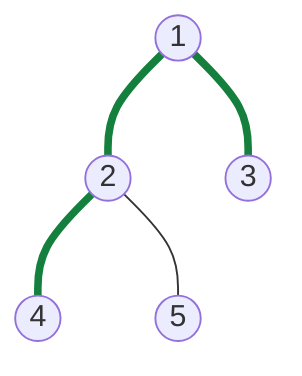

# Diameter of Binary Tree

> The longest path between any two nodes. The answer often does **not** pass through the root, which is why this question is a favourite.

#### 1. What Is It?

The **diameter** of a binary tree is the length of the **longest path between any two nodes**, counted in **edges** (LeetCode 543). The path may or may not pass through the root.

**Signals:** "longest path between two nodes", "diameter", "longest path, not necessarily through the root".

#### 2. How It Works



The longest path is `4 → 2 → 1 → 3` or `5 → 2 → 1 → 3`: **3 edges**. (Here it passes through the root.)

**Key idea.** The longest path that **bends at a node** goes down the left side and down the right side:

```text
path through node = height(left) + height(right)        (heights counted in nodes, see below)
```

So for every node, compute the longest path that uses it as the highest point. The diameter is the **maximum** of these over all nodes.

**Bottom-up with a global best**

```text
height(node):                    // height in NODES: null = 0, leaf = 1
    if null: return 0
    left  = height(node.left)
    right = height(node.right)
    best  = max(best, left + right)     // edges on the longest path bending here
    return 1 + max(left, right)         // the function returns the height, not the diameter
```

Why `left + right` is the edge count: if the left side has `L` nodes down and the right side has `R` nodes down, the path through the node has `L + R` edges.

```text
node 2: left = height(4) = 1, right = height(5) = 1 → path 4-2-5 = 2 edges   best = 2
node 1: left = height(2) = 2, right = height(3) = 1 → path 4-2-1-3 = 3 edges best = 3
diameter = 3
```

**The function returns the height, but the answer is stored in a variable outside.** That is the pattern: *return one thing, record another*. It is reused in Maximum Path Sum (note 17).

#### 3. Brute Force vs Optimized

| Approach | Idea | Time | Space |
|---|---|---|---|
| Brute force | at each node, compute the height of both sides again | `O(n²)` | `O(h)` |
| Optimized | one bottom-up pass, update a global best | `O(n)` | `O(h)` |

```kotlin
// Brute force: heights are recomputed at every node
fun heightNodes(node: TreeNode?): Int =
    if (node == null) 0 else 1 + maxOf(heightNodes(node.left), heightNodes(node.right))

fun diameterBrute(root: TreeNode?): Int {
    if (root == null) return 0
    val through = heightNodes(root.left) + heightNodes(root.right)
    return maxOf(through, diameterBrute(root.left), diameterBrute(root.right))
}
```

#### 4. Kotlin Code

```kotlin
class TreeNode(val value: Int, var left: TreeNode? = null, var right: TreeNode? = null)

// Diameter of Binary Tree (LeetCode 543): O(n)
fun diameterOfBinaryTree(root: TreeNode?): Int {
    var best = 0
    fun height(node: TreeNode?): Int {
        if (node == null) return 0
        val left = height(node.left)
        val right = height(node.right)
        best = maxOf(best, left + right)          // path bending at this node
        return 1 + maxOf(left, right)             // height in nodes
    }
    height(root)
    return best
}
```

Trees:

- `a = TreeNode(1, TreeNode(2, TreeNode(4), TreeNode(5)), TreeNode(3))`
- `b`: a long path that does **not** pass through the root. The root `1` has a leaf right child `9`. Its left child `2` has two deep sides: `2 (3 (4 (5)), 6 (7 (8)))`.
  `b = TreeNode(1, TreeNode(2, TreeNode(3, TreeNode(4, TreeNode(5))), TreeNode(6, TreeNode(7, TreeNode(8)))), TreeNode(9))`

Checks: `diameterOfBinaryTree(a)` → `3`. `diameterOfBinaryTree(TreeNode(1))` → `0`. `diameterOfBinaryTree(null)` → `0`. `diameterOfBinaryTree(b)` → `6`, the path `5-4-3-2-6-7-8` has 6 edges and does **not** use the root. (Through the root the longest path is only `5-4-3-2-1-9` = 5 edges.) `diameterBrute(b)` → `6`.

#### 5. Complexity

| | Time | Space |
|---|---|---|
| Bottom-up | `O(n)` | `O(h)` |
| Brute force | `O(n²)` | `O(h)` |

#### 6. Common Mistakes

1. **Assuming the path goes through the root.** It often does not.
2. **Returning the diameter from the recursion** instead of the height.
3. **Counting nodes vs edges.** The answer counts **edges**. A single node has diameter `0`.
4. **Using `max(left, right)` for the bending path** instead of `left + right`.
5. **Recomputing heights** at every node (`O(n²)`).
6. **Resetting the global variable incorrectly** in repeated tests.

#### 7. Say This in the Interview

1. "The longest path bends at some node. At each node the path is the left height plus the right height, so I take the maximum over all nodes."
2. "The recursion returns the height, and I keep the best path in a variable outside. One pass, `O(n)` time, `O(h)` space."
3. "The longest path may not pass through the root, so I check every node."

#### 8. Quick Check

1. Diameter of a tree with a root and one child?
2. Diameter of a chain of 5 nodes?
3. Does the function return the diameter?

<details>
<summary>Answers</summary>

1. `1` edge.
2. `4` edges.
3. No. It returns the height. The diameter is kept in the outer variable.

</details>

#### 9. Related LeetCode Questions

| # | Question | Idea |
|---|---|---|
| 543 | [Diameter of Binary Tree](https://leetcode.com/problems/diameter-of-binary-tree/) (Easy) | `left + right` at each node |
| 110 | [Balanced Binary Tree](https://leetcode.com/problems/balanced-binary-tree/) (Easy) | same bottom-up pattern |
| 124 | [Binary Tree Maximum Path Sum](https://leetcode.com/problems/binary-tree-maximum-path-sum/) (Hard) | same, with values (note 17) |
| 687 | [Longest Univalue Path](https://leetcode.com/problems/longest-univalue-path/) (Medium) | same, with an equal-value rule |
| 1245 | [Tree Diameter](https://leetcode.com/problems/tree-diameter/) (Medium, premium) | diameter of an unrooted tree |
