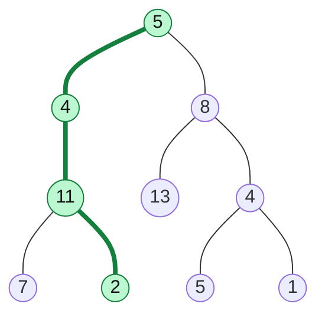

# Path Sum Problems

> A family of questions about the sum of values along a path. The skill: decide if information goes **down** (parameters) or **up** (return value), and use a **prefix sum** when the path may start anywhere.

#### 1. What Is It?

All of these ask about paths from the root (or a node) down to a leaf (or another node), using the sum of node values.

| Question | Path | Method |
|---|---|---|
| **Path Sum** (112) | root to leaf, does one sum to `target`? | subtract as you go down |
| **Path Sum II** (113) | root to leaf, return **all** such paths | backtracking with a path list |
| **Path Sum III** (437) | **any** downward path (start and end anywhere), count them | prefix sum + hash map |
| **Binary Tree Paths** (257) | root to leaf, all paths as strings | backtracking |
| **Sum Root to Leaf Numbers** (129) | each path is a number, sum them | pass the number down |

**Signals:** "root to leaf", "sum equals target", "number of paths", "path from any node".

#### 2. How It Works



Target `22`. The green path `5 → 4 → 11 → 2` sums to `22`. The other answer is `5 → 8 → 4 → 5`, also `22`.

**Path Sum I and II (top-down).** Pass `remaining = target − node.value` to the children. At a **leaf**, check `remaining == 0`. For all paths, keep a `path` list, add on the way in, **remove on the way out** (backtracking).

**Path Sum III (prefix sums).** A downward path from node `A` to node `B` has sum `prefix(B) − prefix(parent of A)`. While walking down, keep a **map of counts of prefix sums seen on the current path**. At each node, the number of paths ending here with sum `target` is `count[currentPrefix − target]`. Remember to **undo** the count when you leave the node.

```text
Walk 10 → 5 → 3, target 8:
prefix sums on the path so far: {0:1, 10:1, 15:1}
at node 3 the running prefix is 18. Look up 18 - 8 = 10 → found once.
So the path that starts just below node 10 (5 → 3) has sum 8. Count 1.
(the idea is the same as "Subarray Sum Equals K", but on a tree path)
```

**Numbers down a path (Sum Root to Leaf Numbers).** `current = current * 10 + node.value`. Add it at each leaf.

#### 3. Brute Force vs Optimized

| Problem | Brute force | Optimized |
|---|---|---|
| Path Sum III | start a DFS from every node, `O(n²)` on a chain | prefix sums + map, `O(n)` |
| Path Sum II | n/a, all paths must be output | backtracking, `O(n · h)` for copies |

```kotlin
// Path Sum III, brute force: a DFS from every node
fun pathSumBrute(root: TreeNode?, target: Int): Int {
    fun countFrom(node: TreeNode?, remaining: Long): Int {
        if (node == null) return 0
        val here = if (node.value.toLong() == remaining) 1 else 0
        return here + countFrom(node.left, remaining - node.value) + countFrom(node.right, remaining - node.value)
    }
    if (root == null) return 0
    return countFrom(root, target.toLong()) + pathSumBrute(root.left, target) + pathSumBrute(root.right, target)
}
```

#### 4. Kotlin Code

```kotlin
class TreeNode(val value: Int, var left: TreeNode? = null, var right: TreeNode? = null)

// Path Sum (LeetCode 112)
fun hasPathSum(root: TreeNode?, target: Int): Boolean {
    if (root == null) return false
    if (root.left == null && root.right == null) return root.value == target     // only a LEAF counts
    val remaining = target - root.value
    return hasPathSum(root.left, remaining) || hasPathSum(root.right, remaining)
}

// Path Sum II (LeetCode 113): all root-to-leaf paths
fun pathSum(root: TreeNode?, target: Int): List<List<Int>> {
    val result = mutableListOf<List<Int>>()
    val path = mutableListOf<Int>()
    fun dfs(node: TreeNode?, remaining: Int) {
        if (node == null) return
        path.add(node.value)
        if (node.left == null && node.right == null && node.value == remaining) {
            result.add(path.toList())                         // copy the path
        } else {
            dfs(node.left, remaining - node.value)
            dfs(node.right, remaining - node.value)
        }
        path.removeAt(path.size - 1)                          // undo
    }
    dfs(root, target)
    return result
}

// Path Sum III (LeetCode 437): any downward path
fun pathSumIII(root: TreeNode?, target: Int): Int {
    val seen = HashMap<Long, Int>()
    seen[0L] = 1                                              // an empty prefix
    fun dfs(node: TreeNode?, prefix: Long): Int {
        if (node == null) return 0
        val cur = prefix + node.value
        var count = seen[cur - target] ?: 0                   // paths ending here
        seen[cur] = (seen[cur] ?: 0) + 1
        count += dfs(node.left, cur) + dfs(node.right, cur)
        seen[cur] = seen[cur]!! - 1                           // leave this node
        return count
    }
    return dfs(root, 0L)
}

// Binary Tree Paths (LeetCode 257)
fun binaryTreePaths(root: TreeNode?): List<String> {
    val result = mutableListOf<String>()
    fun dfs(node: TreeNode?, path: String) {
        if (node == null) return
        val cur = if (path.isEmpty()) "${node.value}" else "$path->${node.value}"
        if (node.left == null && node.right == null) result.add(cur)
        else { dfs(node.left, cur); dfs(node.right, cur) }
    }
    dfs(root, "")
    return result
}

// Sum Root to Leaf Numbers (LeetCode 129)
fun sumNumbers(root: TreeNode?): Int {
    fun dfs(node: TreeNode?, current: Int): Int {
        if (node == null) return 0
        val num = current * 10 + node.value
        if (node.left == null && node.right == null) return num
        return dfs(node.left, num) + dfs(node.right, num)
    }
    return dfs(root, 0)
}
```

Trees (`buildTree` is in note 3):

- `a = buildTree(listOf(5, 4, 8, 11, null, 13, 4, 7, 2, null, null, 5, 1))`
- `b = buildTree(listOf(10, 5, -3, 3, 2, null, 11, 3, -2, null, 1))`

Checks: `hasPathSum(a, 22)` → `true`. `hasPathSum(a, 5)` → `false` (node `5` is not a leaf). `hasPathSum(null, 0)` → `false`. `pathSum(a, 22)` → `[[5,4,11,2],[5,8,4,5]]`. `pathSumIII(b, 8)` → `3` (the paths `5→3`, `5→2→1`, `-3→11`). `pathSumBrute(b, 8)` → `3`. `binaryTreePaths(buildTree(listOf(1, 2, 3, null, 5)))` → `["1->2->5", "1->3"]`. `sumNumbers(buildTree(listOf(1, 2, 3)))` → `25` (`12 + 13`). `sumNumbers(buildTree(listOf(4, 9, 0, 5, 1)))` → `1026` (`495 + 491 + 40`).

#### 5. Complexity

| | Time | Space |
|---|---|---|
| Path Sum I | `O(n)` | `O(h)` |
| Path Sum II | `O(n · h)` (copying paths) | `O(h)` + output |
| Path Sum III (prefix map) | `O(n)` | `O(h)` |
| Path Sum III (brute force) | `O(n²)` worst case | `O(h)` |

#### 6. Common Mistakes

1. **Returning `true` at a `null` child.** Only a **leaf** counts for root-to-leaf paths. Otherwise `Path Sum` wrongly accepts a node with one child.
2. **Forgetting to remove the node** from the path (backtracking) or to copy the path when saving.
3. **Path Sum III:** not initialising `seen[0] = 1`, so paths starting at the root are missed.
4. **Path Sum III:** not undoing the count when leaving a node, so counts leak into sibling branches.
5. **Overflow:** prefix sums can exceed `Int`. Use `Long`.
6. **Negative values:** a path sum can go down and up again, so you cannot stop early when the sum passes the target.

#### 7. Say This in the Interview

1. "For root-to-leaf sums, I pass the remaining sum down and check at a **leaf**."
2. "To list all paths I use backtracking: add the node, recurse, then remove it. I copy the list when I save a result."
3. "For a path that can start anywhere I use the prefix-sum trick from arrays: a map of prefix sums on the current path. It is `O(n)` instead of `O(n²)`."

#### 8. Quick Check

1. In `hasPathSum`, what is the answer for a root `1` with only a left child `2`, target `1`?
2. Why must Path Sum III remove the prefix from the map when it returns?
3. `sumNumbers` of a tree with root `7` only?

<details>
<summary>Answers</summary>

1. `false`. The root is not a leaf, and the leaf path `1 → 2` sums to `3`.
2. The prefix sums in the map must describe only the **current** root-to-node path. Leaving them in would count paths across different branches.
3. `7`.

</details>

#### 9. Related LeetCode Questions

| # | Question | Idea |
|---|---|---|
| 112 | [Path Sum](https://leetcode.com/problems/path-sum/) (Easy) | remaining sum, leaf check |
| 257 | [Binary Tree Paths](https://leetcode.com/problems/binary-tree-paths/) (Easy) | build a string down |
| 113 | [Path Sum II](https://leetcode.com/problems/path-sum-ii/) (Medium) | backtracking |
| 129 | [Sum Root to Leaf Numbers](https://leetcode.com/problems/sum-root-to-leaf-numbers/) (Medium) | `cur * 10 + value` |
| 437 | [Path Sum III](https://leetcode.com/problems/path-sum-iii/) (Medium) | prefix sum + map |
| 124 | [Binary Tree Maximum Path Sum](https://leetcode.com/problems/binary-tree-maximum-path-sum/) (Hard) | note 17 |
