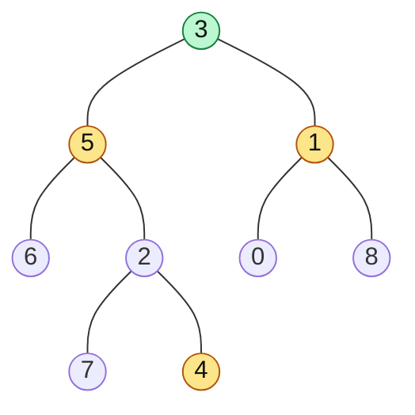

# Lowest Common Ancestor (LCA)

> The lowest node that has both given nodes below it. Two versions: any binary tree (postorder), and a BST (use the ordering).

#### 1. What Is It?

The **lowest common ancestor** of two nodes `p` and `q` is the **deepest node** that has both `p` and `q` as descendants. A node counts as a descendant of itself, so if `p` is an ancestor of `q`, the answer is `p`.

**Signals:** "lowest common ancestor", "common manager", "closest shared parent", "distance between two nodes".

#### 2. How It Works



- `LCA(5, 1)` = `3` (they are on different sides of `3`).
- `LCA(5, 4)` = `5` (`4` is below `5`, and a node is its own ancestor).
- `LCA(7, 4)` = `2`.

**Binary tree: postorder recursion.** Ask each subtree: "do you contain `p` or `q`?"

```text
lca(node):
    if node is null, or node is p, or node is q: return node
    left  = lca(node.left)
    right = lca(node.right)
    if left and right are both non-null: return node    // p and q are on different sides
    return whichever is non-null (or null)              // both are on one side
```

- If `p` and `q` are on **different sides**, the current node is the split point: the LCA.
- If both are on one side, the answer is whatever that side returned.
- If the node itself is `p` (or `q`) we return it immediately. If `q` is below, the other side returns `null`, so `p` bubbles up, which is correct.

**BST: use the ordering.** Compare both values with the current node. If both are smaller, go left. If both are larger, go right. Otherwise the current node **splits** them (or equals one of them): it is the LCA. No recursion needed.

```text
BST 6 (2 (0, 4 (3, 5)), 8 (7, 9)):   LCA(2, 8)
at 6: 2 < 6 and 8 > 6 → they split here → LCA = 6
LCA(3, 5): 6 → both smaller → go to 2 → both larger → go to 4 → 3 < 4 < 5 → LCA = 4
```

**Related ideas:** with a **parent pointer** on every node, LCA is the same as the intersection of two linked lists (move up from both). For repeated queries on a big tree, binary lifting or Euler tour + RMQ is used (names only).

#### 3. Brute Force vs Optimized

| Approach | Idea | Time | Space |
|---|---|---|---|
| Brute force | find the root-to-`p` path and the root-to-`q` path, walk both while equal | `O(n)` | `O(h)` + two lists |
| Recursion (binary tree) | one postorder pass | `O(n)` | `O(h)` |
| BST iterative | follow the ordering | `O(h)` | `O(1)` |

```kotlin
// Brute force: two paths, then the last common node
fun pathTo(root: TreeNode?, target: TreeNode, path: MutableList<TreeNode>): Boolean {
    if (root == null) return false
    path.add(root)
    if (root === target) return true
    if (pathTo(root.left, target, path) || pathTo(root.right, target, path)) return true
    path.removeAt(path.size - 1)
    return false
}

fun lcaBrute(root: TreeNode?, p: TreeNode, q: TreeNode): TreeNode? {
    val a = mutableListOf<TreeNode>()
    val b = mutableListOf<TreeNode>()
    if (!pathTo(root, p, a) || !pathTo(root, q, b)) return null
    var i = 0
    while (i < a.size && i < b.size && a[i] === b[i]) i++
    return a[i - 1]
}
```

#### 4. Kotlin Code

```kotlin
class TreeNode(val value: Int, var left: TreeNode? = null, var right: TreeNode? = null)

// Lowest Common Ancestor of a Binary Tree (LeetCode 236)
fun lowestCommonAncestor(root: TreeNode?, p: TreeNode, q: TreeNode): TreeNode? {
    if (root == null || root === p || root === q) return root
    val left = lowestCommonAncestor(root.left, p, q)
    val right = lowestCommonAncestor(root.right, p, q)
    if (left != null && right != null) return root       // p and q are on different sides
    return left ?: right
}

// Lowest Common Ancestor of a Binary Search Tree (LeetCode 235)
fun lcaBst(root: TreeNode?, p: Int, q: Int): TreeNode? {
    var cur = root
    while (cur != null) {
        cur = when {
            p < cur.value && q < cur.value -> cur.left
            p > cur.value && q > cur.value -> cur.right
            else -> return cur                           // split point, or one of them
        }
    }
    return null
}
```

Binary tree for the checks (nodes are named so we can pass them as `p` and `q`):

```kotlin
val n7 = TreeNode(7); val n4 = TreeNode(4); val n2 = TreeNode(2, n7, n4); val n6 = TreeNode(6)
val n5 = TreeNode(5, n6, n2); val n0 = TreeNode(0); val n8 = TreeNode(8)
val n1 = TreeNode(1, n0, n8); val root = TreeNode(3, n5, n1)
```

Checks: `lowestCommonAncestor(root, n5, n1)?.value` → `3`. `(root, n5, n4)` → `5`. `(root, n7, n4)` → `2`. `(root, n6, n8)` → `3`. `lcaBrute(root, n5, n4)?.value` → `5`.

BST: `bst = TreeNode(6, TreeNode(2, TreeNode(0), TreeNode(4, TreeNode(3), TreeNode(5))), TreeNode(8, TreeNode(7), TreeNode(9)))`

Checks: `lcaBst(bst, 2, 8)?.value` → `6`. `lcaBst(bst, 2, 4)?.value` → `2`. `lcaBst(bst, 3, 5)?.value` → `4`. `lcaBst(bst, 7, 9)?.value` → `8`.

#### 5. Complexity

| | Time | Space |
|---|---|---|
| Binary tree recursion | `O(n)` | `O(h)` |
| BST iterative | `O(h)` | `O(1)` |
| Brute force (two paths) | `O(n)` | `O(h)` |

#### 6. Common Mistakes

1. **Forgetting that a node can be its own ancestor.** `LCA(5, 4)` is `5`, not `3`.
2. **Using BST logic on a plain binary tree.** The ordering is not there.
3. **Comparing values** instead of references in a binary tree with duplicate values. Compare nodes (`===`).
4. **BST: stopping when only one is found** instead of checking the split condition.
5. **Assuming both nodes exist.** If they may be missing, you need a second check.
6. **Not returning when `root` equals `p` or `q`.** This is the shortcut that makes the recursion short.

#### 7. Say This in the Interview

1. "I search both subtrees. If `p` and `q` are found on different sides, the current node is the LCA. If both are on one side, I return what that side found."
2. "If the current node is `p` or `q`, I return it right away. If the other node is below it, the answer is correct; if not, the other side returns `null` and it bubbles up."
3. "In a BST I don't need to search: if both values are smaller I go left, if both larger I go right, else this is the split point. That is `O(h)` and `O(1)` space."

#### 8. Quick Check

1. In the tree above, what is `LCA(6, 4)`?
2. In a BST, `p = 3`, `q = 3`. What is the answer?
3. Why does the recursion return a node immediately when it equals `p` or `q`?

<details>
<summary>Answers</summary>

1. `5` (`6` is the left child of `5`, and `4` is in its right subtree).
2. The node with value `3` (a node is its own ancestor).
3. If the other node is below it, the current node is the LCA. If it is not below, the other node is found elsewhere and the split point will be higher.

</details>

#### 9. Related LeetCode Questions

| # | Question | Idea |
|---|---|---|
| 235 | [Lowest Common Ancestor of a Binary Search Tree](https://leetcode.com/problems/lowest-common-ancestor-of-a-binary-search-tree/) (Medium) | use the ordering |
| 236 | [Lowest Common Ancestor of a Binary Tree](https://leetcode.com/problems/lowest-common-ancestor-of-a-binary-tree/) (Medium) | postorder, split point |
| 1650 | [Lowest Common Ancestor of a Binary Tree III](https://leetcode.com/problems/lowest-common-ancestor-of-a-binary-tree-iii/) (Medium, premium) | parent pointers = list intersection |
| 1123 | [Lowest Common Ancestor of Deepest Leaves](https://leetcode.com/problems/lowest-common-ancestor-of-deepest-leaves/) (Medium) | depth + LCA |
| 865 | [Smallest Subtree with all the Deepest Nodes](https://leetcode.com/problems/smallest-subtree-with-all-the-deepest-nodes/) (Medium) | same as 1123 |
| 1644 | [Lowest Common Ancestor of a Binary Tree II](https://leetcode.com/problems/lowest-common-ancestor-of-a-binary-tree-ii/) (Medium, premium) | nodes may be missing |
