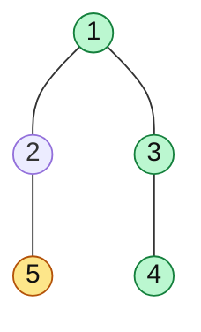
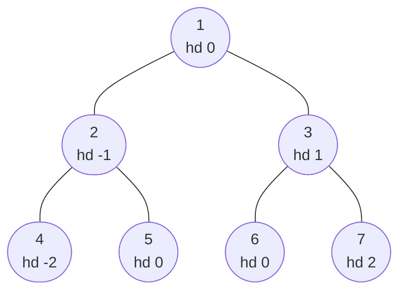

# Tree Views

> What you would see if you looked at a tree from the right, the left, the top or the bottom. Almost always a level order with a small twist.

#### 1. What Is It?

A **view** is the set of nodes visible from one direction.

| View | You see | Method |
|---|---|---|
| **Right side view** | the right-most node of each level | BFS, take the **last** of each level |
| **Left side view** | the left-most node of each level | BFS, take the **first** of each level |
| **Top view** | the top node of each vertical column | BFS with a **horizontal distance** (hd) |
| **Bottom view** | the bottom node of each vertical column | BFS with hd, keep overwriting |

**Signals:** "right side view", "visible from", "top view", "vertical".

#### 2. How It Works



Tree `[1, 2, 3, null, 5, null, 4]`: **right view** = `[1, 3, 4]` (green). **Left view** = `[1, 2, 5]`. Level 2 has two nodes, `5` (child of `2`) and `4` (child of `3`). `5` is the left-most and `4` is the right-most, even though `5` is a right child. The view depends on the **position in the level**, not on left or right child.

**Right side view (BFS).** Do a level order. The last node processed in each level is the answer for that level.

**Right side view (DFS).** Visit the **right child first**. Keep the current depth. The **first node seen at a new depth** is the right-most one.

**Horizontal distance (hd).** Give the root `hd = 0`. The left child gets `hd − 1`, the right child gets `hd + 1`. Nodes with the same `hd` are on the same vertical line.



- **Top view:** for each `hd`, the **first** node reached in BFS (it is the highest). `-2: 4, -1: 2, 0: 1, 1: 3, 2: 7` → `[4, 2, 1, 3, 7]`.
- **Bottom view:** for each `hd`, the **last** node reached in BFS. `hd 0` is `1, 5, 6` in BFS order, so the last is `6` → `[4, 2, 6, 3, 7]`.

Use BFS (not DFS) for top and bottom views, because BFS visits nodes top to bottom, so "first" really means "highest".

#### 3. Brute Force vs Optimized

| Approach | Idea | Time | Space |
|---|---|---|---|
| Brute force | collect all nodes with their depth (and hd), sort or group, then pick | `O(n log n)` | `O(n)` |
| Right view, BFS | last node per level | `O(n)` | `O(w)` |
| Right view, DFS (right first) | first node at each new depth | `O(n)` | `O(h)` |
| Top view | BFS + map by hd | `O(n log n)` with `TreeMap`, `O(n)` with min/max hd | `O(n)` |

```kotlin
// Brute force: gather (depth, value) for every node, keep the right-most per depth
fun rightViewBrute(root: TreeNode?): List<Int> {
    val lastAtDepth = HashMap<Int, Int>()
    fun dfs(node: TreeNode?, depth: Int) {
        if (node == null) return
        lastAtDepth[depth] = node.value                // later (more right) nodes overwrite
        dfs(node.left, depth + 1)
        dfs(node.right, depth + 1)
    }
    dfs(root, 0)
    return lastAtDepth.keys.sorted().map { lastAtDepth[it]!! }
}
```

#### 4. Kotlin Code

```kotlin
class TreeNode(val value: Int, var left: TreeNode? = null, var right: TreeNode? = null)

// Binary Tree Right Side View (LeetCode 199): BFS
fun rightSideView(root: TreeNode?): List<Int> {
    val result = mutableListOf<Int>()
    if (root == null) return result
    val queue = ArrayDeque<TreeNode>()
    queue.addLast(root)
    while (queue.isNotEmpty()) {
        val size = queue.size
        for (i in 0 until size) {
            val node = queue.removeFirst()
            if (i == size - 1) result.add(node.value)    // last node of the level
            node.left?.let { queue.addLast(it) }
            node.right?.let { queue.addLast(it) }
        }
    }
    return result
}

// Left side view: the first node of each level
fun leftSideView(root: TreeNode?): List<Int> {
    val result = mutableListOf<Int>()
    if (root == null) return result
    val queue = ArrayDeque<TreeNode>()
    queue.addLast(root)
    while (queue.isNotEmpty()) {
        val size = queue.size
        for (i in 0 until size) {
            val node = queue.removeFirst()
            if (i == 0) result.add(node.value)           // first node of the level
            node.left?.let { queue.addLast(it) }
            node.right?.let { queue.addLast(it) }
        }
    }
    return result
}

// Right side view: DFS, visit the right child first
fun rightSideViewDfs(root: TreeNode?): List<Int> {
    val result = mutableListOf<Int>()
    fun dfs(node: TreeNode?, depth: Int) {
        if (node == null) return
        if (depth == result.size) result.add(node.value) // first node seen at this depth
        dfs(node.right, depth + 1)
        dfs(node.left, depth + 1)
    }
    dfs(root, 0)
    return result
}

// Top view: first node (BFS) for each horizontal distance
fun topView(root: TreeNode?): List<Int> {
    if (root == null) return emptyList()
    val firstAt = java.util.TreeMap<Int, Int>()         // hd -> value, sorted by hd
    val queue = ArrayDeque<Pair<TreeNode, Int>>()
    queue.addLast(root to 0)
    while (queue.isNotEmpty()) {
        val (node, hd) = queue.removeFirst()
        if (hd !in firstAt) firstAt[hd] = node.value
        node.left?.let { queue.addLast(it to hd - 1) }
        node.right?.let { queue.addLast(it to hd + 1) }
    }
    return firstAt.values.toList()
}

// Bottom view: last node (BFS) for each horizontal distance
fun bottomView(root: TreeNode?): List<Int> {
    if (root == null) return emptyList()
    val lastAt = java.util.TreeMap<Int, Int>()
    val queue = ArrayDeque<Pair<TreeNode, Int>>()
    queue.addLast(root to 0)
    while (queue.isNotEmpty()) {
        val (node, hd) = queue.removeFirst()
        lastAt[hd] = node.value                          // later nodes overwrite
        node.left?.let { queue.addLast(it to hd - 1) }
        node.right?.let { queue.addLast(it to hd + 1) }
    }
    return lastAt.values.toList()
}
```

Trees (`buildTree` is in note 3):

- `a = buildTree(listOf(1, 2, 3, null, 5, null, 4))`
- `b = buildTree(listOf(1, 2, 3, 4, 5, 6, 7))`

Checks: `rightSideView(a)` → `[1, 3, 4]`. `rightSideViewDfs(a)` → `[1, 3, 4]`. `rightViewBrute(a)` → `[1, 3, 4]`. `leftSideView(a)` → `[1, 2, 5]`. `topView(b)` → `[4, 2, 1, 3, 7]`. `bottomView(b)` → `[4, 2, 6, 3, 7]`. `rightSideView(null)` → `[]`.

#### 5. Complexity

| | Time | Space |
|---|---|---|
| Right / left view (BFS) | `O(n)` | `O(w)` |
| Right view (DFS) | `O(n)` | `O(h)` |
| Top / bottom view (`TreeMap`) | `O(n log n)` | `O(n)` |
| Top / bottom view (track min and max hd, array) | `O(n)` | `O(n)` |

#### 6. Common Mistakes

1. **Taking only the right child chain.** The right view can include a left child when the right side is shorter.
2. **Using DFS for top view** with "first seen": DFS may reach a deeper node before a higher one. Use BFS.
3. **Using `HashMap` and then forgetting to sort** by hd.
4. **Reading `queue.size` inside the loop** instead of saving it first.
5. **Not distinguishing top and bottom:** top keeps the first, bottom keeps the last.
6. **Mixing hd sign:** left is `−1`, right is `+1`.

#### 7. Say This in the Interview

1. "The right side view is the last node of every level, so a level order with a queue solves it in `O(n)`."
2. "With DFS I visit the right child first, and the first node I see at each depth is the visible one."
3. "For top and bottom views I give every node a horizontal distance, and use BFS so that earlier means higher."

#### 8. Quick Check

1. Right view of a tree that is a left chain `1 → 2 → 3` (each the left child)?
2. Top view or bottom view: which keeps the first node seen per hd?
3. Why is BFS needed for the top view?

<details>
<summary>Answers</summary>

1. `[1, 2, 3]`. Each level has only one node, and it is the right-most one on its level.
2. Top view.
3. BFS goes level by level from the top, so the first node for each hd is the highest one. DFS does not guarantee this.

</details>

#### 9. Related LeetCode Questions

| # | Question | Idea |
|---|---|---|
| 199 | [Binary Tree Right Side View](https://leetcode.com/problems/binary-tree-right-side-view/) (Medium) | last of each level |
| 515 | [Find Largest Value in Each Tree Row](https://leetcode.com/problems/find-largest-value-in-each-tree-row/) (Medium) | max per level |
| 513 | [Find Bottom Left Tree Value](https://leetcode.com/problems/find-bottom-left-tree-value/) (Medium) | first of the last level |
| 987 | [Vertical Order Traversal of a Binary Tree](https://leetcode.com/problems/vertical-order-traversal-of-a-binary-tree/) (Hard) | hd + depth + sort |
| 314 | [Binary Tree Vertical Order Traversal](https://leetcode.com/problems/binary-tree-vertical-order-traversal/) (Medium, premium) | BFS by hd |
| 545 | [Boundary of Binary Tree](https://leetcode.com/problems/boundary-of-binary-tree/) (Medium, premium) | note 19 |
