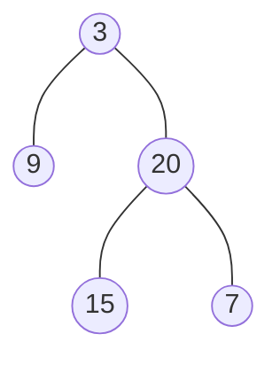

# Construct Tree from Traversals

> Given two traversals, rebuild the tree. The rule: **preorder (or postorder) tells you the root, inorder tells you the left and right parts.**

#### 1. What Is It?

You are given two traversal lists of a binary tree with **unique values**, and you must rebuild the tree.

| Given | Root comes from | Split with |
|---|---|---|
| Preorder + Inorder | the **first** value of preorder | inorder |
| Postorder + Inorder | the **last** value of postorder | inorder |

**Why two lists?** One traversal alone is ambiguous. Preorder + **postorder** is also ambiguous in general (a single child could be left or right). Inorder is the one that separates left from right.

**Signals:** "construct", "build the tree from", "preorder and inorder".

#### 2. How It Works

`preorder = [3, 9, 20, 15, 7]`, `inorder = [9, 3, 15, 20, 7]`

```text
1. The first preorder value is the root: 3.
2. Find 3 in inorder:   [9]  3  [15, 20, 7]
                         left     right
   Left subtree has 1 node, right subtree has 3 nodes.
3. Take the next 1 preorder values for the left  → [9]
   and the next 3 preorder values for the right → [20, 15, 7]
4. Repeat: the right part has root 20 (first in its preorder).
   In inorder [15, 20, 7]:  left [15], right [7].
```



**The efficient way.** Do not cut the arrays (copying is slow). Instead:

1. Put every inorder value's **index in a hash map**, so finding the root in inorder is `O(1)`.
2. Keep one **moving pointer** into preorder. Every call takes the next value as its root.
3. Recurse on index ranges of inorder: `build(lo, hi)`. **Build the left subtree first**, because preorder lists the left subtree before the right one.

**Postorder + inorder.** Same idea, but the root is the **last** postorder value, and you move the pointer **backwards**. Build the **right** subtree **first**.

#### 3. Brute Force vs Optimized

| Approach | Idea | Time | Space |
|---|---|---|---|
| Brute force | find the root in inorder with `indexOf` and copy sub-arrays for each call | `O(n²)` | `O(n²)` in the worst case (copies) |
| Optimized | hash map for inorder positions + index ranges + a moving pointer | `O(n)` | `O(n)` |

```kotlin
// Brute force: linear search + array copies
fun buildTreeBrute(preorder: IntArray, inorder: IntArray): TreeNode? {
    if (preorder.isEmpty()) return null
    val rootValue = preorder[0]
    val mid = inorder.indexOf(rootValue)                         // O(n) search every time
    val left = buildTreeBrute(preorder.copyOfRange(1, mid + 1), inorder.copyOfRange(0, mid))
    val right = buildTreeBrute(preorder.copyOfRange(mid + 1, preorder.size), inorder.copyOfRange(mid + 1, inorder.size))
    return TreeNode(rootValue, left, right)
}
```

#### 4. Kotlin Code

```kotlin
class TreeNode(val value: Int, var left: TreeNode? = null, var right: TreeNode? = null)

// Construct Binary Tree from Preorder and Inorder Traversal (LeetCode 105)
fun buildTreePreIn(preorder: IntArray, inorder: IntArray): TreeNode? {
    val indexOf = HashMap<Int, Int>()
    for ((i, v) in inorder.withIndex()) indexOf[v] = i
    var pre = 0                                                  // moving pointer into preorder

    fun build(lo: Int, hi: Int): TreeNode? {
        if (lo > hi) return null
        val rootValue = preorder[pre++]                          // next root
        val mid = indexOf[rootValue]!!
        val left = build(lo, mid - 1)                            // LEFT first
        val right = build(mid + 1, hi)
        return TreeNode(rootValue, left, right)
    }
    return build(0, inorder.size - 1)
}

// Construct Binary Tree from Inorder and Postorder Traversal (LeetCode 106)
fun buildTreeInPost(inorder: IntArray, postorder: IntArray): TreeNode? {
    val indexOf = HashMap<Int, Int>()
    for ((i, v) in inorder.withIndex()) indexOf[v] = i
    var post = postorder.size - 1                                // moving pointer, from the end

    fun build(lo: Int, hi: Int): TreeNode? {
        if (lo > hi) return null
        val rootValue = postorder[post--]
        val mid = indexOf[rootValue]!!
        val right = build(mid + 1, hi)                           // RIGHT first
        val left = build(lo, mid - 1)
        return TreeNode(rootValue, left, right)
    }
    return build(0, inorder.size - 1)
}
```

`toLevelList` is in note 3.

Checks: `toLevelList(buildTreePreIn(intArrayOf(3, 9, 20, 15, 7), intArrayOf(9, 3, 15, 20, 7)))` → `[3, 9, 20, null, null, 15, 7]`. `toLevelList(buildTreeInPost(intArrayOf(9, 3, 15, 20, 7), intArrayOf(9, 15, 7, 20, 3)))` → the same list. `buildTreePreIn(intArrayOf(-1), intArrayOf(-1))` → one node with value `-1`. `buildTreePreIn(intArrayOf(), intArrayOf())` → `null`. `buildTreeBrute(...)` gives the same tree as the optimized one.

Trace of `buildTreePreIn` (`pre` is the pointer):

```text
build(0,4): root = pre[0] = 3, mid = 1
   build(0,0): root = 9, mid = 0 → build(0,-1) null, build(1,0) null → leaf 9
   build(2,4): root = 20, mid = 3
      build(2,2): root = 15 → leaf
      build(4,4): root = 7  → leaf
```

#### 5. Complexity

| | Time | Space |
|---|---|---|
| Optimized (map + pointer) | `O(n)` | `O(n)` map + `O(h)` stack |
| Brute force | `O(n²)` | `O(n²)` worst case |

#### 6. Common Mistakes

1. **Building the right subtree first** with a preorder pointer (the wrong order). Preorder is node, left, right. For postorder it is reversed: right first.
2. **Cutting arrays** instead of passing index ranges (copies make it slow).
3. **Linear search for the root** in inorder (`indexOf`) at every call.
4. **Duplicate values.** These methods need **unique** values.
5. **Off-by-one** on the ranges (`mid - 1` and `mid + 1`).
6. **Trying to build from preorder + postorder only** and expecting a unique tree.

#### 7. Say This in the Interview

1. "Preorder gives me the root first. Inorder tells me how many nodes are on the left and right of that root."
2. "I store the inorder indexes in a map so finding the root costs `O(1)`, and I recurse on index ranges. Total `O(n)`."
3. "I must build the left subtree before the right, because preorder lists the left subtree first. With postorder it is the opposite."

#### 8. Quick Check

1. What are the preorder and inorder of a tree with root `1` and only a right child `2`?
2. In `buildTreePreIn`, why does `left` come before `right`?
3. Can preorder + postorder always rebuild a unique tree?

<details>
<summary>Answers</summary>

1. Preorder `[1, 2]`, inorder `[1, 2]`.
2. The moving `pre` pointer reads the preorder list in order, and the whole left subtree appears right after the root.
3. No. A node with one child can have it as left or right, and both give the same preorder and postorder lists.

</details>

#### 9. Related LeetCode Questions

| # | Question | Idea |
|---|---|---|
| 108 | [Convert Sorted Array to Binary Search Tree](https://leetcode.com/problems/convert-sorted-array-to-binary-search-tree/) (Easy) | middle as root |
| 105 | [Construct Binary Tree from Preorder and Inorder Traversal](https://leetcode.com/problems/construct-binary-tree-from-preorder-and-inorder-traversal/) (Medium) | map + pointer |
| 106 | [Construct Binary Tree from Inorder and Postorder Traversal](https://leetcode.com/problems/construct-binary-tree-from-inorder-and-postorder-traversal/) (Medium) | pointer from the end |
| 889 | [Construct Binary Tree from Preorder and Postorder Traversal](https://leetcode.com/problems/construct-binary-tree-from-preorder-and-postorder-traversal/) (Medium) | one valid answer |
| 1008 | [Construct Binary Search Tree from Preorder Traversal](https://leetcode.com/problems/construct-binary-search-tree-from-preorder-traversal/) (Medium) | BST: bounds, no inorder needed |
| 654 | [Maximum Binary Tree](https://leetcode.com/problems/maximum-binary-tree/) (Medium) | max as root |
