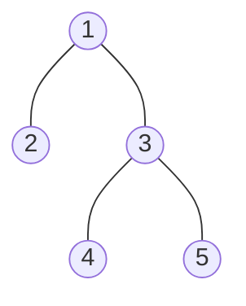

# Serialize / Deserialize Tree

> Turn a tree into a string, and the string back into the same tree. A common Hard question that is easy once you add `null` markers.

#### 1. What Is It?

**Serialize** = convert a tree into a string (to save it or send it over a network). **Deserialize** = rebuild the exact same tree from that string.

A traversal alone loses the shape. **Writing a marker for every `null` child** keeps the shape, so **one traversal is enough**.

**Signals:** "serialize and deserialize", "encode / decode a tree", "store a tree".

#### 2. How It Works

Use `#` for a null child. **Preorder with null markers:**



```text
preorder with markers:  1, 2, #, #, 3, 4, #, #, 5, #, #
```

```text
serialize(node):
    if null: write "#"
    else:    write value; serialize(left); serialize(right)

deserialize(tokens):
    take the next token
    if "#": return null
    node = new node(token)
    node.left  = deserialize(tokens)      // consumes the left subtree's tokens
    node.right = deserialize(tokens)      // then the right subtree's tokens
    return node
```

Why it works: the same order of reading as writing. Each call consumes exactly the tokens of its own subtree.

**Other formats**

| Format | Note |
|---|---|
| **Level order (BFS)** | the LeetCode list `[1,2,3,null,null,4,5]`. This is `toLevelList` / `buildTree` from note 3. |
| **Preorder + `#`** | shown here, the shortest code |
| **Postorder + `#`** | also works (read tokens from the end) |
| **BST** | **preorder values only, no markers**: rebuild with value bounds (LeetCode 449) |
| **Separator** | always use a separator such as `,` so `12` and `1,2` stay different |

#### 3. Brute Force vs Optimized

| Approach | Idea | Size |
|---|---|---|
| Inorder only | cannot rebuild the shape | ambiguous |
| Preorder + inorder (two strings) | works (note 15), but needs unique values and two lists | `2n` values |
| Preorder with `#` markers | one string, any values | `n` values + `n + 1` markers |
| BST preorder only | the BST rule replaces the markers | `n` values |

```kotlin
// A tempting but wrong idea: preorder values only, without markers
fun serializeNoMarkers(root: TreeNode?): String =
    if (root == null) "" else "${root.value}," + serializeNoMarkers(root.left) + serializeNoMarkers(root.right)
// 1(2,null) and 1(null,2) both give "1,2," so the shape is lost. Always write the null markers.
```

#### 4. Kotlin Code

```kotlin
class TreeNode(val value: Int, var left: TreeNode? = null, var right: TreeNode? = null)

// Serialize and Deserialize Binary Tree (LeetCode 297): preorder with markers
fun serialize(root: TreeNode?): String {
    val sb = StringBuilder()
    fun dfs(node: TreeNode?) {
        if (node == null) { sb.append("#,"); return }
        sb.append(node.value).append(',')
        dfs(node.left)
        dfs(node.right)
    }
    dfs(root)
    return sb.toString()
}

fun deserialize(data: String): TreeNode? {
    val tokens = ArrayDeque(data.split(",").filter { it.isNotEmpty() })
    fun build(): TreeNode? {
        val token = tokens.removeFirst()
        if (token == "#") return null
        val node = TreeNode(token.toInt())
        node.left = build()                              // left tokens come first
        node.right = build()
        return node
    }
    return build()
}

// Serialize and Deserialize BST (LeetCode 449): preorder values only
fun serializeBst(root: TreeNode?): String {
    val sb = StringBuilder()
    fun dfs(node: TreeNode?) {
        if (node == null) return
        sb.append(node.value).append(',')
        dfs(node.left)
        dfs(node.right)
    }
    dfs(root)
    return sb.toString()
}

fun deserializeBst(data: String): TreeNode? {
    val values = data.split(",").filter { it.isNotEmpty() }.map { it.toInt() }
    var i = 0
    fun build(low: Long, high: Long): TreeNode? {
        if (i == values.size) return null
        val v = values[i]
        if (v <= low || v >= high) return null           // belongs to a different subtree
        i++
        val node = TreeNode(v)
        node.left = build(low, v.toLong())
        node.right = build(v.toLong(), high)
        return node
    }
    return build(Long.MIN_VALUE, Long.MAX_VALUE)
}
```

Tree: `val root = buildTree(listOf(1, 2, 3, null, null, 4, 5))` (note 3).

Checks: `serialize(root)` → `"1,2,#,#,3,4,#,#,5,#,#,"`. `toLevelList(deserialize(serialize(root)))` → `[1, 2, 3, null, null, 4, 5]` (round trip). `serialize(null)` → `"#,"`, and `deserialize("#,")` → `null`. A negative value works: `serialize(TreeNode(-1))` → `"-1,#,#,"`. BST `TreeNode(2, TreeNode(1), TreeNode(3))`: `serializeBst` → `"2,1,3,"` and `toLevelList(deserializeBst("2,1,3,"))` → `[2, 1, 3]`.

Trace of `deserialize("1,2,#,#,3,#,#,")`:

```text
build: token 1 → node 1.  left = build: token 2 → node 2. left = build: # → null. right = build: # → null. (node 2 done)
                          right = build: token 3 → node 3. left: # null. right: # null. (node 3 done)
```

#### 5. Complexity

| | Time | Space |
|---|---|---|
| Serialize | `O(n)` | `O(n)` string + `O(h)` stack |
| Deserialize | `O(n)` | `O(n)` tokens + `O(h)` stack |
| BST version | `O(n)` | smaller output (no markers) |

#### 6. Common Mistakes

1. **No `null` markers.** Different trees give the same string.
2. **No separator.** `1` and `2` vs `12` become the same.
3. **Building the right subtree before the left** when reading (wrong order).
4. **Using `String +` in a loop** (`O(n²)`). Use `StringBuilder`.
5. **Choosing a marker that can appear as a value.** `#` is safe for integers.
6. **Not handling the empty tree** (`"#,"`) or a trailing separator when splitting.
7. **Recursion depth** on very deep trees. Use BFS (level order) if needed.

#### 7. Say This in the Interview

1. "A traversal alone loses the shape. If I also write a marker for every null child, a single preorder is enough."
2. "To deserialize I read tokens in the same order: the next token is the root, then the left subtree, then the right subtree, each consuming exactly its own tokens."
3. "For a BST I don't need markers: I rebuild with value bounds, so the string is shorter."

#### 8. Quick Check

1. Serialize the tree with root `1` and a single left child `2` (using `#,`).
2. Why is a separator needed?
3. Why can a BST skip the null markers?

<details>
<summary>Answers</summary>

1. `"1,2,#,#,#,"`.
2. Without it, the values `1` and `2` and the single value `12` could not be told apart.
3. The BST ordering tells you where each value belongs, so the shape can be rebuilt from the values and bounds.

</details>

#### 9. Related LeetCode Questions

| # | Question | Idea |
|---|---|---|
| 297 | [Serialize and Deserialize Binary Tree](https://leetcode.com/problems/serialize-and-deserialize-binary-tree/) (Hard) | preorder with `#` |
| 449 | [Serialize and Deserialize BST](https://leetcode.com/problems/serialize-and-deserialize-bst/) (Medium) | preorder + bounds |
| 428 | [Serialize and Deserialize N-ary Tree](https://leetcode.com/problems/serialize-and-deserialize-n-ary-tree/) (Hard, premium) | write the child count |
| 652 | [Find Duplicate Subtrees](https://leetcode.com/problems/find-duplicate-subtrees/) (Medium) | serialize each subtree as a key |
| 572 | [Subtree of Another Tree](https://leetcode.com/problems/subtree-of-another-tree/) (Easy) | serialize and compare (note 18) |
| 105 | [Construct Binary Tree from Preorder and Inorder Traversal](https://leetcode.com/problems/construct-binary-tree-from-preorder-and-inorder-traversal/) (Medium) | note 15 |
