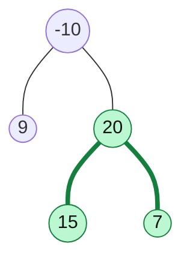

# Maximum Path Sum

> The hardest standard tree question, but it is the same pattern as Diameter: **return one thing, record another**. This time the values can be negative.

#### 1. What Is It?

A **path** is any sequence of connected nodes, going up and then down (it can start and end at any node, and does not need to pass through the root). The **path sum** is the sum of the node values on it. Return the **maximum path sum** (LeetCode 124).

Node values can be **negative**, so a longer path is not always better.

**Signals:** "maximum path sum", "any node to any node", "values can be negative".

#### 2. How It Works



The best path is `15 → 20 → 7 = 42`. It does not include the root `-10`.

**Two different numbers at every node. Keep them apart.**

| | Meaning | Used for |
|---|---|---|
| **gain(node)** (returned) | the best sum of a path that **starts at this node and goes down one side** | the parent can extend it upward |
| **bend(node)** (recorded) | the best path that **uses this node as the highest point**: `value + leftGain + rightGain` | the global answer |

```text
gain(node):
    if null: return 0
    left  = max(0, gain(node.left))      // ignore a branch that makes the sum smaller
    right = max(0, gain(node.right))
    best  = max(best, node.value + left + right)      // path that bends here
    return node.value + max(left, right)               // path that continues up: ONE side only
```

- `max(0, ...)` means "if a branch is negative, do not take it".
- A path that goes **up to the parent** can use only **one** child side (it cannot fork), so the returned value uses `max(left, right)`.

```text
node 15: left=0, right=0 → best = 15          returns 15
node 7 : best = max(15, 7) = 15               returns 7
node 20: left=15, right=7 → bend = 20+15+7 = 42   best = 42     returns 20 + 15 = 35
node 9 : best stays 42                        returns 9
node -10: left=9, right=35 → bend = -10+9+35 = 34  best stays 42
answer 42
```

This is exactly the diameter pattern (note 11), with values instead of edge counts and `max(0, ...)` to skip negative branches.

#### 3. Brute Force vs Optimized

| Approach | Idea | Time | Space |
|---|---|---|---|
| Brute force | for each node, recompute the best downward gain of each side | `O(n²)` | `O(h)` |
| Optimized | one bottom-up pass with a global best | `O(n)` | `O(h)` |

```kotlin
// Brute force: for every node, compute the downward gains again from scratch
fun gainDown(node: TreeNode?): Int {
    if (node == null) return 0
    return node.value + maxOf(0, gainDown(node.left), gainDown(node.right))
}

fun maxPathSumBrute(root: TreeNode?): Int {
    if (root == null) return Int.MIN_VALUE
    val bend = root.value + maxOf(0, gainDown(root.left)) + maxOf(0, gainDown(root.right))
    return maxOf(bend, maxPathSumBrute(root.left), maxPathSumBrute(root.right))
}
```

#### 4. Kotlin Code

```kotlin
class TreeNode(val value: Int, var left: TreeNode? = null, var right: TreeNode? = null)

// Binary Tree Maximum Path Sum (LeetCode 124): O(n)
fun maxPathSum(root: TreeNode?): Int {
    var best = Int.MIN_VALUE                              // not 0: every value may be negative
    fun gain(node: TreeNode?): Int {
        if (node == null) return 0
        val left = maxOf(0, gain(node.left))             // drop a negative branch
        val right = maxOf(0, gain(node.right))
        best = maxOf(best, node.value + left + right)    // path bending at this node
        return node.value + maxOf(left, right)           // continue up with ONE side
    }
    gain(root)
    return best
}
```

`buildTree` is in note 3.

Checks: `maxPathSum(buildTree(listOf(-10, 9, 20, null, null, 15, 7)))` → `42`. `maxPathSum(buildTree(listOf(1, 2, 3)))` → `6`. `maxPathSum(TreeNode(-3))` → `-3` (the best is the single node). `maxPathSum(buildTree(listOf(2, -1)))` → `2`. `maxPathSum(buildTree(listOf(-2, -1)))` → `-1`. `maxPathSumBrute(buildTree(listOf(-10, 9, 20, null, null, 15, 7)))` → `42`.

#### 5. Complexity

| | Time | Space |
|---|---|---|
| Optimized | `O(n)` | `O(h)` |
| Brute force | `O(n²)` | `O(h)` |

#### 6. Common Mistakes

1. **Starting `best` at `0`.** If all values are negative the answer is negative. Start at `Int.MIN_VALUE`.
2. **Returning the bend sum** (`value + left + right`) to the parent. A path cannot fork on its way up.
3. **Forgetting `max(0, ...)`** and adding a negative branch.
4. **Assuming the path passes through the root.**
5. **Overflow:** with big values, sums can exceed `Int`. Use `Long` if limits are large.
6. **Mixing this up with Diameter:** diameter counts edges, here we add values.

#### 7. Say This in the Interview

1. "At each node there are two numbers. The best path that **bends** here is `value + leftGain + rightGain`. The best path that **continues up** can use only one side."
2. "I ignore negative gains with `max(0, ...)`."
3. "The recursion returns the gain, and the answer is kept in a variable. One pass: `O(n)` time, `O(h)` space."

#### 8. Quick Check

1. Answer for a single node `-5`?
2. Why does the function return `node.value + max(left, right)` and not `+ left + right`?
3. When does a negative child gain get used?

<details>
<summary>Answers</summary>

1. `-5`.
2. The returned path goes up to the parent and then possibly further. A path cannot branch into both children and still continue upward.
3. Never: `max(0, gain)` turns it into `0`, which means "do not include that branch". (The only exception is a path that is a single negative node.)

</details>

#### 9. Related LeetCode Questions

| # | Question | Idea |
|---|---|---|
| 543 | [Diameter of Binary Tree](https://leetcode.com/problems/diameter-of-binary-tree/) (Easy) | same pattern, edge counts |
| 124 | [Binary Tree Maximum Path Sum](https://leetcode.com/problems/binary-tree-maximum-path-sum/) (Hard) | gain + global best |
| 687 | [Longest Univalue Path](https://leetcode.com/problems/longest-univalue-path/) (Medium) | same pattern, equal values |
| 337 | [House Robber III](https://leetcode.com/problems/house-robber-iii/) (Medium) | return two values per node |
| 968 | [Binary Tree Cameras](https://leetcode.com/problems/binary-tree-cameras/) (Hard) | return a state per node |
| 53 | [Maximum Subarray](https://leetcode.com/problems/maximum-subarray/) (Medium) | the array version of this idea |
