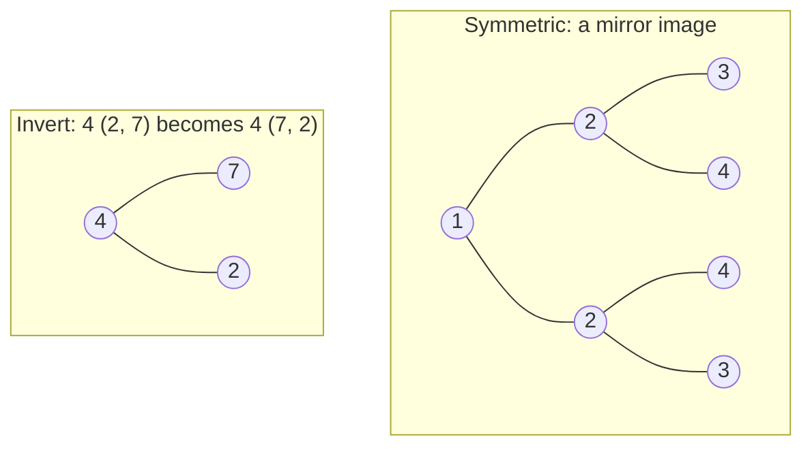

# Same, Symmetric, Invert & Subtree

> Compare two trees, mirror a tree, or merge two. Each one is a two-pointer recursion: walk **two nodes together**.

#### 1. What Is It?

Several small, very common questions share one skill: recurse on **two nodes at the same time**.

| Question | Idea |
|---|---|
| **Same Tree** (100) | the two trees have the same shape and values |
| **Symmetric Tree** (101) | the tree is a mirror of itself |
| **Invert Binary Tree** (226) | swap `left` and `right` everywhere |
| **Subtree of Another Tree** (572) | does `root` contain a copy of `sub` somewhere? |
| **Merge Two Binary Trees** (617) | add overlapping nodes, keep the rest |

**Signals:** "two trees", "mirror", "symmetric", "same structure", "invert", "contains a subtree".

#### 2. How It Works



**Same Tree.** Walk both trees together:

```text
same(a, b):
    both null        → true
    one null         → false
    values differ    → false
    return same(a.left, b.left) and same(a.right, b.right)
```

**Symmetric.** Compare the tree with itself, but **cross over**: the left of one side with the right of the other.

```text
mirror(a, b):
    both null → true;   one null → false;   values differ → false
    return mirror(a.left, b.right) and mirror(a.right, b.left)
```

`isSymmetric(root) = mirror(root.left, root.right)`.

**Invert.** For each node, invert both subtrees, then swap them.

**Subtree.** For every node of `root`, check `same(node, sub)`. That is `O(m · n)` for `n` nodes in `root` and `m` in `sub`. **Faster:** serialize both trees (note 16) with a marker for each null and a separator **before each value**, then check whether the string of `sub` is contained in the string of `root`.

```text
root = [3,4,5,1,2]:   ,3,4,1,#,#,2,#,#,5,#,#
sub  = [4,1,2]:       ,4,1,#,#,2,#,#          ← appears inside → true
```

The separator **before** every value avoids a false match like value `12` containing `2`.

**Merge.** If both nodes exist, add the values and merge the children. If one is `null`, return the other.

#### 3. Brute Force vs Optimized

| Problem | Simple | Faster |
|---|---|---|
| Subtree | `same` at every node, `O(m · n)` | serialize + string search, `O(m + n)` with KMP |
| Symmetric | build the mirror, then compare, `O(n)` extra space | compare in place, `O(h)` |
| Same / Invert / Merge | one recursion | already `O(n)` |

```kotlin
// Subtree of Another Tree, simple version: same() at every node
fun isSubtreeBrute(root: TreeNode?, sub: TreeNode?): Boolean {
    if (sub == null) return true
    if (root == null) return false
    return isSameTree(root, sub) || isSubtreeBrute(root.left, sub) || isSubtreeBrute(root.right, sub)
}
```

#### 4. Kotlin Code

```kotlin
class TreeNode(val value: Int, var left: TreeNode? = null, var right: TreeNode? = null)

// Same Tree (LeetCode 100)
fun isSameTree(a: TreeNode?, b: TreeNode?): Boolean {
    if (a == null && b == null) return true
    if (a == null || b == null) return false
    if (a.value != b.value) return false
    return isSameTree(a.left, b.left) && isSameTree(a.right, b.right)
}

// Symmetric Tree (LeetCode 101)
fun isSymmetric(root: TreeNode?): Boolean {
    fun mirror(a: TreeNode?, b: TreeNode?): Boolean {
        if (a == null && b == null) return true
        if (a == null || b == null) return false
        if (a.value != b.value) return false
        return mirror(a.left, b.right) && mirror(a.right, b.left)    // cross over
    }
    return root == null || mirror(root.left, root.right)
}

// Invert Binary Tree (LeetCode 226)
fun invertTree(root: TreeNode?): TreeNode? {
    if (root == null) return null
    val left = invertTree(root.left)
    val right = invertTree(root.right)
    root.left = right
    root.right = left
    return root
}

// Subtree of Another Tree (LeetCode 572): serialize and search
fun isSubtree(root: TreeNode?, sub: TreeNode?): Boolean {
    fun ser(node: TreeNode?): String =
        if (node == null) ",#" else ",${node.value}" + ser(node.left) + ser(node.right)
    return ser(root).contains(ser(sub))
}

// Merge Two Binary Trees (LeetCode 617)
fun mergeTrees(a: TreeNode?, b: TreeNode?): TreeNode? {
    if (a == null) return b
    if (b == null) return a
    return TreeNode(a.value + b.value, mergeTrees(a.left, b.left), mergeTrees(a.right, b.right))
}
```

Trees (`buildTree`, `toLevelList` in note 3; `preorder` in note 4):

Checks: `isSameTree(buildTree(listOf(1,2,3)), buildTree(listOf(1,2,3)))` → `true`. `isSameTree(buildTree(listOf(1,2)), buildTree(listOf(1,null,2)))` → `false` (same values, different shape). `isSymmetric(buildTree(listOf(1,2,2,3,4,4,3)))` → `true`. `isSymmetric(buildTree(listOf(1,2,2,null,3,null,3)))` → `false`. `preorder(invertTree(buildTree(listOf(4,2,7,1,3,6,9))))` → `[4,7,9,6,2,3,1]`. `isSubtree(buildTree(listOf(3,4,5,1,2)), buildTree(listOf(4,1,2)))` → `true`. `isSubtree(buildTree(listOf(3,4,5,1,2,null,null,null,null,0)), buildTree(listOf(4,1,2)))` → `false` (the node `2` has an extra child `0`). `isSubtreeBrute` gives the same answers. `toLevelList(mergeTrees(buildTree(listOf(1,3,2,5)), buildTree(listOf(2,1,3,null,4,null,7))))` → `[3, 4, 5, 5, 4, null, 7]`.

#### 5. Complexity

| | Time | Space |
|---|---|---|
| Same / Symmetric / Invert / Merge | `O(n)` | `O(h)` |
| Subtree, simple | `O(m · n)` | `O(h)` |
| Subtree, serialization | `O(m + n)` typical (string search) | `O(m + n)` |

#### 6. Common Mistakes

1. **Symmetric:** comparing `a.left` with `b.left` (that is "same", not "mirror"). Cross over.
2. **Same Tree:** only comparing values. A different shape with the same values must be `false`.
3. **Forgetting the one-null case** (`a == null || b == null`).
4. **Subtree:** a root that only matches **part** of a subtree. The whole subtree must match down to the leaves.
5. **Subtree by serialization:** no separator before values, or no `#` markers (false matches).
6. **Invert:** swapping before recursing is fine, but forgetting to return the root.

#### 7. Say This in the Interview

1. "I'll recurse on both trees at once. If both are null it's true, if exactly one is null it's false, and the values must match."
2. "For symmetry I compare the left of one side with the right of the other."
3. "For a subtree, checking `same` at every node is `O(m · n)`. A faster way is to serialize both trees with null markers and check for a substring."

#### 8. Quick Check

1. Is a tree with just a root symmetric?
2. What does `invertTree` return for `null`?
3. Why must `isSameTree` check the one-null case before reading `a.value`?

<details>
<summary>Answers</summary>

1. Yes (`mirror(null, null)` is true).
2. `null`.
3. If one of them is `null`, reading `.value` crashes.

</details>

#### 9. Related LeetCode Questions

| # | Question | Idea |
|---|---|---|
| 100 | [Same Tree](https://leetcode.com/problems/same-tree/) (Easy) | two-node recursion |
| 101 | [Symmetric Tree](https://leetcode.com/problems/symmetric-tree/) (Easy) | cross-compare |
| 226 | [Invert Binary Tree](https://leetcode.com/problems/invert-binary-tree/) (Easy) | swap children |
| 572 | [Subtree of Another Tree](https://leetcode.com/problems/subtree-of-another-tree/) (Easy) | same() at each node |
| 617 | [Merge Two Binary Trees](https://leetcode.com/problems/merge-two-binary-trees/) (Easy) | add or take the other |
| 951 | [Flip Equivalent Binary Trees](https://leetcode.com/problems/flip-equivalent-binary-trees/) (Medium) | same, with optional swaps |
| 114 | [Flatten Binary Tree to Linked List](https://leetcode.com/problems/flatten-binary-tree-to-linked-list/) (Medium) | rewire in place |
