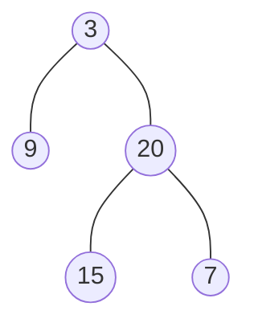
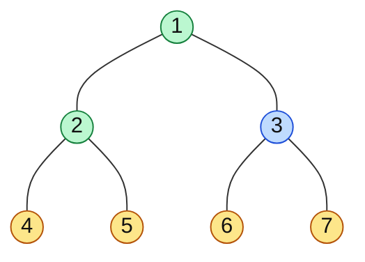

# Zigzag Level Order & Boundary Traversal

> Two traversal variations that test whether you can **adapt** the standard ones: reverse every second level, and walk around the outside of the tree.

#### 1. What Is It?

| Traversal | What it outputs |
|---|---|
| **Zigzag level order** (103) | level order, but **left → right** on even levels and **right → left** on odd levels |
| **Boundary traversal** (545) | the outline of the tree anticlockwise: **root, left boundary, leaves, right boundary (bottom to top)** |

**Signals:** "zigzag", "spiral", "alternate direction", "boundary", "outer edge".

#### 2. How It Works

**Zigzag.** Do the normal level order (note 5). Keep a flag `leftToRight`. After you collect a level, **reverse that level** if the flag is false. Flip the flag after every level.



```text
level 0: [3]          left → right   → [3]
level 1: [9, 20]      right → left   → [20, 9]
level 2: [15, 7]      left → right   → [15, 7]
result: [[3], [20, 9], [15, 7]]
```

**Boundary.** Three parts, in order:

1. **Left boundary** (top to bottom): go down the left side. Take each node that is **not a leaf**. Prefer the left child, else the right child.
2. **Leaves** (left to right): every leaf of the tree (DFS).
3. **Right boundary** (collected top to bottom, but output **bottom to top**): go down the right side, take non-leaves, prefer the right child, else the left child. Then reverse.

The **root** goes first (unless it is a leaf, then it is covered by the leaves part). Leaves are kept out of the two boundaries so that no node appears twice.



Green = root and left boundary, yellow = leaves, blue = right boundary. Output: `[1, 2, 4, 5, 6, 7, 3]`.

#### 3. Brute Force vs Optimized

| Problem | Simple | Optimized |
|---|---|---|
| Zigzag | levels with a `LinkedList`/deque, insert at the front on odd levels (`addFirst`) | collect and reverse, both `O(n)` |
| Boundary | compute depth, then pick nodes by position, hard to get right | three direct walks, `O(n)` |

```kotlin
// Zigzag with a deque per level: addLast on even levels, addFirst on odd levels (no reversing)
fun zigzagDeque(root: TreeNode?): List<List<Int>> {
    val result = mutableListOf<List<Int>>()
    if (root == null) return result
    val queue = ArrayDeque<TreeNode>()
    queue.addLast(root)
    var leftToRight = true
    while (queue.isNotEmpty()) {
        val level = ArrayDeque<Int>()
        repeat(queue.size) {
            val node = queue.removeFirst()
            if (leftToRight) level.addLast(node.value) else level.addFirst(node.value)
            node.left?.let { queue.addLast(it) }
            node.right?.let { queue.addLast(it) }
        }
        result.add(level.toList())
        leftToRight = !leftToRight
    }
    return result
}
```

#### 4. Kotlin Code

```kotlin
class TreeNode(val value: Int, var left: TreeNode? = null, var right: TreeNode? = null)

// Binary Tree Zigzag Level Order Traversal (LeetCode 103)
fun zigzagLevelOrder(root: TreeNode?): List<List<Int>> {
    val result = mutableListOf<List<Int>>()
    if (root == null) return result
    val queue = ArrayDeque<TreeNode>()
    queue.addLast(root)
    var leftToRight = true
    while (queue.isNotEmpty()) {
        val level = mutableListOf<Int>()
        repeat(queue.size) {
            val node = queue.removeFirst()
            level.add(node.value)
            node.left?.let { queue.addLast(it) }
            node.right?.let { queue.addLast(it) }
        }
        if (!leftToRight) level.reverse()
        result.add(level)
        leftToRight = !leftToRight
    }
    return result
}

// Boundary of Binary Tree (LeetCode 545)
fun boundaryOfBinaryTree(root: TreeNode?): List<Int> {
    if (root == null) return emptyList()
    fun isLeaf(n: TreeNode) = n.left == null && n.right == null
    val result = mutableListOf<Int>()
    if (!isLeaf(root)) result.add(root.value)

    // 1. left boundary, top to bottom, no leaves
    var cur = root.left
    while (cur != null) {
        if (!isLeaf(cur)) result.add(cur.value)
        cur = cur.left ?: cur.right
    }

    // 2. all leaves, left to right
    fun addLeaves(n: TreeNode?) {
        if (n == null) return
        if (isLeaf(n)) { result.add(n.value); return }
        addLeaves(n.left)
        addLeaves(n.right)
    }
    addLeaves(root)

    // 3. right boundary, collected top to bottom, then added bottom to top
    val right = mutableListOf<Int>()
    cur = root.right
    while (cur != null) {
        if (!isLeaf(cur)) right.add(cur.value)
        cur = cur.right ?: cur.left
    }
    result.addAll(right.reversed())
    return result
}
```

Trees (`buildTree` is in note 3):

Checks: `zigzagLevelOrder(buildTree(listOf(3, 9, 20, null, null, 15, 7)))` → `[[3], [20, 9], [15, 7]]`. `zigzagDeque(...)` → the same. `zigzagLevelOrder(null)` → `[]`. `boundaryOfBinaryTree(buildTree(listOf(1, 2, 3, 4, 5, 6, 7)))` → `[1, 2, 4, 5, 6, 7, 3]`. `boundaryOfBinaryTree(buildTree(listOf(1, null, 2, 3, 4)))` → `[1, 3, 4, 2]`. `boundaryOfBinaryTree(TreeNode(1))` → `[1]`.

Trace of the second tree (`1` with right child `2`, which has leaves `3` and `4`): the root is added. The left boundary is empty (no left child). The leaves are `3, 4`. The right boundary goes `2` (not a leaf, added), then `4` (a leaf, skipped). Reversed: `[2]`. Result `[1, 3, 4, 2]`.

#### 5. Complexity

| | Time | Space |
|---|---|---|
| Zigzag | `O(n)` | `O(w)` |
| Boundary | `O(n)` | `O(h)` + output |

#### 6. Common Mistakes

1. **Reversing the wrong levels** (reverse the odd levels, with the root as level 0 going left to right).
2. **Reversing the queue instead of the level list** (breaks the children order).
3. **Boundary:** counting a leaf twice (once in a boundary, once in leaves).
4. **Boundary:** adding the root twice, or when the root is a leaf.
5. **Boundary:** forgetting the "else take the other child" rule when a boundary node has only one child.
6. **Right boundary in the wrong order.** It must be bottom to top.

#### 7. Say This in the Interview

1. "Zigzag is a level order with a direction flag. For right-to-left levels I reverse that level's list. Still `O(n)`."
2. "For the boundary I walk three parts: the left edge without leaves, all the leaves, and the right edge without leaves in reverse order. Excluding the leaves from the edges avoids duplicates."
3. "A node with only one child still lies on the boundary, so I follow the other child."

#### 8. Quick Check

1. Zigzag of a tree with only a root `5`?
2. In which order is the right boundary output?
3. Where do the leaves go in the boundary?

<details>
<summary>Answers</summary>

1. `[[5]]`.
2. Bottom to top (reverse of how you collect it).
3. In the middle, left to right, between the left and right boundaries.

</details>

#### 9. Related LeetCode Questions

| # | Question | Idea |
|---|---|---|
| 102 | [Binary Tree Level Order Traversal](https://leetcode.com/problems/binary-tree-level-order-traversal/) (Medium) | the base (note 5) |
| 103 | [Binary Tree Zigzag Level Order Traversal](https://leetcode.com/problems/binary-tree-zigzag-level-order-traversal/) (Medium) | reverse odd levels |
| 545 | [Boundary of Binary Tree](https://leetcode.com/problems/boundary-of-binary-tree/) (Medium, premium) | left edge, leaves, right edge |
| 199 | [Binary Tree Right Side View](https://leetcode.com/problems/binary-tree-right-side-view/) (Medium) | note 14 |
| 987 | [Vertical Order Traversal of a Binary Tree](https://leetcode.com/problems/vertical-order-traversal-of-a-binary-tree/) (Hard) | note 14 |
| 429 | [N-ary Tree Level Order Traversal](https://leetcode.com/problems/n-ary-tree-level-order-traversal/) (Medium) | level order with many children |
