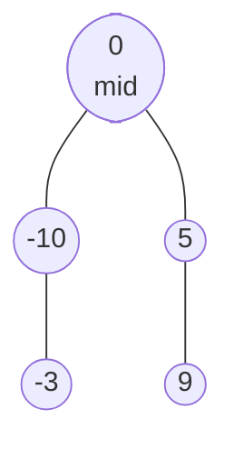

# BST Problems

> The usual BST interview questions. They all use the same fact: **inorder is sorted**, and the ordering lets you skip subtrees.

#### 1. What Is It?

| Question | Idea |
|---|---|
| **Kth Smallest in a BST** (230) | iterative inorder, stop at the `k`-th node |
| **Convert Sorted Array to BST** (108) | the **middle** is the root, recurse on both halves (gives a balanced tree) |
| **BST Iterator** (173) | a stack that holds the left spine: lazy inorder |
| **Range Sum of BST** (938) | skip subtrees that are out of range |
| **Inorder Successor** (285) | the smallest value greater than `p` |

**Signals:** "BST", "sorted", "kth", "range", "next smaller or larger".

#### 2. How It Works

**Kth smallest.** Inorder visits values in ascending order. Count nodes as you pop them. At the `k`-th pop, stop. Time `O(h + k)`.

**Sorted array to BST.** A sorted array is already an inorder list. Choose the middle element as the root so both sides have about the same size, then repeat on the left and right halves.



Input `[-10, -3, 0, 5, 9]` → root `0`, left half `[-10, -3]`, right half `[5, 9]`.

**BST Iterator.** Keep a stack with the left spine of the tree (the current node and all its left descendants). `next()` pops the top, then pushes the left spine of that node's **right child**. Each node is pushed and popped once, so `next()` is `O(1)` amortized and the stack holds at most `h` nodes.

```text
tree 7 (3, 15 (9, 20)).  start: push 7, 3.             stack [7, 3]
next() → pop 3 (no right child)                         returns 3   stack [7]
next() → pop 7, push left spine of 15: 15, 9            returns 7   stack [15, 9]
next() → pop 9                                          returns 9   stack [15]
next() → pop 15, push left spine of 20: 20              returns 15  stack [20]
next() → pop 20                                         returns 20  stack []
```

**Range sum.** If `node.value < low`, everything on the left is smaller, so go right only. If `node.value > high`, go left only. Otherwise add the node and visit both sides.

**Inorder successor.** Walk down from the root. If `p < node.value`, this node is a candidate (remember it) and go left. Otherwise go right. The last remembered node is the successor.

#### 3. Brute Force vs Optimized

| Problem | Brute force | Optimized |
|---|---|---|
| Kth smallest | inorder into a list, take index `k − 1`: `O(n)` time and space | iterative inorder, stop at `k`: `O(h + k)`, `O(h)` space |
| BST Iterator | inorder into a list up front: `O(n)` space | stack of the left spine: `O(h)` space |
| Range sum | visit all nodes, `O(n)` | skip out-of-range subtrees, `O(h + matches)` |
| Successor | inorder list, find the next | walk one path, `O(h)` |

```kotlin
// Brute force kth smallest: whole inorder list
fun kthSmallestBrute(root: TreeNode?, k: Int): Int {
    val out = mutableListOf<Int>()
    fun inorder(n: TreeNode?) {
        if (n == null) return
        inorder(n.left); out.add(n.value); inorder(n.right)
    }
    inorder(root)
    return out[k - 1]
}
```

#### 4. Kotlin Code

```kotlin
class TreeNode(val value: Int, var left: TreeNode? = null, var right: TreeNode? = null)

// Kth Smallest Element in a BST (LeetCode 230)
fun kthSmallest(root: TreeNode?, k: Int): Int {
    val stack = ArrayDeque<TreeNode>()
    var cur = root
    var remaining = k
    while (cur != null || stack.isNotEmpty()) {
        while (cur != null) {
            stack.addLast(cur)
            cur = cur.left
        }
        val node = stack.removeLast()
        remaining--
        if (remaining == 0) return node.value
        cur = node.right
    }
    return -1
}

// Convert Sorted Array to Binary Search Tree (LeetCode 108)
fun sortedArrayToBST(nums: IntArray): TreeNode? {
    fun build(lo: Int, hi: Int): TreeNode? {
        if (lo > hi) return null
        val mid = lo + (hi - lo) / 2
        return TreeNode(nums[mid], build(lo, mid - 1), build(mid + 1, hi))
    }
    return build(0, nums.size - 1)
}

// Binary Search Tree Iterator (LeetCode 173)
class BSTIterator(root: TreeNode?) {
    private val stack = ArrayDeque<TreeNode>()

    init { pushLeft(root) }

    private fun pushLeft(node: TreeNode?) {
        var cur = node
        while (cur != null) {
            stack.addLast(cur)
            cur = cur.left
        }
    }

    fun next(): Int {
        val node = stack.removeLast()
        pushLeft(node.right)
        return node.value
    }

    fun hasNext(): Boolean = stack.isNotEmpty()
}

// Range Sum of BST (LeetCode 938)
fun rangeSumBST(root: TreeNode?, low: Int, high: Int): Int {
    if (root == null) return 0
    if (root.value < low) return rangeSumBST(root.right, low, high)     // left side is too small
    if (root.value > high) return rangeSumBST(root.left, low, high)     // right side is too big
    return root.value + rangeSumBST(root.left, low, high) + rangeSumBST(root.right, low, high)
}

// Inorder Successor in BST (LeetCode 285): the smallest value greater than p
fun inorderSuccessor(root: TreeNode?, p: Int): TreeNode? {
    var cur = root
    var successor: TreeNode? = null
    while (cur != null) {
        if (p < cur.value) {
            successor = cur                              // a candidate: it is larger than p
            cur = cur.left
        } else {
            cur = cur.right
        }
    }
    return successor
}
```

Trees (`buildTree`, `toLevelList` are in note 3):

- `a = TreeNode(5, TreeNode(3, TreeNode(2, TreeNode(1)), TreeNode(4)), TreeNode(6))`
- `b = buildTree(listOf(7, 3, 15, null, null, 9, 20))`
- `c = buildTree(listOf(10, 5, 15, 3, 7, null, 18))`

Checks: `kthSmallest(buildTree(listOf(3, 1, 4, null, 2)), 1)` → `1`. `kthSmallest(a, 3)` → `3` (inorder is `1, 2, 3, 4, 5, 6`). `kthSmallestBrute(a, 3)` → `3`. `toLevelList(sortedArrayToBST(intArrayOf(-10, -3, 0, 5, 9)))` → `[0, -10, 5, null, -3, null, 9]`. `BSTIterator(b)`: `next()` → `3`, `next()` → `7`, `hasNext()` → `true`, `next()` → `9`, `next()` → `15`, `next()` → `20`, `hasNext()` → `false`. `rangeSumBST(c, 7, 15)` → `32` (`7 + 10 + 15`). `inorderSuccessor(a, 4)?.value` → `5`. `inorderSuccessor(a, 2)?.value` → `3`. `inorderSuccessor(a, 6)` → `null`.

#### 5. Complexity

| | Time | Space |
|---|---|---|
| Kth smallest | `O(h + k)` | `O(h)` |
| Sorted array to BST | `O(n)` | `O(log n)` stack |
| BST Iterator | `next()` `O(1)` amortized, `hasNext()` `O(1)` | `O(h)` |
| Range sum | `O(h + m)` for `m` nodes in range | `O(h)` |
| Inorder successor | `O(h)` | `O(1)` |

Follow-up for Kth Smallest: if the tree is changed often and `k` varies, store the **size of each left subtree** in every node. Then each query is `O(h)`.

#### 6. Common Mistakes

1. **Counting from `0` instead of `1`** for `k`.
2. **Not stopping early** in kth smallest (full traversal).
3. **BST Iterator:** building the whole inorder list in the constructor (`O(n)` memory, not the requested `O(h)`).
4. **Sorted array to BST:** using `(lo + hi) / 2` and overflowing, or picking the first element as the root (builds a chain).
5. **Range sum:** visiting both sides even when the node is out of range.
6. **Successor:** moving in the wrong direction, or returning the node when `p == cur.value` instead of going right.

#### 7. Say This in the Interview

1. "An inorder traversal of a BST is sorted, so the kth smallest is the kth node I pop. I stop there: `O(h + k)`."
2. "To build a balanced BST from a sorted array I use the middle as the root and recurse on each half."
3. "The iterator keeps a stack of the left spine, so `next()` is `O(1)` amortized and the memory is `O(h)`."

#### 8. Quick Check

1. Which element is the root when you convert `[1, 2, 3, 4, 5]` to a balanced BST?
2. After the iterator returns `3` from the tree above, what is on the stack?
3. What is the inorder successor of the largest value?

<details>
<summary>Answers</summary>

1. `3` (the middle).
2. `[7]`. Node `3` had no right child, so nothing new was pushed, and `7` is still waiting.
3. `null`, because nothing is larger.

</details>

#### 9. Related LeetCode Questions

| # | Question | Idea |
|---|---|---|
| 108 | [Convert Sorted Array to Binary Search Tree](https://leetcode.com/problems/convert-sorted-array-to-binary-search-tree/) (Easy) | middle is the root |
| 938 | [Range Sum of BST](https://leetcode.com/problems/range-sum-of-bst/) (Easy) | skip out-of-range |
| 230 | [Kth Smallest Element in a BST](https://leetcode.com/problems/kth-smallest-element-in-a-bst/) (Medium) | inorder, stop at k |
| 173 | [Binary Search Tree Iterator](https://leetcode.com/problems/binary-search-tree-iterator/) (Medium) | stack of the left spine |
| 285 | [Inorder Successor in BST](https://leetcode.com/problems/inorder-successor-in-bst/) (Medium, premium) | candidate on the way down |
| 450 | [Delete Node in a BST](https://leetcode.com/problems/delete-node-in-a-bst/) (Medium) | note 8 |
| 538 | [Convert BST to Greater Tree](https://leetcode.com/problems/convert-bst-to-greater-tree/) (Medium) | reverse inorder |
| 653 | [Two Sum IV - Input is a BST](https://leetcode.com/problems/two-sum-iv-input-is-a-bst/) (Easy) | inorder + two pointers |
