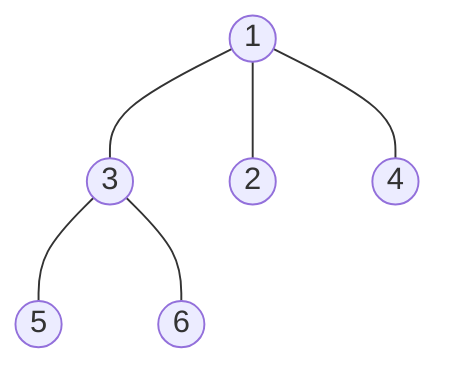
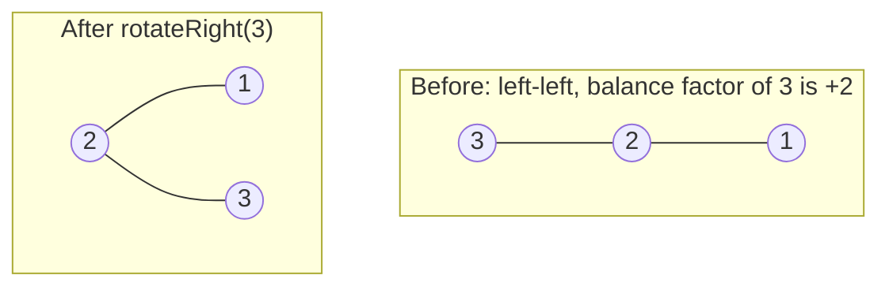

# Beyond Binary Trees: N-ary, AVL, Segment, Fenwick

> The "good to have" and "advanced" trees. You rarely code them in a first-round interview, but you must know **what they are for** and the one-line idea.

#### 1. What Is It?

| Tree | One-line idea | Priority |
|---|---|---|
| **N-ary tree** | a node has any number of children (file system, DOM, org chart) | 🟢 coded in interviews |
| **AVL tree** | a BST that **rebalances with rotations** so height stays `O(log n)` | 🟡 know the idea, rotations |
| **Red-Black tree** | a looser self-balancing BST (colours). Used in `TreeMap`, `TreeSet`, C++ `map` | 🟡 names and purpose |
| **Segment tree** | answers **range queries** (sum, min, max) and **point updates** in `O(log n)` | 🟡 advanced |
| **Fenwick tree (BIT)** | a compact tree for **prefix sums with updates** in `O(log n)` | 🟡 advanced |
| **Trie** | a tree of characters for prefix search (Trie folder) | 🟢 separate folder |
| **Heap** | a complete tree for min/max (Heap folder) | 🟢 separate folder |
| **B-tree / B+ tree** | wide, shallow trees used by **databases and file systems** to minimise disk reads | ⚪ skip at first |

#### 2. How It Works

**N-ary tree.** Each node holds a list of children. The traversals are the same as in a binary tree. DFS loops over all children. BFS uses the same level-size trick.



**AVL tree.** Store a height in each node. The **balance factor** is `height(left) − height(right)`. After an insert, if it becomes `+2` or `−2`, **rotate**.



| Imbalance | Fix |
|---|---|
| Left-Left (`bf > 1`, new key in the left-left) | rotate **right** at the node |
| Right-Right (`bf < −1`, key in the right-right) | rotate **left** at the node |
| Left-Right | rotate **left** at the left child, then rotate **right** at the node |
| Right-Left | rotate **right** at the right child, then rotate **left** at the node |

A rotation keeps the inorder order, so it is still a valid BST. Inserting `1, 2, 3, 4, 5` in order would make a chain of height 5 in a plain BST, but an AVL tree stays at height 3.

**Red-Black tree.** Every node is red or black, with rules (root is black, no two reds in a row, same number of black nodes on every path). It allows a slightly less strict balance than AVL, so it does **fewer rotations on insert/delete**. Java's `TreeMap` and `TreeSet` use it.

**Segment tree.** Each node stores the answer (sum/min/max) for a **range** of the array. The root covers everything, the children cover the two halves. A query combines `O(log n)` nodes, an update changes `O(log n)` nodes. Use it for "range minimum with updates" and "range sum with updates".

**Fenwick tree (Binary Indexed Tree).** An array where index `i` stores the sum of a block of size `lowbit(i)`. `lowbit(i) = i and (−i)`. Update moves **up** by adding `lowbit`. Query moves **down** by subtracting `lowbit`.

**B-tree / B+ tree.** Each node holds many keys (hundreds), so the tree is very shallow (3 or 4 levels for millions of rows). One node = one disk page. Indexes in databases use B+ trees (see the Database roadmap).

#### 3. Brute Force vs Optimized

| Problem | Brute force | Better |
|---|---|---|
| Range sum with updates | recompute a sum per query `O(n)`; or keep a prefix array and rebuild on update `O(n)` | Fenwick / Segment tree, `O(log n)` for both |
| BST that stays fast | plain BST, may become a chain, `O(n)` | AVL / Red-Black, `O(log n)` guaranteed |
| Any-number-of-children tree | not possible with `left` / `right` | N-ary node with a list |

```kotlin
// Brute force: sum of a range straight from the array, O(n) per query
fun rangeSumBrute(nums: IntArray, l: Int, r: Int): Int {
    var s = 0
    for (i in l..r) s += nums[i]
    return s
}
```

#### 4. Kotlin Code

```kotlin
// ---------- N-ary tree
class NaryNode(val value: Int, val children: MutableList<NaryNode> = mutableListOf())

// N-ary Tree Preorder / Postorder (LeetCode 589, 590)
fun preorderNary(root: NaryNode?, out: MutableList<Int> = mutableListOf()): List<Int> {
    if (root == null) return out
    out.add(root.value)
    for (child in root.children) preorderNary(child, out)
    return out
}

fun postorderNary(root: NaryNode?, out: MutableList<Int> = mutableListOf()): List<Int> {
    if (root == null) return out
    for (child in root.children) postorderNary(child, out)
    out.add(root.value)
    return out
}

// Maximum Depth of N-ary Tree (LeetCode 559)
fun maxDepthNary(root: NaryNode?): Int {
    if (root == null) return 0
    var deepest = 0
    for (child in root.children) deepest = maxOf(deepest, maxDepthNary(child))
    return 1 + deepest
}

// N-ary Tree Level Order Traversal (LeetCode 429)
fun levelOrderNary(root: NaryNode?): List<List<Int>> {
    val result = mutableListOf<List<Int>>()
    if (root == null) return result
    val queue = ArrayDeque<NaryNode>()
    queue.addLast(root)
    while (queue.isNotEmpty()) {
        val level = mutableListOf<Int>()
        repeat(queue.size) {
            val node = queue.removeFirst()
            level.add(node.value)
            for (child in node.children) queue.addLast(child)
        }
        result.add(level)
    }
    return result
}

// ---------- AVL tree
class AvlNode(val value: Int) {
    var left: AvlNode? = null
    var right: AvlNode? = null
    var height = 1
}

fun h(n: AvlNode?): Int = n?.height ?: 0
fun update(n: AvlNode) { n.height = 1 + maxOf(h(n.left), h(n.right)) }
fun balanceFactor(n: AvlNode?): Int = if (n == null) 0 else h(n.left) - h(n.right)

fun rotateRight(y: AvlNode): AvlNode {
    val x = y.left!!
    y.left = x.right
    x.right = y
    update(y); update(x)
    return x                                             // x is the new root of this subtree
}

fun rotateLeft(x: AvlNode): AvlNode {
    val y = x.right!!
    x.right = y.left
    y.left = x
    update(x); update(y)
    return y
}

fun insertAvl(node: AvlNode?, v: Int): AvlNode {
    if (node == null) return AvlNode(v)
    if (v < node.value) node.left = insertAvl(node.left, v)
    else if (v > node.value) node.right = insertAvl(node.right, v)
    else return node                                     // no duplicates
    update(node)
    val bf = balanceFactor(node)
    if (bf > 1) {                                        // left heavy
        if (v > node.left!!.value) node.left = rotateLeft(node.left!!)     // left-right case
        return rotateRight(node)
    }
    if (bf < -1) {                                       // right heavy
        if (v < node.right!!.value) node.right = rotateRight(node.right!!) // right-left case
        return rotateLeft(node)
    }
    return node
}

// ---------- Fenwick tree (1-indexed)
class FenwickTree(private val n: Int) {
    private val tree = IntArray(n + 1)

    fun add(index: Int, delta: Int) {
        var i = index
        while (i <= n) {
            tree[i] += delta
            i += i and (-i)                              // move up by the lowest set bit
        }
    }

    fun prefixSum(index: Int): Int {
        var i = index
        var sum = 0
        while (i > 0) {
            sum += tree[i]
            i -= i and (-i)                              // move down
        }
        return sum
    }

    fun rangeSum(l: Int, r: Int): Int = prefixSum(r) - prefixSum(l - 1)
}
```

N-ary tree for the checks: `root = NaryNode(1, mutableListOf(NaryNode(3, mutableListOf(NaryNode(5), NaryNode(6))), NaryNode(2), NaryNode(4)))`

Checks: `preorderNary(root)` → `[1, 3, 5, 6, 2, 4]`. `postorderNary(root)` → `[5, 6, 3, 2, 4, 1]`. `maxDepthNary(root)` → `3`. `levelOrderNary(root)` → `[[1], [3, 2, 4], [5, 6]]`.

AVL: `var t: AvlNode? = null; for (v in 1..5) t = insertAvl(t, v)` gives root value `2`, `h(t)` → `3`, `t.right.value` → `4`, and `t.right.left.value` → `3`. A plain BST with the same inserts has height 5. The left-left example: insert `3, 2, 1`, then the root is `2` with `1` on the left and `3` on the right.

Fenwick: add `3, 2, -1, 6, 5` at positions `1..5` (call `add(i, value)` for each). `prefixSum(3)` → `4`. `prefixSum(5)` → `15`. `rangeSum(2, 4)` → `7`. After `add(2, 10)`: `rangeSum(2, 4)` → `17`. `rangeSumBrute(intArrayOf(3, 2, -1, 6, 5), 1, 3)` → `7` (0-indexed).

#### 5. Complexity

| Structure | Search | Insert / update | Query | Space |
|---|---|---|---|---|
| N-ary tree | `O(n)` | `O(1)` add child | | `O(n)` |
| AVL / Red-Black | `O(log n)` | `O(log n)` | | `O(n)` |
| Segment tree | | update `O(log n)` | range query `O(log n)` | `O(n)` |
| Fenwick tree | | update `O(log n)` | prefix `O(log n)` | `O(n)` |
| B+ tree (disk) | `O(log_B n)` page reads | `O(log_B n)` | range scan fast | `O(n)` |

#### 6. Common Mistakes

1. **Treating an N-ary tree like a binary tree** (fixed `left`/`right`).
2. **AVL:** forgetting to update heights after a rotation, or applying a single rotation on a left-right case.
3. **Fenwick:** using 0-based indexes. It is 1-based.
4. **Fenwick:** `i += i and (−i)` written as `i += i & -i` (Java style) in Kotlin. Use `and`.
5. **Choosing a segment tree** when a plain prefix array is enough (no updates).
6. **Spending interview time** coding Red-Black rotations. Explain the idea instead.

#### 7. Say This in the Interview

1. "A plain BST can degrade to a chain. An AVL tree stores heights and rotates after an insert when the balance factor leaves `[-1, 1]`, so the height stays `O(log n)`."
2. "Java's `TreeMap` is a Red-Black tree, so `get`, `put` and `remove` are `O(log n)`."
3. "For range sums with updates I'd use a Fenwick tree or a segment tree. Both are `O(log n)` per operation, while a prefix array makes updates `O(n)`."

#### 8. Quick Check

1. What is the balance factor of a node with left height 3 and right height 1?
2. Which rotation fixes a left-left imbalance?
3. When do you pick a segment tree over a prefix-sum array?

<details>
<summary>Answers</summary>

1. `3 − 1 = 2`, which is out of balance (left heavy).
2. A single right rotation at the unbalanced node.
3. When values change between queries (updates), or when the query is not a sum (min, max, gcd).

</details>

#### 9. Related LeetCode Questions

| # | Question | Idea |
|---|---|---|
| 589 | [N-ary Tree Preorder Traversal](https://leetcode.com/problems/n-ary-tree-preorder-traversal/) (Easy) | loop over children |
| 559 | [Maximum Depth of N-ary Tree](https://leetcode.com/problems/maximum-depth-of-n-ary-tree/) (Easy) | max over children |
| 429 | [N-ary Tree Level Order Traversal](https://leetcode.com/problems/n-ary-tree-level-order-traversal/) (Medium) | queue + level size |
| 1448 | [Count Good Nodes in Binary Tree](https://leetcode.com/problems/count-good-nodes-in-binary-tree/) (Medium) | pass max down |
| 307 | [Range Sum Query - Mutable](https://leetcode.com/problems/range-sum-query-mutable/) (Medium) | Fenwick or segment tree |
| 315 | [Count of Smaller Numbers After Self](https://leetcode.com/problems/count-of-smaller-numbers-after-self/) (Hard) | Fenwick tree |
