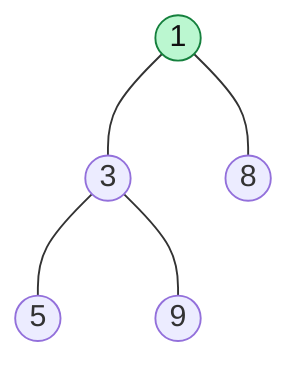

# Heap Fundamentals

> A heap gives you the smallest (or largest) item in `O(1)`, and lets you add or remove items in `O(log n)`. It is the tool behind "top K", "kth largest" and "always take the best next".

#### 1. What Is It?

A **heap** is a **complete binary tree** where every parent is ordered against its children:

- **Min-heap:** every parent `≤` its children, so the **smallest** item is at the root.
- **Max-heap:** every parent `≥` its children, so the **largest** item is at the root.

A heap is **not sorted**. Only the **root** is guaranteed to be the best. Siblings and cousins have no order.

**Why it matters:** many interview questions need "the best item right now, again and again", while items keep arriving or leaving. A sorted array makes insert slow. A plain array makes finding the best slow. A heap makes both fast.

**Signals:** "kth largest / smallest", "top K", "K closest", "merge K sorted", "running median", "schedule by priority", "always pick the smallest".

#### 2. How It Works

*A min-heap. The root `1` is the smallest. The array below the tree shows how it is stored.*



```text
array:  [1, 3, 8, 5, 9]
index:   0  1  2  3  4        children of index i are 2i+1 and 2i+2
```

| Operation | What happens | Cost |
|---|---|---|
| `peek()` | read the root | `O(1)` |
| `add(x)` | put at the end, move up while smaller than the parent | `O(log n)` |
| `poll()` | take the root, move the last item to the root, move it down | `O(log n)` |
| build from `n` items | heapify (note 16) | `O(n)` |
| search for a value | no order inside, scan | `O(n)` |

The tree is **complete**, so its height is `log₂ n`. That is why every move up or down costs `O(log n)`.

**Heap vs other structures**

| | Unsorted list | Sorted list | Balanced BST | **Heap** |
|---|---|---|---|---|
| Get min | `O(n)` | `O(1)` | `O(log n)` | **`O(1)`** |
| Insert | `O(1)` | `O(n)` | `O(log n)` | **`O(log n)`** |
| Remove min | `O(n)` | `O(1)` or `O(n)` | `O(log n)` | **`O(log n)`** |
| Search any value | `O(n)` | `O(log n)` | `O(log n)` | `O(n)` |
| Memory | array | array | nodes + pointers | **plain array** |

Pick a heap when you only need the **extreme** item. Pick a BST (`TreeMap`) when you also need search or ordered iteration.

#### 3. Brute Force vs Optimized

Task: "keep a collection and repeatedly remove the smallest."

| Approach | Insert | Remove smallest | `n` inserts + `n` removes |
|---|---|---|---|
| Unsorted list, scan for the min | `O(1)` | `O(n)` | `O(n²)` |
| Sorted list | `O(n)` | `O(1)` | `O(n²)` |
| Heap | `O(log n)` | `O(log n)` | `O(n log n)` |

```kotlin
// Brute force: a list, scan for the smallest every time
class ListQueue {
    private val items = mutableListOf<Int>()
    fun add(x: Int) { items.add(x) }                       // O(1)
    fun poll(): Int {                                      // O(n)
        var best = 0
        for (i in items.indices) if (items[i] < items[best]) best = i
        return items.removeAt(best)
    }
}
```

#### 4. Kotlin Code

```kotlin
import java.util.PriorityQueue

fun main() {
    val heap = PriorityQueue<Int>()                        // min-heap
    for (x in listOf(5, 3, 8, 1, 9)) heap.add(x)

    println(heap.peek())      // 1   (smallest, not removed)
    println(heap.poll())      // 1   (removed)
    println(heap.poll())      // 3
    println(heap.size)        // 3
}
```

Checks: after adding `5, 3, 8, 1, 9`, `peek()` → `1`. Then `poll()` repeatedly returns `1, 3, 5, 8, 9`. `ListQueue` gives the same answers, but each `poll()` scans the whole list. `PriorityQueue<Int>().peek()` on an empty heap → `null` (it does not throw).

Kotlin's `PriorityQueue` is a **min-heap by default**. Details are in note 7.

#### 5. Complexity

| | Time | Space |
|---|---|---|
| `peek` | `O(1)` | |
| `add`, `poll` | `O(log n)` | |
| Heapify `n` items | `O(n)` | in place |
| Heap of `n` items | | `O(n)` |

#### 6. Common Mistakes

1. **Thinking a heap is sorted.** Printing or iterating a `PriorityQueue` does **not** give sorted order. Use `poll()` repeatedly.
2. **Using a heap to search** for an arbitrary value (it is `O(n)`).
3. **Using a min-heap when you need a max-heap** (note 2).
4. **Forgetting that `peek()` returns `null`** on an empty heap and `remove()` throws.
5. **Choosing a heap when a sort is enough.** If you only need one answer from fixed data, `O(n log n)` sorting or an `O(n)` scan can be simpler.

#### 7. Say This in the Interview

1. "I need the smallest item again and again while items come and go. A heap gives `O(1)` peek and `O(log n)` insert and remove."
2. "A heap is a complete binary tree stored in an array. Only the root is ordered, so it is not a sorted structure."
3. "Sorting everything would be `O(n log n)`. With a heap of size `K` I can do `O(n log K)`."

#### 8. Quick Check

1. What is the time to get the minimum from a min-heap? To remove it?
2. Is `[1, 3, 8, 5, 9]` a valid min-heap?
3. Can you read all heap items in sorted order by iterating the array?

<details>
<summary>Answers</summary>

1. `O(1)` to read, `O(log n)` to remove.
2. Yes. Index 0 has children 3 and 8 (both larger). Index 1 (value 3) has children 5 and 9 (both larger).
3. No. Only the root is guaranteed. You must `poll()` repeatedly.

</details>

#### 9. Related LeetCode Questions

| # | Question | Idea |
|---|---|---|
| 1046 | [Last Stone Weight](https://leetcode.com/problems/last-stone-weight/) (Easy) | max-heap warm-up |
| 703 | [Kth Largest Element in a Stream](https://leetcode.com/problems/kth-largest-element-in-a-stream/) (Easy) | min-heap of size K |
| 215 | [Kth Largest Element in an Array](https://leetcode.com/problems/kth-largest-element-in-an-array/) (Medium) | heap or quickselect |
| 347 | [Top K Frequent Elements](https://leetcode.com/problems/top-k-frequent-elements/) (Medium) | heap on counts |
| 1337 | [The K Weakest Rows in a Matrix](https://leetcode.com/problems/the-k-weakest-rows-in-a-matrix/) (Easy) | heap with a tie rule |
