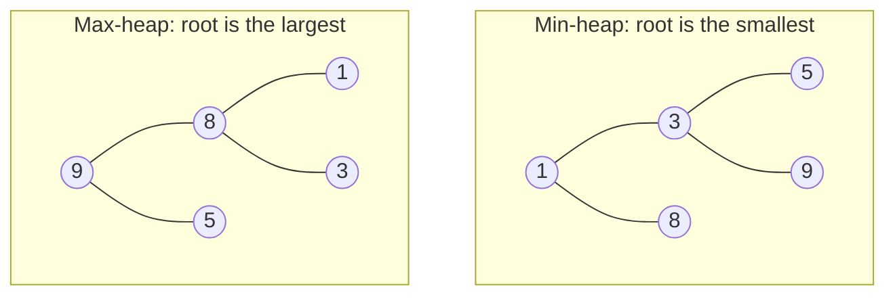

# Min Heap vs Max Heap

> The first decision in every heap problem. A small rule decides it: **to keep the K largest, use a min-heap. To keep the K smallest, use a max-heap.**

#### 1. What Is It?

- A **min-heap** keeps the **smallest** item at the root.
- A **max-heap** keeps the **largest** item at the root.

They are the same structure with the comparison reversed.

**Why it matters:** the best heap is often the **opposite** of what the words suggest. "Find the K largest" wants a **min**-heap, because you need to throw away the **smallest** of your K candidates.

#### 2. How It Works

The same values `5, 3, 8, 1, 9`:



**The Top K rule**

| Goal | Use | Why |
|---|---|---|
| `K` **largest** items | **min**-heap of size `K` | the root is the smallest of the `K` kept, so it is the one to evict |
| `K` **smallest** items | **max**-heap of size `K` | the root is the largest of the `K` kept |
| process the earliest deadline first | min-heap | smallest deadline on top |
| process the highest score first | max-heap | largest score on top |
| lower half of a stream (median) | max-heap | you need the largest of the lower half |
| upper half of a stream (median) | min-heap | you need the smallest of the upper half |

```text
K largest of [5, 3, 8, 1, 9], K = 3  (min-heap of size 3)
add 5 → [5]    add 3 → [3,5]    add 8 → [3,5,8]
add 1 → size 4 → remove the smallest (1) → [3,5,8]
add 9 → size 4 → remove the smallest (3) → [5,8,9]       answer: 5, 8, 9
```

Kotlin gives a **min-heap**. To get a max-heap, reverse the comparison.

#### 3. Brute Force vs Optimized

| Goal | Brute force | Heap |
|---|---|---|
| `K` largest of `n` | sort descending, take `K`: `O(n log n)` | min-heap of size `K`: `O(n log K)` |
| Max of a changing collection | scan: `O(n)` per query | max-heap: `O(log n)` per update |

```kotlin
fun kLargestBySort(nums: IntArray, k: Int): List<Int> =
    nums.sortedDescending().take(k)                          // O(n log n)
```

#### 4. Kotlin Code

```kotlin
import java.util.PriorityQueue

// Min-heap (default)
val minHeap = PriorityQueue<Int>()

// Max-heap
val maxHeap = PriorityQueue<Int>(compareByDescending<Int> { it })
// also: PriorityQueue<Int>(Collections.reverseOrder())

// The K largest with a min-heap of size K
fun kLargest(nums: IntArray, k: Int): List<Int> {
    val heap = PriorityQueue<Int>()
    for (x in nums) {
        heap.add(x)
        if (heap.size > k) heap.poll()                       // drop the smallest
    }
    return heap.sortedDescending()
}

// The K smallest with a max-heap of size K
fun kSmallest(nums: IntArray, k: Int): List<Int> {
    val heap = PriorityQueue<Int>(compareByDescending<Int> { it })
    for (x in nums) {
        heap.add(x)
        if (heap.size > k) heap.poll()                       // drop the largest
    }
    return heap.sorted()
}
```

Checks: with `5, 3, 8, 1, 9`: `minHeap.peek()` → `1`, `maxHeap.peek()` → `9`. `kLargest(intArrayOf(5, 3, 8, 1, 9), 3)` → `[9, 8, 5]`. `kSmallest(intArrayOf(5, 3, 8, 1, 9), 3)` → `[1, 3, 5]`. `kLargestBySort(...)` → `[9, 8, 5]`.

#### 5. Complexity

| | Time | Space |
|---|---|---|
| Top K with a heap of size `K` | `O(n log K)` | `O(K)` |
| Sort and take `K` | `O(n log n)` | `O(n)` |

#### 6. Common Mistakes

1. **Using a max-heap for "K largest"** and keeping all `n` items.
2. **Using `a - b` in a comparator.** It can overflow. Use `compareBy` or `compareByDescending`.
3. **Forgetting that `PriorityQueue` is a min-heap by default** in Kotlin and Java.
4. **Not capping the size at `K`.** Without `if (size > k) poll()`, the heap holds everything.
5. **Mixing up the reading:** after the loop, the **root** is the Kth largest (min-heap), not the largest.

#### 7. Say This in the Interview

1. "For the K largest I use a **min**-heap of size K. The root is the smallest of my candidates, so it is the one to drop when a bigger value arrives."
2. "That is `O(n log K)` time and `O(K)` space, better than sorting when K is small."
3. "Kotlin's `PriorityQueue` is a min-heap. I reverse the comparator for a max-heap."

#### 8. Quick Check

1. Which heap finds the 3 smallest numbers?
2. After processing a stream with a min-heap of size `K = 2`, what does `peek()` return?
3. Why not use `{ a, b -> b - a }` for a max-heap?

<details>
<summary>Answers</summary>

1. A **max**-heap of size 3.
2. The 2nd largest value seen so far (the smallest of the two kept).
3. Subtraction can overflow for large or negative values. `compareByDescending` is safe.

</details>

#### 9. Related LeetCode Questions

| # | Question | Idea |
|---|---|---|
| 1046 | [Last Stone Weight](https://leetcode.com/problems/last-stone-weight/) (Easy) | max-heap |
| 703 | [Kth Largest Element in a Stream](https://leetcode.com/problems/kth-largest-element-in-a-stream/) (Easy) | min-heap of size K |
| 215 | [Kth Largest Element in an Array](https://leetcode.com/problems/kth-largest-element-in-an-array/) (Medium) | min-heap of size K |
| 973 | [K Closest Points to Origin](https://leetcode.com/problems/k-closest-points-to-origin/) (Medium) | max-heap of size K |
| 506 | [Relative Ranks](https://leetcode.com/problems/relative-ranks/) (Easy) | max-heap of scores |
