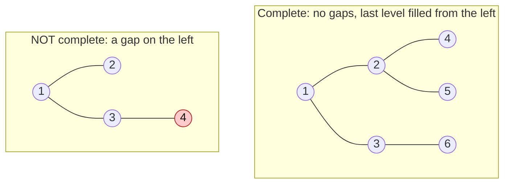

# Complete Binary Tree Property

> A heap is always a **complete** binary tree. That one fact lets you store it in a plain array and move around with index math.

#### 1. What Is It?

A binary tree is **complete** when every level is full except possibly the last, and the last level is filled **from the left**, with no gaps.

A heap must have two properties:

1. **Shape:** the tree is complete.
2. **Order:** every parent `≤` its children (min-heap) or `≥` (max-heap).

Because of the shape rule, there are **no gaps**, so the tree can be stored in an **array** with no pointers and no wasted slots.

#### 2. How It Works



**Array layout** (level by level, index from 0):

```text
tree:     1                 array:  [1, 2, 3, 4, 5, 6]
        /   \                index:   0  1  2  3  4  5
       2     3
      / \   /
     4   5 6
```

| For the node at index `i` | Index |
|---|---|
| left child | `2i + 1` |
| right child | `2i + 2` |
| parent | `(i − 1) / 2` |
| last parent (has a child) | `n / 2 − 1` |
| leaves | indexes `n / 2` to `n − 1` |

```text
n = 6:   last parent = 6/2 - 1 = 2 (value 3).   leaves are indexes 3, 4, 5 (values 4, 5, 6)
index 4 (value 5): parent = (4 - 1) / 2 = 1 (value 2)       ✓
index 1 (value 2): left = 3 (value 4), right = 4 (value 5)  ✓
```

Why the **shape** matters: it keeps the height at `log₂ n`, so every sift-up and sift-down takes at most `log n` steps. And a new item always goes at the **end of the array**, which is the next free spot on the last level.

#### 3. Brute Force vs Optimized

| Storage | Memory per node | Finding a parent | Note |
|---|---|---|---|
| Node objects with `left`, `right`, `parent` pointers | 3 pointers | `O(1)` | extra memory, slow to allocate |
| **Array with index math** | none | `O(1)` | compact, cache friendly |

A **non-complete** tree stored in an array would leave holes and waste space. That is why heaps are always complete.

```kotlin
// Pointer-based node, for comparison. A heap does NOT need this.
class HeapNode(var value: Int, var left: HeapNode? = null, var right: HeapNode? = null, var parent: HeapNode? = null)
```

#### 4. Kotlin Code

```kotlin
fun leftChild(i: Int) = 2 * i + 1
fun rightChild(i: Int) = 2 * i + 2
fun parentOf(i: Int) = (i - 1) / 2

// Is this array a valid min-heap?
fun isMinHeap(a: IntArray): Boolean {
    for (i in a.indices) {
        val l = leftChild(i)
        val r = rightChild(i)
        if (l < a.size && a[i] > a[l]) return false
        if (r < a.size && a[i] > a[r]) return false
    }
    return true
}

// Is a tree (given as a level-order list with nulls) complete? A null must never come before a value.
fun isCompleteLevelList(values: List<Int?>): Boolean {
    var seenNull = false
    for (v in values) {
        if (v == null) seenNull = true
        else if (seenNull) return false
    }
    return true
}
```

Checks: `leftChild(1)` → `3`, `rightChild(1)` → `4`, `parentOf(5)` → `2`. `isMinHeap(intArrayOf(1, 3, 8, 5, 9))` → `true`. `isMinHeap(intArrayOf(5, 3, 8))` → `false` (`5 > 3`). `isMinHeap(intArrayOf())` → `true`. `isCompleteLevelList(listOf(1, 2, 3, 4, null))` → `true`. `isCompleteLevelList(listOf(1, 2, null, 4))` → `false`.

#### 5. Complexity

| | Time | Space |
|---|---|---|
| Index math (child, parent) | `O(1)` | none |
| Tree height | `log₂ n` | |
| `isMinHeap` check | `O(n)` | `O(1)` |

#### 6. Common Mistakes

1. **Parent index `i / 2`** (that is the 1-based formula). With 0-based indexes use `(i − 1) / 2`.
2. **Forgetting to check `2i + 1 < n`** before reading a child.
3. **Confusing complete with full or perfect.** Complete allows the last level to be partly filled.
4. **Storing a non-complete tree in an array** and getting holes.
5. **Assuming a complete tree is sorted.** Complete is about **shape**, not values.

#### 7. Say This in the Interview

1. "A heap is a complete binary tree, so I can store it in an array. The children of index `i` are `2i + 1` and `2i + 2`, and the parent is `(i − 1) / 2`."
2. "A complete tree has height `log n`, so insert and remove cost `O(log n)`."
3. "A new element always goes at the end of the array, which keeps the tree complete, and then I fix the order by moving it up."

#### 8. Quick Check

1. In a heap array of 10 elements, what is the index of the last parent?
2. What is the parent index of index 7?
3. Is a tree with root, a left child and a right child of the **left** child complete?

<details>
<summary>Answers</summary>

1. `10 / 2 − 1 = 4`.
2. `(7 − 1) / 2 = 3`.
3. No. The root's right child is missing but the next level has a node, which is a gap.

</details>

#### 9. Related LeetCode Questions

| # | Question | Idea |
|---|---|---|
| 958 | [Check Completeness of a Binary Tree](https://leetcode.com/problems/check-completeness-of-a-binary-tree/) (Medium) | BFS, no null before a node |
| 222 | [Count Complete Tree Nodes](https://leetcode.com/problems/count-complete-tree-nodes/) (Easy) | complete shape shortcut |
| 919 | [Complete Binary Tree Inserter](https://leetcode.com/problems/complete-binary-tree-inserter/) (Medium) | insert at the next free spot |
| 215 | [Kth Largest Element in an Array](https://leetcode.com/problems/kth-largest-element-in-an-array/) (Medium) | uses a heap |
| 912 | [Sort an Array](https://leetcode.com/problems/sort-an-array/) (Medium) | heap sort is one option (note 17) |
