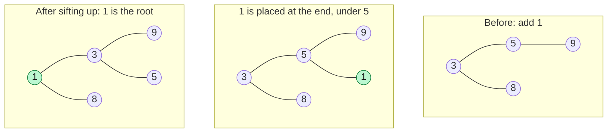

# Heap Operations & Complexity

> Insert moves a value **up**. Extract moves a value **down**. Both follow one path of length `log n`. Know this well enough to explain it and to code it.

#### 1. What Is It?

The core operations of a heap (shown for a min-heap):

| Operation | Meaning | Cost |
|---|---|---|
| **peek** | look at the smallest item | `O(1)` |
| **insert (add)** | add an item, then **sift up** | `O(log n)` |
| **extract (poll)** | remove the smallest, then **sift down** | `O(log n)` |
| **heapify / build** | turn an array into a heap | `O(n)` (note 16) |

**Sift up** and **sift down** are the only two helpers. Everything else uses them.

#### 2. How It Works

**Insert: add at the end, then sift up.** Put the new item at the end of the array (the next free spot keeps the tree complete). While it is smaller than its parent, swap with the parent.



```text
array [3, 5, 8, 9]  →  add 1  →  [3, 5, 8, 9, 1]
index 4: parent index 1 (5).  1 < 5  → swap   [3, 1, 8, 9, 5]
index 1: parent index 0 (3).  1 < 3  → swap   [1, 3, 8, 9, 5]
index 0: no parent → stop
```

**Extract: move the last item to the root, then sift down.** Remove the root (the answer). Move the **last** item to index 0 (this keeps the tree complete). While it is larger than a child, swap it with the **smaller** child.

```text
array [1, 3, 8, 9, 5]     poll() returns 1
move last (5) to the root:  [5, 3, 8, 9]
index 0 (5): children 3 and 8 → smaller is 3 → 5 > 3 → swap   [3, 5, 8, 9]
index 1 (5): child 9 (index 3) → 5 < 9 → stop
heap: [3, 5, 8, 9]
```

**Why `O(log n)`:** the tree is complete, so its height is `log₂ n`. Each swap moves one level.

**Delete an arbitrary item** is not a heap operation. It takes `O(n)` to find it, then `O(log n)` to fix. If you need it, use **lazy deletion** (note 23).

#### 3. Brute Force vs Optimized

| Operation | Sorted array | Heap |
|---|---|---|
| peek | `O(1)` | `O(1)` |
| insert | `O(n)` (shift) | `O(log n)` |
| extract min | `O(1)` or `O(n)` | `O(log n)` |

```kotlin
// Brute force insert into a sorted list: O(n) shifts
fun insertSorted(list: MutableList<Int>, x: Int) {
    var i = 0
    while (i < list.size && list[i] < x) i++
    list.add(i, x)
}
```

#### 4. Kotlin Code

```kotlin
// A min-heap built on an ArrayList
class MinHeap {
    private val a = ArrayList<Int>()

    val size: Int get() = a.size
    fun isEmpty() = a.isEmpty()

    fun peek(): Int = a[0]

    fun add(x: Int) {
        a.add(x)
        siftUp(a.size - 1)
    }

    fun poll(): Int {
        val top = a[0]
        val last = a.removeAt(a.size - 1)               // remove the last item
        if (a.isNotEmpty()) {
            a[0] = last                                  // move it to the root
            siftDown(0)
        }
        return top
    }

    private fun siftUp(start: Int) {
        var i = start
        while (i > 0) {
            val p = (i - 1) / 2
            if (a[p] <= a[i]) break                      // parent is already smaller
            swap(p, i)
            i = p
        }
    }

    private fun siftDown(start: Int) {
        var i = start
        while (true) {
            val l = 2 * i + 1
            val r = l + 1
            var smallest = i
            if (l < a.size && a[l] < a[smallest]) smallest = l
            if (r < a.size && a[r] < a[smallest]) smallest = r
            if (smallest == i) break                     // both children are larger
            swap(i, smallest)
            i = smallest
        }
    }

    private fun swap(i: Int, j: Int) { val t = a[i]; a[i] = a[j]; a[j] = t }

    override fun toString() = a.toString()
}
```

Checks: add `5, 3, 8, 1, 9` one by one: the arrays are `[5]`, `[3, 5]`, `[3, 5, 8]`, `[1, 3, 8, 5]`, `[1, 3, 8, 5, 9]`. `peek()` → `1`. `poll()` → `1` and the heap becomes `[3, 5, 8, 9]`. Polling everything returns `1, 3, 5, 8, 9`. `size` → `0` at the end.

Trace of adding `1` to `[3, 5, 8]`: placed at index 3 → parent index 1 (`5`) is larger → swap → at index 1, parent index 0 (`3`) is larger → swap → `[1, 3, 8, 5]`.

For a **max-heap**, flip the two comparisons: swap while the child is **larger** than the parent.

#### 5. Complexity

| Operation | Time | Space |
|---|---|---|
| `peek` | `O(1)` | `O(1)` |
| `add` | `O(log n)` | `O(1)` |
| `poll` | `O(log n)` | `O(1)` |
| Build from `n` items (`add` each) | `O(n log n)` | |
| Build with heapify | `O(n)` | |
| Search / remove by value | `O(n)` | |
| `n` adds then `n` polls (heap sort idea) | `O(n log n)` | |

#### 6. Common Mistakes

1. **Sift down with the wrong child.** In a min-heap swap with the **smaller** child, or the heap order breaks.
2. **Forgetting to check `l < size`** and `r < size` before reading children.
3. **`poll()` without moving the last item to the root** (leaves a hole).
4. **Removing the last element after reading `a[0]`** in the wrong order when the heap has one element.
5. **Using `<` vs `<=`:** both work, but be consistent.
6. **Thinking `remove(x)` is `O(log n)`.** On `PriorityQueue` it is `O(n)`.

#### 7. Say This in the Interview

1. "Insert puts the item at the end and sifts it up, at most `log n` swaps. Extract moves the last item to the root and sifts it down, always swapping with the smaller child in a min-heap."
2. "Both are `O(log n)` because the heap is a complete tree with height `log n`. Peek is `O(1)`."
3. "Removing an arbitrary element is `O(n)`, so I'd use lazy deletion if I needed it."

#### 8. Quick Check

1. Insert `2` into the min-heap `[3, 5, 8, 9]`. What is the result?
2. In sift down, why swap with the **smaller** child?
3. What does `poll()` do to the last element?

<details>
<summary>Answers</summary>

1. `2` goes to index 4, parent index 1 (`5`) → swap, parent index 0 (`3`) → swap. Result `[2, 3, 8, 9, 5]`.
2. After the swap, the smaller child becomes the parent of the other child, so the order stays valid. Swapping with the larger child would leave a parent larger than its other child.
3. It moves it to the root and sifts it down.

</details>

#### 9. Related LeetCode Questions

| # | Question | Idea |
|---|---|---|
| 1046 | [Last Stone Weight](https://leetcode.com/problems/last-stone-weight/) (Easy) | repeated extract and insert |
| 703 | [Kth Largest Element in a Stream](https://leetcode.com/problems/kth-largest-element-in-a-stream/) (Easy) | add and poll |
| 912 | [Sort an Array](https://leetcode.com/problems/sort-an-array/) (Medium) | heap sort |
| 1845 | [Seat Reservation Manager](https://leetcode.com/problems/seat-reservation-manager/) (Medium) | min-heap of free seats |
| 295 | [Find Median from Data Stream](https://leetcode.com/problems/find-median-from-data-stream/) (Hard) | two heaps |
