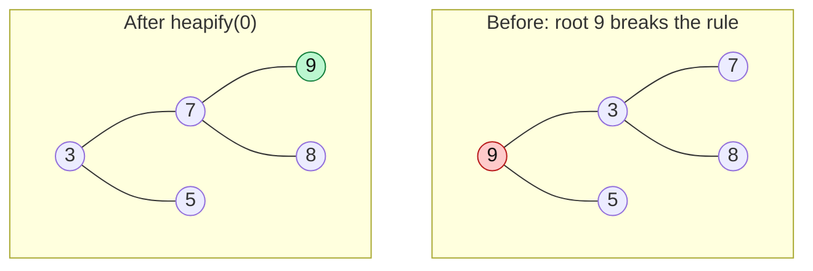

# Heapify: Basic Concept

> **Heapify** fixes **one** node that may be out of place by moving it down. It is the same "sift down" from the last note, now used as a tool to repair or to build a heap.

#### 1. What Is It?

**Heapify** (also "sift down" or "percolate down") takes a node whose **two subtrees are already valid heaps**, and moves the node down until the heap property holds again.

Use it to:

- repair the heap after removing the root,
- **build a heap from an unordered array** (note 16),
- do heap sort (note 17).

#### 2. How It Works

```text
heapify(i):
    smallest = i
    if left child exists  and  a[left]  < a[smallest]: smallest = left
    if right child exists and a[right] < a[smallest]: smallest = right
    if smallest != i:
        swap a[i] and a[smallest]
        heapify(smallest)        // the swapped value may be out of place again
```



```text
array [9, 3, 5, 7, 8]
heapify(0): children 3 (idx 1) and 5 (idx 2), smallest = 3 → swap  [3, 9, 5, 7, 8]
heapify(1): children 7 (idx 3) and 8 (idx 4), smallest = 7 → swap  [3, 7, 5, 9, 8]
heapify(3): no children → stop
result: [3, 7, 5, 9, 8]
```

(Each step moves the value one level down, so heapify costs `O(log n)` for one node.)

**Precondition:** both subtrees must already be heaps. Heapify only fixes **one** bad node at the top.

#### 3. Brute Force vs Optimized

| Goal | Brute force | With heapify |
|---|---|---|
| Fix a heap after the root changed | sort the whole array, `O(n log n)` | one heapify, `O(log n)` |
| Make a heap from an array | `n` inserts, `O(n log n)` | heapify from the last parent up, `O(n)` (note 16) |

```kotlin
// Brute force repair: just sort. A sorted array is always a valid min-heap, but it costs O(n log n).
fun repairBySorting(a: IntArray) = a.sort()
```

#### 4. Kotlin Code

```kotlin
// Heapify a single node (min-heap) within the first `size` items
fun heapifyDown(a: IntArray, size: Int, start: Int) {
    var i = start
    while (true) {
        val l = 2 * i + 1
        val r = 2 * i + 2
        var smallest = i
        if (l < size && a[l] < a[smallest]) smallest = l
        if (r < size && a[r] < a[smallest]) smallest = r
        if (smallest == i) return
        val tmp = a[i]; a[i] = a[smallest]; a[smallest] = tmp
        i = smallest
    }
}
```

Checks: `val a = intArrayOf(9, 3, 5, 7, 8); heapifyDown(a, a.size, 0)` → `a` becomes `[3, 7, 5, 9, 8]`. On `[1, 3, 5]` the call changes nothing. `heapifyDown(intArrayOf(5), 1, 0)` changes nothing. `heapifyDown(intArrayOf(4, 1), 2, 0)` → `[1, 4]`.

#### 5. Complexity

| | Time | Space |
|---|---|---|
| Heapify one node | `O(log n)` (at most the height) | `O(1)` iterative |
| Recursive version | `O(log n)` | `O(log n)` stack |

#### 6. Common Mistakes

1. **Calling heapify when the subtrees are not heaps.** It will not fix the whole array.
2. **Choosing the wrong child** (always the smaller one in a min-heap).
3. **Not looping** after a swap. The moved value may still be too large.
4. **Reading a child index past `size`.** Check `l < size` and `r < size`.
5. **Using the array length instead of the heap size** during heap sort.

#### 7. Say This in the Interview

1. "Heapify takes a node whose two subtrees are heaps, and moves the node down, swapping with the smaller child, until the order is restored. That is `O(log n)`."
2. "It is the same step that `poll()` uses after moving the last item to the root."
3. "Running heapify on every parent from the bottom up builds a heap in `O(n)`."

#### 8. Quick Check

1. What must be true before you call heapify on a node?
2. What is the result of heapify at index 0 on `[4, 1]`?
3. How many nodes can heapify move at most?

<details>
<summary>Answers</summary>

1. Both of its subtrees must already be valid heaps.
2. `[1, 4]`.
3. One value moves down at most `log n` levels.

</details>

#### 9. Related LeetCode Questions

| # | Question | Idea |
|---|---|---|
| 912 | [Sort an Array](https://leetcode.com/problems/sort-an-array/) (Medium) | heap sort uses heapify |
| 215 | [Kth Largest Element in an Array](https://leetcode.com/problems/kth-largest-element-in-an-array/) (Medium) | build a heap, poll |
| 1046 | [Last Stone Weight](https://leetcode.com/problems/last-stone-weight/) (Easy) | heap from an array |
| 1337 | [The K Weakest Rows in a Matrix](https://leetcode.com/problems/the-k-weakest-rows-in-a-matrix/) (Easy) | heap with tie-break |
| 506 | [Relative Ranks](https://leetcode.com/problems/relative-ranks/) (Easy) | max-heap of scores |
