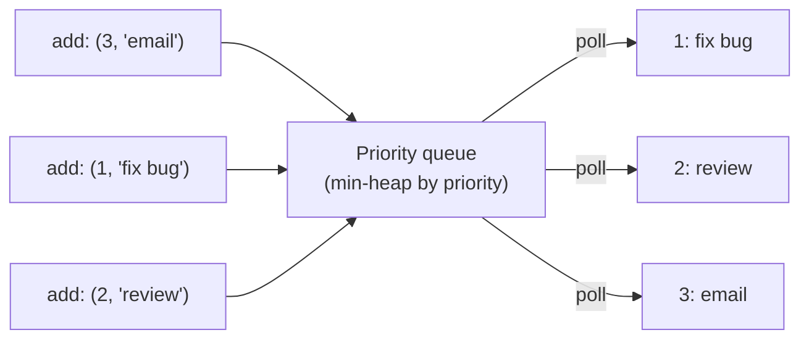

# Priority Queue

> A queue where the item with the **highest priority** leaves first, not the oldest. A heap is how it is built.

#### 1. What Is It?

A **priority queue (PQ)** is an abstract data type with three operations:

| Operation | Meaning |
|---|---|
| `add(item)` | put an item in |
| `peek()` | look at the highest-priority item |
| `poll()` | remove and return the highest-priority item |

- A **queue** is first-in-first-out. A **priority queue** is **best-in-first-out**.
- "Priority" is whatever you define: the smallest number, the earliest deadline, the highest score.
- A **heap** is the usual **implementation** of a priority queue. (The PQ is the idea. The heap is the machinery.)

**Signals:** "process in order of priority / deadline / cost", "always pick the smallest", "next best", "scheduler", "Dijkstra".

#### 2. How It Works



Items come out in priority order, not in the order they were added.

**Priority queue vs plain queue vs sorted list**

| | Queue | Sorted list | **Priority queue (heap)** |
|---|---|---|---|
| Next item | oldest | smallest | smallest (or largest) |
| `add` | `O(1)` | `O(n)` | `O(log n)` |
| `poll` | `O(1)` | `O(1)` | `O(log n)` |

**Where it is used**

- **Dijkstra** (always expand the closest node), **Prim**, A*
- task schedulers, event simulation, OS process scheduling
- **top K** and **merge K sorted**
- Huffman coding, running median, load balancing

**Ties.** If two items have the same priority, the order between them is **not guaranteed** (a heap is not stable). If order matters, add a sequence number as the second key.

#### 3. Brute Force vs Optimized

| Approach | `add` | `poll` | Note |
|---|---|---|---|
| Unsorted list | `O(1)` | `O(n)` scan | simple, slow polls |
| Sorted list | `O(n)` | `O(1)` | slow adds |
| **Heap** | `O(log n)` | `O(log n)` | balanced |

```kotlin
// Brute force PQ: keep an unsorted list and scan for the highest priority each time
class ListPriorityQueue {
    private val items = mutableListOf<Pair<Int, String>>()          // (priority, name)
    fun add(priority: Int, name: String) { items.add(priority to name) }
    fun poll(): Pair<Int, String> {                                 // O(n)
        var best = 0
        for (i in items.indices) if (items[i].first < items[best].first) best = i
        return items.removeAt(best)
    }
}
```

#### 4. Kotlin Code

```kotlin
import java.util.PriorityQueue

data class Task(val priority: Int, val name: String)

fun runTasks(tasks: List<Task>): List<String> {
    val pq = PriorityQueue<Task>(compareBy<Task> { it.priority })   // smallest priority number first
    for (t in tasks) pq.add(t)
    val order = mutableListOf<String>()
    while (pq.isNotEmpty()) order.add(pq.poll().name)
    return order
}

// Ties: add a sequence number so equal priorities keep insertion order
data class Job(val priority: Int, val seq: Int, val name: String)

fun runJobsStable(jobs: List<Pair<Int, String>>): List<String> {
    val pq = PriorityQueue<Job>(compareBy<Job>({ it.priority }, { it.seq }))
    for ((i, j) in jobs.withIndex()) pq.add(Job(j.first, i, j.second))
    val out = mutableListOf<String>()
    while (pq.isNotEmpty()) out.add(pq.poll().name)
    return out
}
```

Checks: `runTasks(listOf(Task(3, "email"), Task(1, "fix bug"), Task(2, "review")))` → `["fix bug", "review", "email"]`. `runJobsStable(listOf(2 to "a", 1 to "b", 2 to "c", 1 to "d"))` → `["b", "d", "a", "c"]` (equal priorities keep the order they were added). `ListPriorityQueue` gives the same order for the first example.

#### 5. Complexity

| | Time | Space |
|---|---|---|
| `add` | `O(log n)` | |
| `poll` | `O(log n)` | |
| `peek` | `O(1)` | |
| Process `n` items | `O(n log n)` | `O(n)` |

#### 6. Common Mistakes

1. **Thinking a priority queue is FIFO.** It is ordered by priority.
2. **Assuming stable order for ties.** Add a sequence number if needed.
3. **Using a PQ when a plain sort would do.** If all items are known up front and you need one pass, sorting is simpler.
4. **Mutating an item's priority** after adding it. The heap will not notice. Remove and re-add, or add a new entry and skip the stale one (note 23).
5. **Wrong direction:** "highest priority first" with a min-heap. Check the comparator.

#### 7. Say This in the Interview

1. "A priority queue always returns the best item next. I'll implement it with a binary heap: `O(log n)` add and poll, `O(1)` peek."
2. "I'd use it here because the next item to process depends on a priority that changes as new items arrive."
3. "Ties are not stable in a heap, so if order matters I add a sequence number as a tie-breaker."

#### 8. Quick Check

1. Is a `PriorityQueue` a FIFO queue?
2. What is the cost of processing `n` items through a PQ?
3. How do you keep insertion order for equal priorities?

<details>
<summary>Answers</summary>

1. No. The highest-priority item leaves first.
2. `O(n log n)`.
3. Add a counter to each item and compare `(priority, counter)`.

</details>

#### 9. Related LeetCode Questions

| # | Question | Idea |
|---|---|---|
| 1046 | [Last Stone Weight](https://leetcode.com/problems/last-stone-weight/) (Easy) | always the two largest |
| 621 | [Task Scheduler](https://leetcode.com/problems/task-scheduler/) (Medium) | most frequent first |
| 743 | [Network Delay Time](https://leetcode.com/problems/network-delay-time/) (Medium) | Dijkstra with a PQ |
| 1834 | [Single-Threaded CPU](https://leetcode.com/problems/single-threaded-cpu/) (Medium) | schedule by time and length |
| 355 | [Design Twitter](https://leetcode.com/problems/design-twitter/) (Medium) | merge feeds by time |
