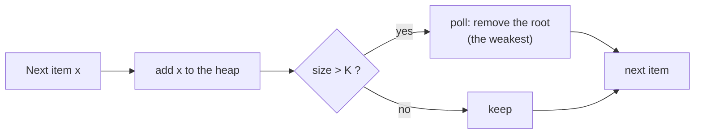

# Top K Elements Pattern

> Keep only the best `K` items in a heap of size `K`. Never sort everything.

#### 1. What Is It?

The **Top K pattern** finds the `K` largest, smallest, most frequent or closest items. Instead of sorting all `n` items, you keep a **heap of size `K`**. Every new item either enters the heap and pushes out the worst candidate, or is ignored.

**Signals:** "K largest", "K smallest", "K most frequent", "K closest", "top K", "K best".

**The size-K rule**

| You want | Use | The root is |
|---|---|---|
| `K` **largest** | **min**-heap, size `K` | the weakest of the best `K` |
| `K` **smallest** | **max**-heap, size `K` | the weakest of the best `K` |

The root is always the **weakest candidate**, the one you will evict first.

#### 2. How It Works



```text
K largest of [4, 1, 7, 3, 8, 5], K = 3      (min-heap of size 3)
add 4 → [4]
add 1 → [1, 4]
add 7 → [1, 4, 7]
add 3 → [1, 3, 4, 7] → size 4 > 3 → remove 1 → [3, 4, 7]
add 8 → [3, 4, 7, 8] → remove 3 → [4, 7, 8]
add 5 → [4, 5, 7, 8] → remove 4 → [5, 7, 8]
answer: 5, 7, 8        the root (5) is also the 3rd largest
```

**Shortcut:** if the new item is not better than the root, skip it. For a min-heap of the K largest: `if (heap.size < k) add else if (x > heap.peek()) { poll(); add(x) }`.

**Frequency or closeness:** first compute a score (count, distance), then run the same pattern on the score.

**Other ways to solve it**

| Method | Time | When |
|---|---|---|
| Sort all | `O(n log n)` | simplest, fine for small `n` |
| **Heap of size K** | `O(n log K)` | streams, `K` much smaller than `n` |
| Quickselect | `O(n)` average | a single answer (Kth element) |
| Bucket sort | `O(n)` | frequencies (counts are at most `n`) |

#### 3. Brute Force vs Optimized

| | Brute force | Heap |
|---|---|---|
| Time | `O(n log n)` | `O(n log K)` |
| Space | `O(n)` (sorted copy) | `O(K)` |
| Works on a stream | no (needs all data) | yes |

```kotlin
fun topKLargestSort(nums: IntArray, k: Int): List<Int> =
    nums.sortedDescending().take(k)
```

#### 4. Kotlin Code

```kotlin
import java.util.PriorityQueue

// K largest values, returned from largest to smallest
fun topKLargest(nums: IntArray, k: Int): List<Int> {
    val heap = PriorityQueue<Int>()                      // min-heap of size k
    for (x in nums) {
        if (heap.size < k) heap.add(x)
        else if (x > heap.peek()) { heap.poll(); heap.add(x) }
    }
    return heap.sortedDescending()
}

// K smallest values, returned from smallest to largest
fun topKSmallest(nums: IntArray, k: Int): List<Int> {
    val heap = PriorityQueue<Int>(compareByDescending<Int> { it })   // max-heap of size k
    for (x in nums) {
        if (heap.size < k) heap.add(x)
        else if (x < heap.peek()) { heap.poll(); heap.add(x) }
    }
    return heap.sorted()
}

// K largest by a score: keep (score, item) pairs
fun topKByLength(words: List<String>, k: Int): List<String> {
    val heap = PriorityQueue<String>(compareBy<String> { it.length })    // shortest on top
    for (w in words) {
        heap.add(w)
        if (heap.size > k) heap.poll()
    }
    return heap.sortedByDescending { it.length }
}
```

Checks: `topKLargest(intArrayOf(4, 1, 7, 3, 8, 5), 3)` → `[8, 7, 5]`. `topKSmallest(intArrayOf(4, 1, 7, 3, 8, 5), 3)` → `[1, 3, 4]`. `topKLargest(intArrayOf(5), 3)` → `[5]` (fewer than `K` items: return what exists). `topKLargest(intArrayOf(), 2)` → `[]`. `topKLargestSort(...)` → `[8, 7, 5]`. `topKByLength(listOf("a", "abcd", "abc", "ab"), 2)` → `["abcd", "abc"]`.

#### 5. Complexity

| | Time | Space |
|---|---|---|
| Heap of size `K` | `O(n log K)` | `O(K)` |
| Sort | `O(n log n)` | `O(n)` |
| Quickselect | `O(n)` average, `O(n²)` worst | `O(1)` |

#### 6. Common Mistakes

1. **The wrong heap type** (max-heap for the K largest).
2. **Letting the heap grow to `n`.** Cap it at `K`.
3. **Returning the heap's iteration order.** It is not sorted. Sort the result if order matters.
4. **K larger than `n`.** Return everything, do not crash.
5. **Ties:** decide what to do with equal values or equal counts.
6. **Forgetting `K == 0`.** The heap should stay empty.

#### 7. Say This in the Interview

1. "Sorting is `O(n log n)`. A min-heap of size `K` keeps the `K` largest in `O(n log K)` and `O(K)` space, and it works on a stream."
2. "The root is the weakest of my current top K, so it's the first to be replaced."
3. "If I only need the Kth element and have all the data, quickselect gives `O(n)` average."

#### 8. Quick Check

1. For the 2 smallest values, which heap and what size?
2. Where is the Kth largest value in a min-heap of size `K`?
3. Time to find the top `K` of `n` items with a heap?

<details>
<summary>Answers</summary>

1. A max-heap of size 2.
2. At the root (`peek()`).
3. `O(n log K)`.

</details>

#### 9. Related LeetCode Questions

| # | Question | Idea |
|---|---|---|
| 703 | [Kth Largest Element in a Stream](https://leetcode.com/problems/kth-largest-element-in-a-stream/) (Easy) | min-heap of size K |
| 1046 | [Last Stone Weight](https://leetcode.com/problems/last-stone-weight/) (Easy) | max-heap |
| 215 | [Kth Largest Element in an Array](https://leetcode.com/problems/kth-largest-element-in-an-array/) (Medium) | heap or quickselect |
| 347 | [Top K Frequent Elements](https://leetcode.com/problems/top-k-frequent-elements/) (Medium) | counts + heap |
| 973 | [K Closest Points to Origin](https://leetcode.com/problems/k-closest-points-to-origin/) (Medium) | distance + max-heap |
| 658 | [Find K Closest Elements](https://leetcode.com/problems/find-k-closest-elements/) (Medium) | distance + tie rule |
