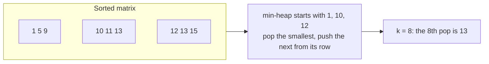

# Kth Largest / Kth Smallest Element

> The most asked heap question. There are three standard answers: sort, a heap of size K, and quickselect. Know all three and when to use each.

#### 1. What Is It?

Find the **Kth largest** (or Kth smallest) element of an array, a stream, or a sorted matrix. The Kth largest is the element at position `K` if you sort in descending order. Duplicates count separately: in `[3, 3, 5]`, the 2nd largest is `3`.

**Signals:** "kth largest", "kth smallest", "kth in a stream", "kth in a sorted matrix".

#### 2. How It Works

**Method 1: heap of size `K`.** Keep a min-heap of the `K` largest values. The **root** is the Kth largest.

```text
nums = [3, 2, 1, 5, 6, 4], K = 2       (min-heap of size 2)
add 3 → [3]       add 2 → [2, 3]       add 1 → size 3, remove 1 → [2, 3]
add 5 → remove 2 → [3, 5]              add 6 → remove 3 → [5, 6]
add 4 → remove 4 → [5, 6]              root = 5 = 2nd largest
```

**Method 2: quickselect.** Partition like quicksort (pivot, smaller left, bigger right). Only continue in the half that contains the target index. Average `O(n)`, worst `O(n²)`.

**Method 3: sort.** `O(n log n)`. Simple, and often enough.

**A stream.** Keep the same min-heap of size `K` between calls. `add(x)` pushes `x`, pops if too big, and returns the root.

**A sorted matrix (each row and column sorted).** Treat each row as a sorted list (K-way merge, note 10): put the first item of each row in a min-heap. Pop `K` times; each time push the next item of that row. The `K`-th pop is the answer. Time `O(K log n)`.



#### 3. Brute Force vs Optimized

| Method | Time | Space | Use when |
|---|---|---|---|
| Sort | `O(n log n)` | `O(1)` or `O(n)` | quick answer, small input |
| Heap of size `K` | `O(n log K)` | `O(K)` | stream, or `K` small |
| Quickselect | `O(n)` average | `O(1)` | one query on a static array |

```kotlin
fun findKthLargestSort(nums: IntArray, k: Int): Int = nums.sortedDescending()[k - 1]
```

#### 4. Kotlin Code

```kotlin
import java.util.PriorityQueue

// Kth Largest Element in an Array (LeetCode 215): heap
fun findKthLargest(nums: IntArray, k: Int): Int {
    val heap = PriorityQueue<Int>()
    for (x in nums) {
        heap.add(x)
        if (heap.size > k) heap.poll()
    }
    return heap.peek()
}

// Kth Largest Element in a Stream (LeetCode 703)
class KthLargest(private val k: Int, nums: IntArray) {
    private val heap = PriorityQueue<Int>()
    init { for (x in nums) add(x) }

    fun add(value: Int): Int {
        heap.add(value)
        if (heap.size > k) heap.poll()
        return heap.peek()
    }
}

// Kth Smallest Element in a Sorted Matrix (LeetCode 378): k-way merge of the rows
fun kthSmallest(matrix: Array<IntArray>, k: Int): Int {
    val heap = PriorityQueue<IntArray>(compareBy<IntArray> { it[0] })      // [value, row, col]
    for (r in matrix.indices) heap.add(intArrayOf(matrix[r][0], r, 0))
    var result = 0
    repeat(k) {
        val (value, r, c) = heap.poll()
        result = value
        if (c + 1 < matrix[r].size) heap.add(intArrayOf(matrix[r][c + 1], r, c + 1))
    }
    return result
}

// Quickselect (average O(n)): Kth largest
fun quickSelectKthLargest(nums: IntArray, k: Int): Int {
    val target = nums.size - k                              // index in ascending order
    var lo = 0
    var hi = nums.size - 1
    while (lo <= hi) {
        val pivot = nums[hi]
        var store = lo
        for (i in lo until hi) {
            if (nums[i] < pivot) { val t = nums[i]; nums[i] = nums[store]; nums[store] = t; store++ }
        }
        val t = nums[store]; nums[store] = nums[hi]; nums[hi] = t   // pivot to its final place
        when {
            store == target -> return nums[store]
            store < target -> lo = store + 1
            else -> hi = store - 1
        }
    }
    return -1
}
```

Checks: `findKthLargest(intArrayOf(3, 2, 1, 5, 6, 4), 2)` → `5`. `findKthLargest(intArrayOf(3, 2, 3, 1, 2, 4, 5, 5, 6), 4)` → `4`. `findKthLargestSort(intArrayOf(3, 2, 1, 5, 6, 4), 2)` → `5`. `quickSelectKthLargest(intArrayOf(3, 2, 1, 5, 6, 4), 2)` → `5`. `KthLargest(3, intArrayOf(4, 5, 8, 2))`: `add(3)` → `4`, `add(5)` → `5`, `add(10)` → `5`, `add(9)` → `8`, `add(4)` → `8`. `kthSmallest(arrayOf(intArrayOf(1, 5, 9), intArrayOf(10, 11, 13), intArrayOf(12, 13, 15)), 8)` → `13`.

#### 5. Complexity

| | Time | Space |
|---|---|---|
| Heap, array | `O(n log K)` | `O(K)` |
| Stream `add` | `O(log K)` | `O(K)` |
| Sorted matrix | `O(K log n)` for `n` rows | `O(n)` |
| Quickselect | `O(n)` avg, `O(n²)` worst | `O(1)` |
| Sort | `O(n log n)` | `O(1)` to `O(n)` |

#### 6. Common Mistakes

1. **Using a max-heap with all `n` items** (`O(n log n)`) when a size-`K` min-heap works.
2. **Off-by-one in the index** for sort or quickselect: Kth largest is index `n − K` ascending, `K − 1` descending.
3. **Removing duplicates** before sorting. "Kth largest" counts duplicates.
4. **Stream:** forgetting that the first calls may have fewer than `K` items.
5. **Quickselect without randomising** the pivot (worst case on sorted input).
6. **Matrix:** pushing the whole matrix instead of the first column, and missing the `O(K log n)` idea.

#### 7. Say This in the Interview

1. "The simplest is sorting, `O(n log n)`. I can do better with a min-heap of size `K`: the root is the Kth largest. That's `O(n log K)` and also works for a stream."
2. "Quickselect gets `O(n)` on average but modifies the array and has an `O(n²)` worst case unless I randomise the pivot."
3. "For a sorted matrix I treat each row as a sorted list and merge them with a heap, stopping at the Kth pop."

#### 8. Quick Check

1. What is the 2nd largest of `[5, 5, 4]`?
2. In which heap, and where, is the Kth largest?
3. What does `KthLargest(1, [])` return for `add(7)`, then `add(3)`?

<details>
<summary>Answers</summary>

1. `5` (duplicates count).
2. A min-heap of size `K`, at the root.
3. `7`, then `7`.

</details>

#### 9. Related LeetCode Questions

| # | Question | Idea |
|---|---|---|
| 703 | [Kth Largest Element in a Stream](https://leetcode.com/problems/kth-largest-element-in-a-stream/) (Easy) | heap of size K |
| 215 | [Kth Largest Element in an Array](https://leetcode.com/problems/kth-largest-element-in-an-array/) (Medium) | heap or quickselect |
| 378 | [Kth Smallest Element in a Sorted Matrix](https://leetcode.com/problems/kth-smallest-element-in-a-sorted-matrix/) (Medium) | k-way merge |
| 373 | [Find K Pairs with Smallest Sums](https://leetcode.com/problems/find-k-pairs-with-smallest-sums/) (Medium) | heap of pairs |
| 719 | [Find K-th Smallest Pair Distance](https://leetcode.com/problems/find-k-th-smallest-pair-distance/) (Hard) | binary search + counting |
| 230 | [Kth Smallest Element in a BST](https://leetcode.com/problems/kth-smallest-element-in-a-bst/) (Medium) | inorder |
