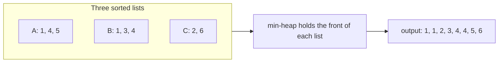

# K-Way Merge Pattern

> Merge `K` sorted lists into one sorted list. A min-heap holds **one item from each list**, so the smallest is always on top.

#### 1. What Is It?

You have `K` **sorted** lists (or arrays, or streams). You want the smallest item overall, then the next one, and so on. Looking at the front of all `K` lists each time would cost `O(K)` per item. A **min-heap of the `K` current front items** gives the smallest in `O(log K)`.

**Signals:** "merge K sorted", "K sorted lists / arrays / streams", "smallest range covering K lists", "Kth smallest in a sorted matrix", "K pairs with smallest sums".

#### 2. How It Works



**Steps**

1. Put the **first item of each list** in a min-heap. Store `(value, list index, position in that list)`.
2. Pop the smallest. Add its value to the output.
3. If that list has a next item, push it.
4. Repeat until the heap is empty.

```text
lists: A = [1,4,5]   B = [1,3,4]   C = [2,6]
heap = {(1,A,0), (1,B,0), (2,C,0)}
pop (1,A) → out [1]          push (4,A)      heap {1B, 2C, 4A}
pop (1,B) → out [1,1]        push (3,B)      heap {2C, 3B, 4A}
pop (2,C) → out [1,1,2]      push (6,C)      heap {3B, 4A, 6C}
pop (3,B) → out [1,1,2,3]    push (4,B)      heap {4A, 4B, 6C}
pop (4,A) → push (5,A) ...   out [1,1,2,3,4]
... final: [1, 1, 2, 3, 4, 4, 5, 6]
```

The heap never has more than `K` items.

**Other ways**

| Way | Time | Note |
|---|---|---|
| Put everything in one array and sort | `O(N log N)` | ignores that lists are sorted |
| Merge two lists at a time, left to right | `O(N · K)` | the early lists are copied again and again |
| **Heap of size `K`** | **`O(N log K)`** | the standard answer |
| Divide and conquer (merge pairs) | `O(N log K)` | no heap, same speed (note 11) |

`N` is the total number of items.

#### 3. Brute Force vs Optimized

| Approach | Time | Space |
|---|---|---|
| Concatenate and sort | `O(N log N)` | `O(N)` |
| Merge lists one after another | `O(N · K)` | `O(N)` |
| Min-heap of size `K` | `O(N log K)` | `O(K)` extra |

```kotlin
// Brute force: concatenate and sort
fun mergeSortedBrute(lists: List<IntArray>): IntArray =
    lists.flatMap { it.toList() }.sorted().toIntArray()
```

#### 4. Kotlin Code

```kotlin
import java.util.PriorityQueue

// Merge K sorted arrays with a heap of [value, list index, position]
fun mergeKSortedArrays(lists: List<IntArray>): IntArray {
    val heap = PriorityQueue<IntArray>(compareBy<IntArray> { it[0] })
    for ((i, list) in lists.withIndex()) {
        if (list.isNotEmpty()) heap.add(intArrayOf(list[0], i, 0))
    }
    val result = ArrayList<Int>()
    while (heap.isNotEmpty()) {
        val (value, listIndex, pos) = heap.poll()
        result.add(value)
        if (pos + 1 < lists[listIndex].size) {
            heap.add(intArrayOf(lists[listIndex][pos + 1], listIndex, pos + 1))
        }
    }
    return result.toIntArray()
}
```

Checks: `mergeKSortedArrays(listOf(intArrayOf(1, 4, 5), intArrayOf(1, 3, 4), intArrayOf(2, 6)))` → `[1, 1, 2, 3, 4, 4, 5, 6]`. `mergeKSortedArrays(listOf())` → `[]`. `mergeKSortedArrays(listOf(intArrayOf(), intArrayOf(7)))` → `[7]`. `mergeSortedBrute(...)` gives the same answer as the heap version.

#### 5. Complexity

| | Time | Space |
|---|---|---|
| Heap merge | `O(N log K)` | `O(K)` heap + `O(N)` output |
| Concatenate + sort | `O(N log N)` | `O(N)` |
| Pairwise one by one | `O(N · K)` | `O(N)` |

#### 6. Common Mistakes

1. **Pushing all items** into the heap (it becomes `O(N log N)`). Only the front of each list belongs there.
2. **Losing track of which list** the popped item came from. Store the list index and position.
3. **Not handling empty lists** at the start.
4. **Comparing the wrong field** in the comparator (compare the value, `it[0]`).
5. **Merging lists one by one** and getting `O(N · K)`.
6. **Forgetting to push the next item** after a pop.

#### 7. Say This in the Interview

1. "I keep a min-heap with one element from each list, so the smallest of all fronts is on top. Each pop outputs the next item, and I push that list's next item."
2. "The heap has at most `K` items, so each step costs `O(log K)`, and the total is `O(N log K)`."
3. "That's better than concatenating and sorting, `O(N log N)`, because it uses the fact that the lists are already sorted."

#### 8. Quick Check

1. How many items are in the heap at the start?
2. What is the time for `K = 1000` lists with `N = 1,000,000` items in total?
3. What do you store with each heap item?

<details>
<summary>Answers</summary>

1. At most `K` (one per non-empty list).
2. About `N log K ≈ 1,000,000 × 10`.
3. The value, which list it came from, and its position in that list.

</details>

#### 9. Related LeetCode Questions

| # | Question | Idea |
|---|---|---|
| 88 | [Merge Sorted Array](https://leetcode.com/problems/merge-sorted-array/) (Easy) | two lists, from the end |
| 23 | [Merge k Sorted Lists](https://leetcode.com/problems/merge-k-sorted-lists/) (Hard) | heap of heads (note 11) |
| 378 | [Kth Smallest Element in a Sorted Matrix](https://leetcode.com/problems/kth-smallest-element-in-a-sorted-matrix/) (Medium) | rows as lists |
| 373 | [Find K Pairs with Smallest Sums](https://leetcode.com/problems/find-k-pairs-with-smallest-sums/) (Medium) | note 11 |
| 632 | [Smallest Range Covering Elements from K Lists](https://leetcode.com/problems/smallest-range-covering-elements-from-k-lists/) (Hard) | note 21 |
| 264 | [Ugly Number II](https://leetcode.com/problems/ugly-number-ii/) (Medium) | merge three multiples |
