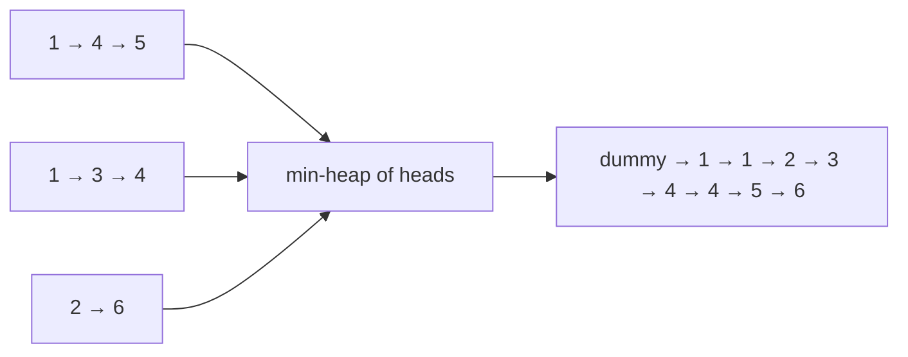

# Merge K Sorted Lists / Arrays

> The two classic K-way merge problems: merge `K` **linked lists**, and find the `K` smallest **pairs** from two sorted arrays.

#### 1. What Is It?

| Question | Input | Method |
|---|---|---|
| **Merge k Sorted Lists** (23) | `K` sorted linked lists | min-heap of the `K` current heads, or divide and conquer |
| **Find K Pairs with Smallest Sums** (373) | two sorted arrays | min-heap of pairs `(i, j)`, grow neighbours as you pop |

Both use the idea from note 10. This note focuses on the code for linked lists and for pairs.

#### 2. How It Works

**Merge k Sorted Lists (heap).** Put every non-empty head node in a min-heap ordered by `val`. Pop the smallest node, attach it to the result, push that node's `next`.



**Merge k Sorted Lists (divide and conquer).** Merge the lists in pairs, then merge the results in pairs, and so on, like merge sort. There are `log K` rounds, each touching all `N` nodes: `O(N log K)`, and **`O(1)` extra space** if you merge in place. (`merge two lists` is the dummy-node merge from the LinkedList folder.)

**K Pairs with Smallest Sums.** `nums1` and `nums2` are sorted. The smallest pair is `(0, 0)`. If `(i, j)` is the smallest, the next candidates are `(i, j + 1)` and `(i + 1, j)`. To avoid duplicates, start with `(i, 0)` for the first `K` values of `i`, and when you pop `(i, j)` push only `(i, j + 1)`.

```text
nums1 = [1, 7, 11]   nums2 = [2, 4, 6]   k = 3
heap starts with (0,0)=1+2=3, (1,0)=7+2=9, (2,0)=11+2=13
pop (0,0): pair [1,2]       push (0,1) = 1+4 = 5
pop (0,1): pair [1,4]       push (0,2) = 1+6 = 7
pop (0,2): pair [1,6]       (no more in row 0)
answer: [[1,2],[1,4],[1,6]]
```

#### 3. Brute Force vs Optimized

| Approach | Time | Space |
|---|---|---|
| Collect all node values, sort, rebuild a list | `O(N log N)` | `O(N)` |
| Merge one list into the result at a time | `O(N · K)` | `O(1)` |
| **Heap** | `O(N log K)` | `O(K)` |
| **Divide and conquer** | `O(N log K)` | `O(1)` extra (iterative merge) |
| All pairs, then sort, for K smallest sums | `O(m · n log(m · n))` | `O(m · n)` |
| Heap of pairs | `O(K log K)` | `O(K)` |

```kotlin
class ListNode(var `val`: Int) { var next: ListNode? = null }

// Brute force: collect values, sort, rebuild
fun mergeKListsBrute(lists: Array<ListNode?>): ListNode? {
    val values = mutableListOf<Int>()
    for (head in lists) {
        var cur = head
        while (cur != null) { values.add(cur.`val`); cur = cur.next }
    }
    values.sort()
    val dummy = ListNode(0)
    var tail = dummy
    for (v in values) { tail.next = ListNode(v); tail = tail.next!! }
    return dummy.next
}
```

#### 4. Kotlin Code

```kotlin
import java.util.PriorityQueue

class ListNode(var `val`: Int) { var next: ListNode? = null }

// Merge k Sorted Lists (LeetCode 23): heap
fun mergeKLists(lists: Array<ListNode?>): ListNode? {
    val heap = PriorityQueue<ListNode>(compareBy<ListNode> { it.`val` })
    for (head in lists) if (head != null) heap.add(head)
    val dummy = ListNode(0)
    var tail = dummy
    while (heap.isNotEmpty()) {
        val node = heap.poll()
        tail.next = node
        tail = node
        node.next?.let { heap.add(it) }
    }
    return dummy.next
}

// Merge k Sorted Lists: divide and conquer
fun mergeKListsDC(lists: Array<ListNode?>): ListNode? {
    if (lists.isEmpty()) return null
    var step = 1
    val work = lists.copyOf()
    while (step < work.size) {
        var i = 0
        while (i + step < work.size) {
            work[i] = mergeTwo(work[i], work[i + step])
            i += step * 2
        }
        step *= 2
    }
    return work[0]
}

fun mergeTwo(a: ListNode?, b: ListNode?): ListNode? {
    val dummy = ListNode(0)
    var tail = dummy
    var x = a
    var y = b
    while (x != null && y != null) {
        if (x.`val` <= y.`val`) { tail.next = x; x = x.next } else { tail.next = y; y = y.next }
        tail = tail.next!!
    }
    tail.next = x ?: y
    return dummy.next
}

// Find K Pairs with Smallest Sums (LeetCode 373)
fun kSmallestPairs(nums1: IntArray, nums2: IntArray, k: Int): List<List<Int>> {
    if (nums1.isEmpty() || nums2.isEmpty()) return emptyList()
    val heap = PriorityQueue<IntArray>(compareBy<IntArray> { nums1[it[0]] + nums2[it[1]] })   // [i, j]
    for (i in 0 until minOf(k, nums1.size)) heap.add(intArrayOf(i, 0))
    val result = mutableListOf<List<Int>>()
    while (heap.isNotEmpty() && result.size < k) {
        val (i, j) = heap.poll()
        result.add(listOf(nums1[i], nums2[j]))
        if (j + 1 < nums2.size) heap.add(intArrayOf(i, j + 1))
    }
    return result
}
```

Helper for the checks: `fun build(vararg v: Int): ListNode?` makes `v[0] → v[1] → ...`, and `fun toList(h: ListNode?): List<Int>` reads a list back.

Checks: `toList(mergeKLists(arrayOf(build(1, 4, 5), build(1, 3, 4), build(2, 6))))` → `[1, 1, 2, 3, 4, 4, 5, 6]`. `mergeKListsDC(...)` on the same input → the same list. `mergeKLists(arrayOf())` → `null`. `mergeKLists(arrayOf(null, build(7)))` → `7`. `kSmallestPairs(intArrayOf(1, 7, 11), intArrayOf(2, 4, 6), 3)` → `[[1, 2], [1, 4], [1, 6]]`. `kSmallestPairs(intArrayOf(1, 1, 2), intArrayOf(1, 2, 3), 2)` → `[[1, 1], [1, 1]]`.

#### 5. Complexity

| | Time | Space |
|---|---|---|
| `mergeKLists` (heap) | `O(N log K)` | `O(K)` |
| `mergeKListsDC` | `O(N log K)` | `O(1)` extra |
| `kSmallestPairs` | `O(K log K)` | `O(K)` |

#### 6. Common Mistakes

1. **Adding `null` heads** to the heap (crash when comparing).
2. **Not pushing `node.next`** after a pop.
3. **Creating new nodes** when you can re-link the existing ones.
4. **Merging in a loop `result = merge(result, list)`**: `O(N · K)`.
5. **Pairs:** pushing both `(i + 1, j)` and `(i, j + 1)` creates duplicates unless you track visited pairs.
6. **Pairs:** starting the heap with every `i` instead of `min(k, size)`.
7. **Overflow:** `nums1[i] + nums2[j]` can overflow `Int` for large values. Use `Long` if limits are big.

#### 7. Say This in the Interview

1. "I put the head of every list in a min-heap. I pop the smallest, link it, and push its next node. That's `O(N log K)` time with `O(K)` space."
2. "Or I can merge lists in pairs, like merge sort: also `O(N log K)`, with `O(1)` extra space."
3. "For K smallest pairs I start from `(i, 0)` and only advance `j`, so each pair is generated once."

#### 8. Quick Check

1. How many nodes are in the heap at any time?
2. Why is merging lists one by one slower?
3. What is the first pair in `kSmallestPairs` for two sorted arrays?

<details>
<summary>Answers</summary>

1. At most `K`.
2. Early nodes are touched in every later merge, giving `O(N · K)`.
3. `(nums1[0], nums2[0])`, which has the smallest sum.

</details>

#### 9. Related LeetCode Questions

| # | Question | Idea |
|---|---|---|
| 21 | [Merge Two Sorted Lists](https://leetcode.com/problems/merge-two-sorted-lists/) (Easy) | the building block |
| 23 | [Merge k Sorted Lists](https://leetcode.com/problems/merge-k-sorted-lists/) (Hard) | heap or divide and conquer |
| 373 | [Find K Pairs with Smallest Sums](https://leetcode.com/problems/find-k-pairs-with-smallest-sums/) (Medium) | grow along `j` |
| 378 | [Kth Smallest Element in a Sorted Matrix](https://leetcode.com/problems/kth-smallest-element-in-a-sorted-matrix/) (Medium) | rows as lists |
| 264 | [Ugly Number II](https://leetcode.com/problems/ugly-number-ii/) (Medium) | three pointers or heap |
| 786 | [K-th Smallest Prime Fraction](https://leetcode.com/problems/k-th-smallest-prime-fraction/) (Medium) | heap of fractions |
