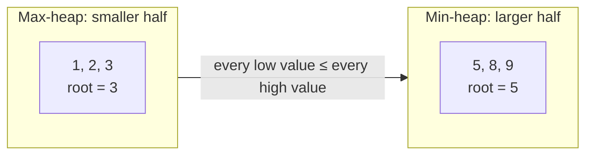

# Two Heaps Pattern

> Use **two heaps** when you need the **middle** of a changing collection, or when one condition **unlocks** items for another choice.

#### 1. What Is It?

The **two heaps pattern** splits the data in two halves, each held in a heap, so that the **boundary** between the halves is available in `O(1)`.

| Heap | Holds | Type | Root is |
|---|---|---|---|
| **low** | the **smaller** half | **max**-heap | the largest of the smaller half |
| **high** | the **larger** half | **min**-heap | the smallest of the larger half |

The two roots are the two numbers **in the middle**. Typical uses:

- **running median** (note 13)
- sliding window median
- **"unlock then pick best"** problems such as IPO (below)

**Signals:** "median", "middle element", "balance two halves", "among the items I can afford, pick the best".

#### 2. How It Works



**Rules for the halves**

1. Every number in `low` is `≤` every number in `high`.
2. The sizes differ by at most 1 (`low` may have one extra).
3. Median: if `low` is bigger, it is `low.peek()`. If equal, it is the average of both roots.

**A second use: IPO (LeetCode 502).** You have `k` projects to pick, starting capital `w`. Each project has a `capital` needed and a `profit`. After each project your capital grows by its profit. Pick the best order to **maximize the final capital**.

- Heap 1 (**min**-heap by capital): projects you **cannot afford yet**.
- Heap 2 (**max**-heap by profit): projects you **can afford now**.

Each round: move every project with `capital <= w` from heap 1 to heap 2, then take the most profitable one from heap 2.

```text
k = 2, w = 0, profits = [1, 2, 3], capital = [0, 1, 1]
round 1: afford capital 0 → project (profit 1).  best = 1.  w = 1
round 2: now afford capital 1 → profits 2 and 3.  best = 3.  w = 4
answer 4
```

#### 3. Brute Force vs Optimized

| Problem | Brute force | Two heaps |
|---|---|---|
| Median of a stream | insert into a sorted list: `O(n)` per number | `O(log n)` per number |
| IPO | each round scan all projects: `O(k · n)` | sort/heap by capital + max-heap by profit: `O((n + k) log n)` |

```kotlin
// Brute force IPO: each round, scan all projects for the best affordable one
fun findMaximizedCapitalBrute(k: Int, w: Int, profits: IntArray, capital: IntArray): Int {
    var money = w
    val used = BooleanArray(profits.size)
    repeat(k) {
        var best = -1
        for (i in profits.indices) {
            if (!used[i] && capital[i] <= money && (best == -1 || profits[i] > profits[best])) best = i
        }
        if (best == -1) return money
        used[best] = true
        money += profits[best]
    }
    return money
}
```

#### 4. Kotlin Code

```kotlin
import java.util.PriorityQueue

// IPO (LeetCode 502)
fun findMaximizedCapital(k: Int, w: Int, profits: IntArray, capital: IntArray): Int {
    val locked = PriorityQueue<IntArray>(compareBy<IntArray> { it[0] })               // [capital, profit], min capital first
    for (i in profits.indices) locked.add(intArrayOf(capital[i], profits[i]))
    val available = PriorityQueue<Int>(compareByDescending<Int> { it })              // profits, max first
    var money = w
    repeat(k) {
        while (locked.isNotEmpty() && locked.peek()[0] <= money) {
            available.add(locked.poll()[1])                                          // now affordable
        }
        if (available.isEmpty()) return money
        money += available.poll()                                                    // take the most profitable
    }
    return money
}
```

Checks: `findMaximizedCapital(2, 0, intArrayOf(1, 2, 3), intArrayOf(0, 1, 1))` → `4`. `findMaximizedCapital(3, 0, intArrayOf(1, 2, 3), intArrayOf(0, 1, 2))` → `6`. `findMaximizedCapital(1, 0, intArrayOf(5), intArrayOf(1))` → `0` (cannot afford anything). `findMaximizedCapitalBrute(2, 0, intArrayOf(1, 2, 3), intArrayOf(0, 1, 1))` → `4`.

The running-median version (`MedianFinder`) is in note 13.

#### 5. Complexity

| | Time | Space |
|---|---|---|
| IPO | `O((n + k) log n)` | `O(n)` |
| Median stream, `add` | `O(log n)` | `O(n)` |
| Median stream, `findMedian` | `O(1)` | |

#### 6. Common Mistakes

1. **Putting numbers into the wrong heap.** The max-heap must hold the smaller half.
2. **Not rebalancing** after each insert (sizes drift apart by more than 1).
3. **IPO:** moving projects only once instead of **every round** (capital grows).
4. **IPO:** forgetting the early return when no project is affordable.
5. **Comparing sizes with `>` and getting an off-by-one** in the median for odd counts. Pick one rule (`low` may be larger) and keep it.
6. **Using `a - b`** in a comparator.

#### 7. Say This in the Interview

1. "I'll keep the smaller half in a max-heap and the larger half in a min-heap. The two roots give me the middle in `O(1)`."
2. "Each insert goes to one heap and I rebalance so their sizes differ by at most one: `O(log n)`."
3. "For IPO, one heap holds projects I can't afford yet (by capital), and another holds affordable ones (by profit). I always take the most profitable affordable one."

#### 8. Quick Check

1. Which heap holds the smaller half of a stream?
2. For the numbers `1, 2, 3, 4`, what are the two roots?
3. In IPO, what unlocks a project?

<details>
<summary>Answers</summary>

1. The **max**-heap (its root is the largest of the smaller half).
2. `2` (max-heap root) and `3` (min-heap root). The median is `2.5`.
3. Having enough capital (`capital <= w`).

</details>

#### 9. Related LeetCode Questions

| # | Question | Idea |
|---|---|---|
| 295 | [Find Median from Data Stream](https://leetcode.com/problems/find-median-from-data-stream/) (Hard) | two heaps (note 13) |
| 502 | [IPO](https://leetcode.com/problems/ipo/) (Hard) | locked heap + available heap |
| 480 | [Sliding Window Median](https://leetcode.com/problems/sliding-window-median/) (Hard) | two heaps + lazy deletion |
| 1642 | [Furthest Building You Can Reach](https://leetcode.com/problems/furthest-building-you-can-reach/) (Medium) | heap of climbs (note 14) |
| 2542 | [Maximum Subsequence Score](https://leetcode.com/problems/maximum-subsequence-score/) (Medium) | sort + min-heap |
