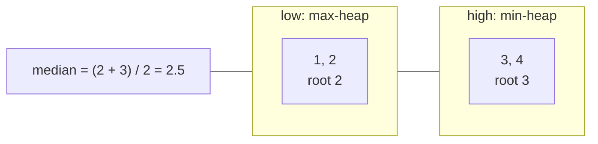

# Find Median from Data Stream

> The standard two-heaps question. Numbers arrive one at a time and you must report the median at any moment.

#### 1. What Is It?

Design a structure with two operations:

- `addNum(num)`: add a number from the stream.
- `findMedian()`: return the median of all numbers so far.

The **median** is the middle value if the count is odd, and the **average of the two middle values** if it is even.

**Signals:** "median", "running median", "stream", "middle element".

#### 2. How It Works

Keep two heaps (note 12):

- `low`: a **max**-heap with the smaller half
- `high`: a **min**-heap with the larger half
- sizes: `low.size == high.size` or `low.size == high.size + 1`

**`addNum`** (three steps keep both rules true):

1. Push the number into `low`.
2. Move `low`'s largest into `high` (this keeps "every low ≤ every high").
3. If `high` is now bigger than `low`, move `high`'s smallest back into `low`.

**`findMedian`:** if `low` is bigger, return `low.peek()`. Otherwise return `(low.peek() + high.peek()) / 2.0`.

```text
add 1: low {1}         high {}            median = 1
add 2: low {1}         high {2}           median = (1 + 2) / 2 = 1.5
add 3: low {1, 2}      high {3}           median = 2
add 4: low {1, 2}      high {3, 4}        median = (2 + 3) / 2 = 2.5
```



**Follow-ups (often asked)**

| Follow-up | Answer |
|---|---|
| All numbers are in `0..100` | keep a count array of size 101, `O(1)` insert, median by scanning 101 buckets |
| 99% of numbers are in `0..100` | counts for `0..100`, plus two counters and a small structure for the rest |
| Sliding window median | two heaps with **lazy deletion** (note 23), or a sorted structure |

#### 3. Brute Force vs Optimized

| Approach | `addNum` | `findMedian` |
|---|---|---|
| Unsorted list, sort each time | `O(1)` | `O(n log n)` |
| Insert into a sorted list | `O(n)` | `O(1)` |
| **Two heaps** | **`O(log n)`** | **`O(1)`** |

```kotlin
// Brute force: keep a sorted list and insert in place
class MedianFinderSorted {
    private val list = mutableListOf<Int>()
    fun addNum(num: Int) {
        var i = 0
        while (i < list.size && list[i] < num) i++
        list.add(i, num)                                  // O(n)
    }
    fun findMedian(): Double {
        val n = list.size
        return if (n % 2 == 1) list[n / 2].toDouble() else (list[n / 2 - 1] + list[n / 2]) / 2.0
    }
}
```

#### 4. Kotlin Code

```kotlin
import java.util.PriorityQueue

// Find Median from Data Stream (LeetCode 295)
class MedianFinder {
    private val low = PriorityQueue<Int>(compareByDescending<Int> { it })   // max-heap: smaller half
    private val high = PriorityQueue<Int>()                                 // min-heap: larger half

    fun addNum(num: Int) {
        low.add(num)
        high.add(low.poll())                                // the largest of low goes to high
        if (high.size > low.size) low.add(high.poll())      // keep low the same size or one bigger
    }

    fun findMedian(): Double =
        if (low.size > high.size) low.peek().toDouble()
        else (low.peek().toLong() + high.peek().toLong()) / 2.0
}
```

Checks: add `1`, add `2` → `findMedian()` → `1.5`. Add `3` → `2.0`. Add `4` → `2.5`. A new `MedianFinder` with only `5` → `5.0`. Negative numbers: add `-1`, add `-2` → `-1.5`. `MedianFinderSorted` gives the same answers after the same calls.

Trace of `addNum(3)` after `1, 2`: `low {1}`, `high {2}`. Push `3` into `low` → `{1, 3}`. Move its largest `3` to `high` → `low {1}`, `high {2, 3}`. `high` is bigger, so move `2` back → `low {1, 2}`, `high {3}`. Median is `low.peek() = 2`.

#### 5. Complexity

| | Time | Space |
|---|---|---|
| `addNum` | `O(log n)` | |
| `findMedian` | `O(1)` | |
| Total | | `O(n)` |

#### 6. Common Mistakes

1. **Using one sorted list** (`O(n)` inserts).
2. **Not rebalancing** the sizes.
3. **Wrong halves:** `low` must be the max-heap.
4. **Integer division** in the average: `(a + b) / 2` loses `.5`. Divide by `2.0`.
5. **Overflow:** `a + b` can exceed `Int`. Add as `Long`.
6. **Calling `findMedian()` on an empty stream** (undefined; usually not tested).

#### 7. Say This in the Interview

1. "I split the numbers into a lower half in a max-heap and an upper half in a min-heap, with sizes within one of each other."
2. "The median is the top of the bigger heap, or the average of both tops. `addNum` is `O(log n)` and `findMedian` is `O(1)`."
3. "If all values are small integers, I can use a count array instead."

#### 8. Quick Check

1. After adding `5, 15, 1, 3`, what is the median?
2. Why push to `low` first and then move to `high`?
3. What does `findMedian()` return when both heaps have size 2 with tops 2 and 3?

<details>
<summary>Answers</summary>

1. Sorted: `1, 3, 5, 15`, so `(3 + 5) / 2 = 4.0`.
2. It guarantees every number in `low` is `≤` every number in `high`, whichever side the new number belongs to.
3. `2.5`.

</details>

#### 9. Related LeetCode Questions

| # | Question | Idea |
|---|---|---|
| 295 | [Find Median from Data Stream](https://leetcode.com/problems/find-median-from-data-stream/) (Hard) | two heaps |
| 480 | [Sliding Window Median](https://leetcode.com/problems/sliding-window-median/) (Hard) | two heaps + lazy deletion |
| 703 | [Kth Largest Element in a Stream](https://leetcode.com/problems/kth-largest-element-in-a-stream/) (Easy) | one heap |
| 502 | [IPO](https://leetcode.com/problems/ipo/) (Hard) | two heaps, another use |
| 1825 | [Finding MK Average](https://leetcode.com/problems/finding-mk-average/) (Hard) | structures for a middle band |
