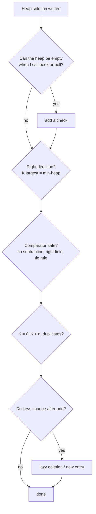

# Common Heap Edge Cases

> Read this before a heap interview and run through it at the end of every solution. Most heap bugs are on this list.

#### 1. What Is It?

These are the situations where heap solutions crash, loop forever, or return a wrong answer. Interviewers watch whether you check them yourself. They fall into five groups:

1. **empty heap** (`peek`, `poll`),
2. **wrong heap direction** (min vs max, `K` largest vs smallest),
3. **comparator bugs** (overflow, ties, wrong field),
4. **size problems** (`K` larger than `n`, `K = 0`, duplicates),
5. **stale or changed data** (mutating items, deleting, decrease-key).

#### 2. How It Works

**The checklist**

| # | Edge case | What goes wrong | Fix |
|---|---|---|---|
| 1 | `peek()` / `poll()` on an empty heap | returns `null` (Kotlin) and crashes later | check `isNotEmpty()` first |
| 2 | `remove()` on an empty heap | `NoSuchElementException` | use `poll()` or check |
| 3 | Min-heap used for "K largest" with a max-heap mindset | wrong or too slow | K largest → **min**-heap of size `K` |
| 4 | Heap size not capped | `O(n log n)`, more memory | `if (size > k) poll()` |
| 5 | `K > n` | `peek()` on a small heap gives a wrong "Kth" | check `n >= K`, or define the answer |
| 6 | `K == 0` or `K == 1` | empty result, or special case | handle early |
| 7 | Duplicates | counted once or twice? | read the statement; heap keeps duplicates |
| 8 | Comparator `{ a, b -> a - b }` | **overflow** for big or negative values | `compareBy`, `Integer.compare` |
| 9 | Comparing the wrong field | wrong order | check `it[0]` vs `it[1]` |
| 10 | Ties are not stable | different answers on equal keys | add a second key (index or word) |
| 11 | Printing / iterating the heap | not sorted | `poll()` repeatedly, or sort a copy |
| 12 | Changing an object's key after `add` | the heap order is now wrong | remove and add again, or push a new entry |
| 13 | `pq.remove(x)` or `pq.contains(x)` | `O(n)` | lazy deletion (note 23) |
| 14 | Decrease-key (Dijkstra) | no such method | push the new entry, skip stale ones on `poll` |
| 15 | Stale entries after update | processing an old, outdated item | compare with the current best before using it |
| 16 | Integer sums overflow (`a + b`) | wrong median or total | `Long` |
| 17 | Storing `IntArray` / `Pair` without a comparator | `ClassCastException` | always pass a comparator for non-`Comparable` items |
| 18 | Max-heap with `Int.MIN_VALUE` as a sentinel | breaks the comparison | use nullable / a flag |
| 19 | Very large `n`, boxed `Int` memory | memory pressure | `IntArray`-based custom heap, or note the cost |
| 20 | Modifying the heap while iterating it | `ConcurrentModificationException` | poll into a list, then process |
| 21 | Streaming: asked for the answer before `K` items arrived | `peek()` is `null` or wrong | state your assumption |



#### 3. Brute Force vs Optimized

| Problem | Naive | Better |
|---|---|---|
| Update a priority | `pq.remove(x)` then `pq.add(x)`: `O(n)` | add a new entry and skip the old one when it comes out: `O(log n)` |
| Safe max-heap | `{ a, b -> b - a }` | `compareByDescending { it }` |
| Check for empty | assume non-empty | `if (pq.isNotEmpty())` |

```kotlin
import java.util.PriorityQueue

// The classic overflow bug: b - a overflows for these two numbers
val risky = PriorityQueue<Int> { a, b -> b - a }
// risky.add(Int.MIN_VALUE); risky.add(1)  → the order can be wrong

// Safe
val safe = PriorityQueue<Int>(compareByDescending<Int> { it })
```

#### 4. Kotlin Code

```kotlin
import java.util.PriorityQueue

// Safe peek: returns a default when the heap is empty
fun PriorityQueue<Int>.peekOr(default: Int): Int = this.peek() ?: default

// K-th largest with all the edge cases handled
fun kthLargestSafe(nums: IntArray, k: Int): Int? {
    if (k <= 0 || k > nums.size) return null                 // K = 0 or K > n
    val heap = PriorityQueue<Int>()
    for (x in nums) {
        heap.add(x)
        if (heap.size > k) heap.poll()
    }
    return heap.peek()
}

// Stable tie-breaking: equal priorities come out in insertion order
data class Item(val priority: Int, val order: Int, val name: String)

fun stableOrder(items: List<Pair<Int, String>>): List<String> {
    val pq = PriorityQueue<Item>(compareBy<Item>({ it.priority }, { it.order }))
    items.forEachIndexed { i, (p, n) -> pq.add(Item(p, i, n)) }
    val out = mutableListOf<String>()
    while (pq.isNotEmpty()) out.add(pq.poll().name)
    return out
}
```

Checks: `PriorityQueue<Int>().peekOr(-1)` → `-1`. `kthLargestSafe(intArrayOf(3, 2, 1), 5)` → `null`. `kthLargestSafe(intArrayOf(3, 2, 1), 0)` → `null`. `kthLargestSafe(intArrayOf(3, 3, 5), 2)` → `3` (duplicates count). `kthLargestSafe(intArrayOf(Int.MIN_VALUE, 1), 1)` → `1`. `stableOrder(listOf(1 to "a", 1 to "b", 0 to "c"))` → `["c", "a", "b"]`.

#### 5. Complexity

| Fix | Cost |
|---|---|
| `isNotEmpty()` / null checks | `O(1)` |
| Lazy deletion instead of `remove(x)` | `O(log n)` instead of `O(n)` |
| Tie-break key | no extra cost |

#### 6. Common Mistakes

1. **Never testing the empty and `K > n` cases.**
2. **Writing the comparator as a subtraction.**
3. **Assuming the iteration order of a `PriorityQueue`.**
4. **Trying to update an item in place.**
5. **Forgetting that duplicates are separate entries.**
6. **Leaving stale entries unchecked** (Dijkstra, scheduling).

#### 7. Say This in the Interview

1. "Before I finish, I'll check: empty heap, `K` larger than `n`, duplicates, and ties."
2. "I use `compareBy` so the comparator can't overflow."
3. "A heap has no decrease-key. I add a new entry, and when I pop an old one I skip it if it is out of date."

#### 8. Quick Check

1. What does `PriorityQueue<Int>().poll()` return?
2. Name two ways a heap comparator can be wrong.
3. How do you "update" a priority in a `PriorityQueue`?

<details>
<summary>Answers</summary>

1. `null`.
2. Overflow from subtraction, comparing the wrong field, or no tie-break for equal keys.
3. Add a new entry with the new priority, and ignore the stale one when it is polled.

</details>

#### 9. Related LeetCode Questions

| # | Question | Idea |
|---|---|---|
| 703 | [Kth Largest Element in a Stream](https://leetcode.com/problems/kth-largest-element-in-a-stream/) (Easy) | fewer than `K` items at first |
| 1046 | [Last Stone Weight](https://leetcode.com/problems/last-stone-weight/) (Easy) | empty heap at the end |
| 692 | [Top K Frequent Words](https://leetcode.com/problems/top-k-frequent-words/) (Medium) | ties |
| 743 | [Network Delay Time](https://leetcode.com/problems/network-delay-time/) (Medium) | stale entries |
| 973 | [K Closest Points to Origin](https://leetcode.com/problems/k-closest-points-to-origin/) (Medium) | comparator on squared distance |
