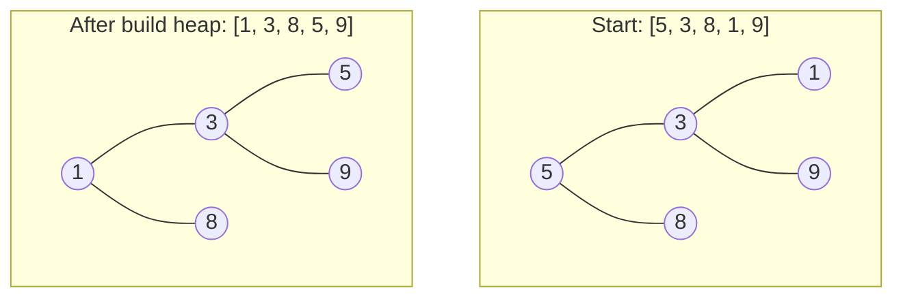

# Build Heap

> Turning an unordered array into a heap in **`O(n)`**, faster than adding items one by one (`O(n log n)`). A common "why is this O(n)?" follow-up.

#### 1. What Is It?

**Build heap** (also *heapify the array*) converts any array into a valid heap **in place**.

Two ways:

| Way | Idea | Time |
|---|---|---|
| **Insert one by one** | `add` each item (sift up) | `O(n log n)` |
| **Bottom-up heapify** | start from the **last parent** and sift down each node, going back to the root | **`O(n)`** |

**Signals:** "build a heap from an array", "heap sort", "is it `O(n)` or `O(n log n)`?", "initialise a priority queue with all items".

#### 2. How It Works

Leaves are already valid heaps of size 1, so skip them. The **last parent** is at index `n / 2 − 1`. Sift down every parent from there to index 0.



```text
array [5, 3, 8, 1, 9], n = 5, last parent index = 5/2 - 1 = 1
sift down index 1 (3): children 1 and 9 → smallest 1 → swap       [5, 1, 8, 3, 9]
sift down index 0 (5): children 1 and 8 → smallest 1 → swap       [1, 5, 8, 3, 9]
   continue at index 1 (5): children 3 and 9 → smallest 3 → swap  [1, 3, 8, 5, 9]
result: [1, 3, 8, 5, 9]  ✓ valid min-heap
```

**Why `O(n)` and not `O(n log n)`?** A sift down costs the **height of the node**, not `log n`. Most nodes are near the bottom, where the height is small:

| Level (from the bottom) | Nodes | Cost each | Total |
|---|---|---|---|
| leaves | about `n / 2` | 0 (skipped) | 0 |
| height 1 | about `n / 4` | 1 | `n / 4` |
| height 2 | about `n / 8` | 2 | `2n / 8` |
| height 3 | about `n / 16` | 3 | `3n / 16` |
| ... | | | |

The total is `n × (1/4 + 2/8 + 3/16 + ...)`, and that sum is a small constant (it converges to 1). So the whole build is `O(n)`.

Inserting one by one is `O(n log n)` because each insert may climb `log n` levels, and half of the nodes are leaves that could climb the most.

In Kotlin: `PriorityQueue<Int>(listOf(...))` or `PriorityQueue(collection)` builds the heap in `O(n)`. Calling `addAll` adds one at a time (`O(n log n)`).

#### 3. Brute Force vs Optimized

| Approach | Time | Space |
|---|---|---|
| `n` inserts (sift up) | `O(n log n)` | `O(n)` extra if copying |
| Sort the array (a sorted array is a heap) | `O(n log n)` | |
| **Bottom-up heapify** | **`O(n)`** | `O(1)` in place |

```kotlin
// Brute force: insert one by one with a heap built on a list (sift up)
fun buildByInsert(a: IntArray): IntArray {
    val heap = ArrayList<Int>()
    for (x in a) {
        heap.add(x)
        var i = heap.size - 1
        while (i > 0 && heap[(i - 1) / 2] > heap[i]) {
            val p = (i - 1) / 2
            val t = heap[p]; heap[p] = heap[i]; heap[i] = t
            i = p
        }
    }
    return heap.toIntArray()
}
```

#### 4. Kotlin Code

```kotlin
// Build a min-heap in place in O(n)
fun buildMinHeap(a: IntArray) {
    for (i in a.size / 2 - 1 downTo 0) siftDown(a, a.size, i)
}

fun siftDown(a: IntArray, size: Int, start: Int) {
    var i = start
    while (true) {
        val l = 2 * i + 1
        val r = 2 * i + 2
        var smallest = i
        if (l < size && a[l] < a[smallest]) smallest = l
        if (r < size && a[r] < a[smallest]) smallest = r
        if (smallest == i) return
        val t = a[i]; a[i] = a[smallest]; a[smallest] = t
        i = smallest
    }
}
```

Checks: `val a = intArrayOf(5, 3, 8, 1, 9); buildMinHeap(a)` → `a` is `[1, 3, 8, 5, 9]`. `buildByInsert(intArrayOf(5, 3, 8, 1, 9))` → `[1, 3, 8, 5, 9]` (the same here, but the two methods can give **different** valid heaps on other inputs). `buildMinHeap(intArrayOf())` does nothing. `buildMinHeap(intArrayOf(7))` does nothing. A reversed array `[5, 4, 3, 2, 1]` becomes `[1, 2, 3, 5, 4]`.

Trace of `[5, 4, 3, 2, 1]`: last parent index 1 (`4`): children `2` and `1` → smallest `1` (index 4) → swap → `[5, 1, 3, 2, 4]`. Index 0 (`5`): children `1`, `3` → smallest `1` → swap → `[1, 5, 3, 2, 4]`, then index 1 (`5`): children `2` (index 3) and `4` (index 4) → smallest `2` → swap → `[1, 2, 3, 5, 4]`.

#### 5. Complexity

| | Time | Space |
|---|---|---|
| Bottom-up build heap | `O(n)` | `O(1)` |
| Build by repeated insert | `O(n log n)` | |
| Then `n` polls (heap sort) | `O(n log n)` | |

#### 6. Common Mistakes

1. **Looping from `0` upward** instead of from the last parent down to `0`.
2. **Starting at `n − 1`** instead of `n / 2 − 1` (wasted work on leaves, but still correct).
3. **Saying build heap is `O(n log n)`.** It is `O(n)`.
4. **Using `addAll` on a `PriorityQueue`** and expecting `O(n)`.
5. **Comparing the final arrays of two methods** and expecting them to be equal. A heap is not unique.
6. **Forgetting the order in the loop.** Parents must be sifted down after their children are fixed.

#### 7. Say This in the Interview

1. "I start at the last parent, index `n / 2 − 1`, and sift each node down while moving back to the root."
2. "It's `O(n)`, not `O(n log n)`: a sift down costs the node's height, and most nodes are near the bottom with a tiny height."
3. "In Kotlin, `PriorityQueue(collection)` does this heapify, while adding items one by one is `O(n log n)`."

#### 8. Quick Check

1. What is the index of the last parent for `n = 8`?
2. Is build heap `O(n)` or `O(n log n)`?
3. Is the heap built from an array unique?

<details>
<summary>Answers</summary>

1. `8 / 2 − 1 = 3`.
2. `O(n)`.
3. No. Different build methods can produce different valid heaps.

</details>

#### 9. Related LeetCode Questions

| # | Question | Idea |
|---|---|---|
| 912 | [Sort an Array](https://leetcode.com/problems/sort-an-array/) (Medium) | heap sort |
| 1046 | [Last Stone Weight](https://leetcode.com/problems/last-stone-weight/) (Easy) | heap from an array |
| 215 | [Kth Largest Element in an Array](https://leetcode.com/problems/kth-largest-element-in-an-array/) (Medium) | heapify, then poll |
| 1337 | [The K Weakest Rows in a Matrix](https://leetcode.com/problems/the-k-weakest-rows-in-a-matrix/) (Easy) | heap with a key |
| 1005 | [Maximize Sum Of Array After K Negations](https://leetcode.com/problems/maximize-sum-of-array-after-k-negations/) (Easy) | repeatedly take the smallest |
